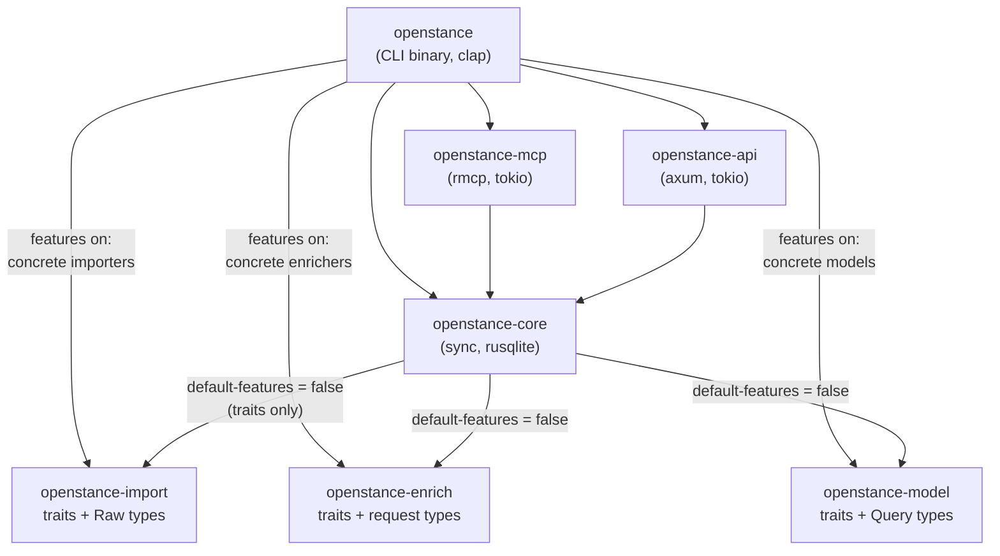
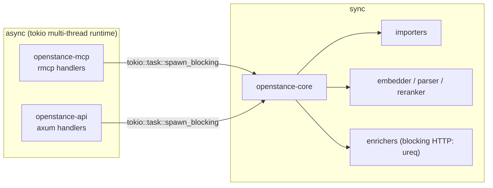

# Crates and dependencies

How the Rust workspace is split, what each crate owns, which traits form the seams, how dependencies are allowed to point, and which features turn importers, enrichers and model backends on or off.

See also: [overview.md](overview.md), [data-flow.md](data-flow.md), [conventions.md](../engineering/conventions.md), [dev-setup.md](../engineering/dev-setup.md), [ci-and-release.md](../engineering/ci-and-release.md).

---

## 1. Workspace layout

```text
openstance/
  Cargo.toml                    # [workspace], shared [workspace.dependencies], profile settings
  Cargo.lock
  rust-toolchain.toml           # pinned stable toolchain
  deny.toml                     # cargo-deny: licenses, advisories, banned crates
  dist-workspace.toml           # cargo-dist release config (Phase 4)
  crates/
    openstance-core/            # schema, migrations, resolution, scoring, search, playbooks, views
      src/
        lib.rs                  # Graph, Store, re-exports of trait-crate types
        db/                     # connection open, pragmas, sqlite-vec registration
          migrations/           # 0001_init.sql, 0002_..., applied in order
        ingest.rs               # GraphSink: implements import::Sink, writes source/interaction/identity
        resolve/                # normalization, rules, clusters, review queue
        score/                  # components R F C M B, presets, bulk detection, ties
        search/                 # RuleParser, SQL filters, FTS5, vector scan, fusion, evidence
        playbook/               # Playbook trait, path, brief, accounts, refresh, watch, reconnect, verify
        egress.rs               # EgressGate: quote, budget, no_enrich, enrich_log
        view/                   # create, export (.ost), import, search_view
        overrides.rs            # override read/write, LWW resolution, tombstones
        rebuild.rs              # replay sources + overrides
        export.rs               # csv, json, vcf, parquet
        json.rs                 # the single JSON shape (serde types) used by CLI/API/MCP
    openstance-import/          # Importer + Sink traits, Raw* types, built-in importers
      src/
        lib.rs                  # traits, RawIdentity, RawInteraction, ImportStats, detect()
        mbox.rs                 # feature "mbox"
        linkedin_csv.rs         # feature "linkedin"
        vcf.rs                  # feature "vcf"
        ics.rs                  # feature "ics"         (Phase 3)
        x_archive.rs            # feature "x-archive"   (Phase 3)
        csv_map.rs              # feature "csv"         (Phase 5, P5-IMP-08)
        imap.rs                 # feature "imap"        (Phase 5)
        whatsapp.rs ...         # Phase 5 importers
    openstance-enrich/          # Enricher trait, request/quote/result types, backends
      src/
        lib.rs                  # Enricher, EnrichRequest, Quote, EnrichResult, NullEnricher
        treg.rs                 # feature "treg"        (Phase 3)
        ownkeys/                # feature "ownkeys"     (post Phase 4, see roadmap)
        mock.rs                 # feature "mock" / cfg(test): MockEnricher for tests
    openstance-model/           # Embedder, QueryParser, Reranker traits; Query types; backends
      src/
        lib.rs                  # traits, Query, Candidate, Ranked, Null* impls
        fastembed.rs            # feature "fastembed"   (Phase 2, default)
        ollama.rs               # feature "ollama"      (Phase 4)
        openai.rs               # feature "openai"      (Phase 4)
        anthropic.rs            # feature "anthropic"   (Phase 4)
    openstance-mcp/             # rmcp server: tool schemas -> core calls
    openstance-api/             # axum HTTP API + embedded UI assets
    openstance/                 # clap CLI binary; wires concrete impls; installs `ost` alias
  ui/                           # optional TS + Vite app; `npm run build` -> ui/dist, embedded by openstance-api
  playbooks/                    # markdown skill files for agents, one per playbook (openstance's own text)
  fixtures/                     # tiny synthetic exports with known overlaps (mbox, csv, vcf, ics, x)
  evals/                        # search eval queries + expected top-5 ids
  docs/
```

---

## 2. Dependency direction

The rule from the tech spec: **binary -> servers -> core -> trait crates. Core never imports a concrete provider.**



How the rule is made mechanical:

1. **Trait crates own their shared types.** To avoid a cycle (core depends on the trait crates, so trait crates cannot depend on core), the types that appear in trait signatures live with the trait:
   - `openstance-import`: `Importer`, `Sink`, `RawIdentity`, `RawInteraction`, `ImportStats`, `SourceRef`.
   - `openstance-enrich`: `Enricher`, `EnrichRequest`, `Quote`, `EnrichResult`, `Usd` (micro-USD integer).
   - `openstance-model`: `Embedder`, `QueryParser`, `Reranker`, `Query`, `Candidate`, `Ranked`.
   Core re-exports them (`pub use openstance_model::Query;`) so downstream code imports everything from core.
2. **Core depends on trait crates with `default-features = false`.** With no features, each trait crate compiles only its traits, types and `Null` implementation. A concrete provider is physically absent from core's dependency graph.
3. **Concrete implementations are constructed in the binary** (`crates/openstance/src/wire.rs`) from config and passed into core as `Box<dyn Trait>` inside a `Providers` struct.
4. **CI enforces it** (see [ci-and-release.md](../engineering/ci-and-release.md)):
   - `cargo tree -p openstance-core -e normal` must not contain `tokio`, `axum`, `rmcp`, `reqwest`, `ureq`, `fastembed`, `ort`.
   - `cargo tree -p openstance-import --no-default-features` and the same for `-enrich` and `-model` must not contain any HTTP client.
   - `openstance-mcp` and `openstance-api` must not depend on each other.

---

## 3. Crate responsibilities and public API

### 3.1 `openstance-import`

Turns a file into a stream of raw records. Never touches `person`. Pure parsing: no database, no network (the IMAP importer in Phase 5 is the one exception and is behind its own feature).

```rust
pub trait Importer: Send + Sync {
    /// Stable kind string stored in source.kind, e.g. "linkedin_csv".
    fn kind(&self) -> &'static str;
    /// Sniff the file (name, magic bytes, header row) so `openstance import <file>` needs no flag.
    fn detect(&self, path: &Path) -> bool;
    /// Stream records into the sink. Must be streaming: never hold the whole file in memory.
    fn import(&self, path: &Path, sink: &mut dyn Sink) -> Result<ImportStats, ImportError>;
}

pub trait Sink {
    fn identity(&mut self, r: RawIdentity);       // a handle seen outside any event (vCard, CSV row)
    fn interaction(&mut self, r: RawInteraction); // an event and its participants, by handle
    fn progress(&mut self, _bytes_done: u64, _bytes_total: Option<u64>) {}
    fn skip(&mut self, reason: SkipReason, locator: &str);
}

// RawIdentity, RawInteraction (kind, at, subject, external_id, thread_key, dir_hint, list_unsub,
// participants with role, slot and name/title/company/location hints), ImportStats:
// authoritative definitions in tech-spec/ingestion.md section 3.

/// Registry built by the binary from enabled features.
pub fn detect<'a>(importers: &'a [Box<dyn Importer>], path: &Path) -> Option<&'a dyn Importer>;
```

Importers receive an `ImportOptions` (for example `email_bodies: bool`) at construction, not per call. See [ingestion.md](../tech-spec/ingestion.md) for per-format rules.

### 3.2 `openstance-model`

Model seams. Every trait has a `Null` implementation so the binary works with nothing installed.

```rust
pub trait Embedder: Send + Sync {
    fn embed(&self, texts: &[&str]) -> Result<Vec<Vec<f32>>, ModelError>;
    fn dims(&self) -> usize;          // 384 for bge-small-en-v1.5; stored in the db meta to detect re-index
    fn id(&self) -> &str;             // "fastembed:bge-small-en-v1.5"
}
pub trait QueryParser: Send + Sync {
    /// Model output is validated against Query; on failure the caller falls back to RuleParser.
    fn parse(&self, text: &str, today: i64) -> Result<Query, ModelError>;
}
pub trait Reranker: Send + Sync {
    fn rerank(&self, q: &Query, cands: Vec<Candidate>) -> Result<Vec<Ranked>, ModelError>;
}

// Query lives here (no cycle with core). Fields: text, company[], title[], location[], industry[] (soft),
// tags[], since/until (interaction window), last_contact_before, met_in_person, replied, min_score,
// lost_touch, include_bulk (default false), limit. Authoritative definition: tech-spec/search.md section 2.
```

`RuleParser` (regex for company/title/dates/flags) lives in core, not here, because it is the always-available default and has no model dependency. `NullEmbedder` reports `dims() == 0`, which tells core to skip the vector scan. See [models.md](../tech-spec/models.md).

| Feature | Implementation | Network | Phase |
|---|---|---|---|
| (none) | `NullEmbedder`, `NullReranker` | none | 1 |
| `fastembed` | `FastEmbedder` (bge-small-en-v1.5, int8, CPU), `FastReranker` (bge-reranker-base) | model download only | 2 |
| `ollama` | `OllamaParser`, `OllamaEmbedder`, `OllamaReranker` | localhost only | 4 |
| `openai` | `OpenAiParser`, `OpenAiEmbedder`, `OpenAiReranker` (OpenAI-compatible base URL) | egress | 4 |
| `anthropic` | `AnthropicParser`, `AnthropicReranker` | egress | 4 |

### 3.3 `openstance-enrich`

The only crate that can send user data to a third party for enrichment.

```rust
pub trait Enricher: Send + Sync {
    fn name(&self) -> &'static str;                                              // "none", "treg", "ownkeys", "mock"
    fn supports(&self, op: &str) -> bool;
    fn quote(&self, jobs: &[EnrichJob]) -> Result<Vec<QuoteLine>, EnrichError>; // micro-USD per job, no data sent
    fn enrich(&self, job: &EnrichJob) -> Result<EnrichResult, EnrichError>;     // called only by EgressGate
}
// EnrichJob = { person_id: Option<i64>, request: EnrichRequest }

pub enum EnrichRequest {
    Profile   { name: String, company: Option<String>, linkedin: Option<String> },
    FindEmail { name: String, domain: String },
    VerifyEmail { email: String },
    Company   { domain: String },
    WebSearch { query: String },
}

// Quote = { backend, lines: Vec<QuoteLine>, total_micro_usd, budget_micro_usd, within_budget, skipped, quoted_at }
// Full definitions: tech-spec/enrichment.md section 2.
```

`quote` must not transmit the request's personal fields. If a backend needs a network call to price a request, it prices by request kind (from a cached price table), not by sending names or emails.

Enforcement of `no_enrich`, budgets, `allow_egress` and logging is **not** the backend's job. It lives in core's `EgressGate` so a buggy or new backend cannot bypass it. See [enrichment.md](../tech-spec/enrichment.md).

| Feature | Implementation | Phase |
|---|---|---|
| (none) | `NullEnricher`: `quote` returns 0, `enrich` returns `EnrichError::Disabled` | 3 |
| `treg` | `TregEnricher`: calls treg's routed tools over its HTTP API with one token; provider choice and fallback stay on treg's side | 3 |
| `ownkeys` | `OwnKeysEnricher`: user's own provider keys | after Phase 4 |
| `mock` | `MockEnricher`: records requests, returns canned data; used by playbook tests | test only |

treg is one implementation behind the trait. openstance does not vendor treg's skill file.

### 3.4 `openstance-core`

Everything that defines what openstance *is*. Synchronous. Depends on `rusqlite`, `sqlite-vec`, `serde`, `serde_json`, `unicode-normalization`, `strsim`, `regex`, `time`, `age`, `thiserror`, `tracing`, and the three trait crates without features.

Main public types:

```rust
pub struct Providers {
    pub importers: Vec<Box<dyn Importer>>,
    pub embedder: Box<dyn Embedder>,
    pub parser: Box<dyn QueryParser>,      // RuleParser when config.model.parser = "rules"
    pub reranker: Box<dyn Reranker>,
    pub enricher: Box<dyn Enricher>,
}

pub struct Graph { /* rusqlite::Connection(s), Config, Providers */ }

impl Graph {
    pub fn open(cfg: &Config, providers: Providers) -> Result<Self>;   // runs pending migrations
    pub fn init(cfg: &Config) -> Result<InitReport>;                   // creates db, age key, token

    // ingest + derive
    pub fn import(&mut self, paths: &[PathBuf]) -> Result<Vec<ImportReport>>; // import, then resolve+score+index
    pub fn rebuild(&mut self) -> Result<RebuildReport>;

    // read
    pub fn search(&self, q: SearchRequest) -> Result<SearchResponse>;      // text and/or Query
    pub fn person(&self, key: &PersonKey) -> Result<PersonDetail>;          // id, email, name
    pub fn how_connected(&self, target: &PersonKey) -> Result<Vec<PathResult>>;
    pub fn review_queue(&self) -> Result<Vec<MergeCandidate>>;

    // write (all go through the override table)
    pub fn edit(&mut self, person: PersonId, edit: Edit) -> Result<()>;
    pub fn merge(&mut self, a: PersonId, b: PersonId) -> Result<PersonId>;
    pub fn split(&mut self, p: PersonId) -> Result<Vec<PersonId>>;

    // playbooks + egress
    pub fn playbook(&self, name: &str) -> Option<&dyn Playbook>;
    pub fn quote_enrich(&self, jobs: &[EnrichJob]) -> Result<Quote>;

    // views
    pub fn view_create(&mut self, spec: ViewSpec) -> Result<ViewId>;
    pub fn view_export(&self, name: &str, out: &mut dyn Write) -> Result<()>;
    pub fn view_import(&mut self, file: &Path) -> Result<ImportedView>;
    pub fn search_view(&self, view: &str, q: SearchRequest) -> Result<SearchResponse>;

    pub fn export(&self, fmt: ExportFormat, out: &mut dyn Write) -> Result<()>;
}

pub trait Playbook: Send + Sync {
    fn name(&self) -> &'static str;
    fn input_schema(&self) -> &'static serde_json::Value;
    fn plan(&self, g: &Graph, gate: &mut EgressGate, input: &serde_json::Value) -> Result<Plan>;   // steps + quote, no egress
    fn run(&self, g: &Graph, gate: &mut EgressGate, input: &serde_json::Value, ctx: &RunCtx) -> Result<Outcome>;
}
```

Note: the original tech spec writes `run(&self, g: &Graph, e: &dyn Enricher, ...)`. Here playbooks receive an `EgressGate` that wraps the `&dyn Enricher` and enforces quote-first, `no_enrich`, budget and `enrich_log`. Playbooks never see the raw enricher, so they cannot skip the checks. [playbooks.md](../tech-spec/playbooks.md#1-types) is authoritative on the exact signature.

```rust
pub struct EgressGate<'a> { /* &Graph, &dyn Enricher, run_id, playbook, budget, spent, approved quote */ }
impl EgressGate<'_> {
    pub fn quote(&mut self, jobs: Vec<EnrichJob>) -> Result<Quote>;   // filters no_enrich / do_not_share, prices, checks budget
    pub fn approve(&mut self, q: &Quote);                             // caller allowed egress for this quote
    pub fn execute(&mut self, job: &EnrichJob) -> Result<EnrichResult>; // only jobs in the approved quote; writes enrich_log
    pub fn commit(&mut self, results: &[EnrichResult]) -> Result<CommitStats>; // stores under source enrich:<backend>
    pub fn receipt(&self) -> Receipt;
}
// Authoritative definitions: tech-spec/enrichment.md section 4 and tech-spec/playbooks.md section 1.
```

### 3.5 `openstance-mcp`

An `rmcp` server. Owns: tool definitions and JSON schemas for `search_people`, `get_person`, `how_connected`, `path_to`, `brief`, `list_views`, `search_view`, `quote_enrich`; mapping tool input to core requests; returning core's JSON as structured content. Transport: stdio (`openstance mcp`) and, mounted into `openstance-api`, streamable HTTP. It holds no business logic: anything a tool does is also reachable from the CLI. See [interfaces.md](../tech-spec/interfaces.md).

```rust
pub fn serve_stdio(graph: SharedGraph) -> impl Future<Output = Result<()>>;
pub fn router(graph: SharedGraph) -> rmcp::transport::StreamableHttpService; // mounted by openstance-api at /mcp
```

### 3.6 `openstance-api`

An `axum` app bound to `127.0.0.1:7411`. Owns: routes (`GET /people?q=`, `GET /people/{id}`, `POST /playbooks/{name}`, `POST /edits`, `GET /views`, `POST /import` multipart, `GET /health`), bearer-token middleware, Host/Origin checks, embedded UI assets (feature `ui`, via `rust-embed`), and mounting the MCP HTTP transport. Same JSON as the CLI. Depends on `openstance-core` and `openstance-mcp`.

### 3.7 `openstance` (binary)

`clap` CLI. Owns: argument parsing, config loading (`toml`), `tracing-subscriber` setup, wiring concrete providers from config into `Providers`, output formatting (human table or `--json`), the `ost` alias (a second `[[bin]]` target with the same `main`), and starting the tokio runtime only for `mcp` and `serve`.

---

## 4. Where tokio lives



- **Only `openstance-mcp` and `openstance-api` depend on tokio.** The binary creates a runtime (`tokio::runtime::Builder::new_multi_thread()`) only inside the `mcp` and `serve` subcommands; every other command is plain sync `main`.
- Core is sync so it can be unit-tested without a runtime, used from the CLI without one, and called from other languages later through a C ABI if wanted.
- Network-calling backends (treg, Ollama, OpenAI, Anthropic, model download) use a **blocking** HTTP client (`ureq` with rustls) so they stay out of async. When called from a server they are already on the blocking pool.
- Long CPU work (embedding 20k people, rebuild) runs on the blocking pool from servers; the HTTP handler returns `202` with a job id for imports via `POST /import` (see [interfaces.md](../tech-spec/interfaces.md)).

---

## 5. Feature flags

### 5.1 Per-crate features

| Crate | Feature | Enables | Default in release binary |
|---|---|---|---|
| openstance-import | `mbox` | Takeout mbox, headers-only streaming parser (`mail-parser`) | yes |
| | `linkedin` | `Connections.csv`, `messages.csv`, `Invitations.csv` (`csv`) | yes |
| | `vcf` | Apple/Google Contacts | yes |
| | `ics` | calendar exports (`icalendar`) | yes, from Phase 3 |
| | `x-archive` | X/Twitter archive zip (`zip`) | yes, from Phase 3 |
| | `csv` | generic CSV with a column map | 5 (may be pulled earlier) |
| | `imap`, `whatsapp`, `slack`, `discord`, `telegram`, `notes`, `pst` | Phase 5 importers | decided per importer |
| openstance-model | `fastembed` | local embedder + cross-encoder reranker (`fastembed`, `ort`) | yes, from Phase 2 |
| | `ollama`, `openai`, `anthropic` | parser / reranker / embedder backends | yes, from Phase 4 |
| openstance-enrich | `treg` | treg backend | yes, from Phase 3 |
| | `ownkeys` | own provider keys | later |
| | `mock` | test double | never |
| openstance-core | `sqlcipher` | swaps rusqlite `bundled` for `bundled-sqlcipher` | no (separate build) |
| openstance-api | `ui` | embeds `ui/dist` | yes, from Phase 4 |

### 5.2 Binary features

The `openstance` binary re-exposes umbrella features so packagers can build minimal variants:

```toml
[features]
default   = ["importers-default", "models-local", "enrich-treg", "server", "ui"]
importers-default = ["openstance-import/mbox", "openstance-import/linkedin", "openstance-import/vcf",
                     "openstance-import/ics", "openstance-import/x-archive"]
models-local  = ["openstance-model/fastembed"]
models-remote = ["openstance-model/ollama", "openstance-model/openai", "openstance-model/anthropic"]
enrich-treg   = ["openstance-enrich/treg"]
server        = ["dep:openstance-mcp", "dep:openstance-api"]
ui            = ["server", "openstance-api/ui"]
sqlcipher     = ["openstance-core/sqlcipher"]
offline       = []   # build with no enrichers and no remote models: `--no-default-features --features importers-default,models-local,server`
```

`openstance config` and `openstance --version` print the compiled-in features so a user can confirm, for example, that an `offline` build contains no enrichment code at all.

---

## 6. Third-party dependencies

All versions are pinned in `[workspace.dependencies]`; crates use `dep.workspace = true`.

| Dependency | Used by | Purpose | Notes |
|---|---|---|---|
| `rusqlite` (`bundled`, `functions`, `vtab`) | core | SQLite access, FTS5 | `bundled-sqlcipher` under the `sqlcipher` feature |
| `sqlite-vec` | core | `vec0` virtual table for 384-d vectors | statically linked, registered with `sqlite3_auto_extension` |
| `fastembed` (+ `ort`) | model (`fastembed`) | bge-small-en-v1.5 int8 embeddings, bge-reranker-base | largest contributor to binary size; keep under the 40 MB target |
| `clap` (derive) | binary | CLI | |
| `tokio` | mcp, api | async runtime | not in core |
| `axum`, `tower-http` | api | HTTP server, limits, tracing layer | |
| `rmcp` | mcp | MCP protocol, stdio and streamable HTTP | |
| `rust-embed` | api (`ui`) | embed UI static files | |
| `age` | core | X25519 encryption of `.ost` views | |
| `toml`, `serde`, `serde_json` | all | config and the JSON shape | |
| `tracing`, `tracing-subscriber` | all / binary | structured logs | PII rules in [conventions.md](../engineering/conventions.md) |
| `thiserror` / `anyhow` | libraries / binary | errors | |
| `blake3` | core, import | file hashes, migration checksums, embed-text hashes | |
| `schemars` | core, model | JSON Schema for `Query` (parser validation, MCP tool schemas) | |
| `phonenumber`, `chrono-tz` | core, import | E.164 normalization, timezone handling | |
| `ureq` (rustls) | enrich, model | blocking HTTPS | no OpenSSL dependency |
| `mail-parser` | import (`mbox`) | header parsing | streaming over a buffered reader |
| `csv` | import | LinkedIn and generic CSV | |
| `zip` | import (`x-archive`) | archive reading | enforce size and path limits, see threat model |
| `unicode-normalization`, `strsim` | core | NFKC, Jaro-Winkler suggestions | |
| `regex`, `time` | core | RuleParser, date parsing | |
| `arrow`/`parquet` | core (`export-parquet`) | `export --format parquet` | optional feature, heavy |
| `proptest`, `insta`, `assert_cmd` | dev | property, golden and CLI tests | see [testing-strategy.md](../engineering/testing-strategy.md) |

Policy: `cargo-deny` allows MIT, Apache-2.0, BSD, ISC, Zlib, Unicode licenses; bans `openssl-sys`; `cargo-audit` runs in CI. Any new dependency in core needs a line in the PR explaining why.

---

## 7. Adding an importer

1. Add `crates/openstance-import/src/<kind>.rs` implementing `Importer`. Emit `RawIdentity`/`RawInteraction` only; never touch the database.
2. Add a feature `<kind>` in `openstance-import/Cargo.toml` gating the module and any parser dependency.
3. Register it in the binary's `wire.rs` under `#[cfg(feature = ...)]`.
4. Add a synthetic fixture under `fixtures/<kind>/` with known overlaps against existing fixtures, and extend the resolution test's expected person and flagged-merge counts.
5. Document it in [ingestion.md](../tech-spec/ingestion.md).

Adding an enricher or model backend is the same shape: one module, one feature, one line in `wire.rs`, a test with recorded responses (no live network in CI).

---

## 8. Build profiles

```toml
[profile.release]
lto = "fat"
codegen-units = 1
strip = "symbols"
opt-level = 3
# panic stays "unwind": a panic inside spawn_blocking in mcp/serve becomes a JoinError
# mapped to a 500 / MCP error instead of killing the server process.

[profile.dev.package."*"]
opt-level = 2      # make sqlite and ort usable in debug builds
```
