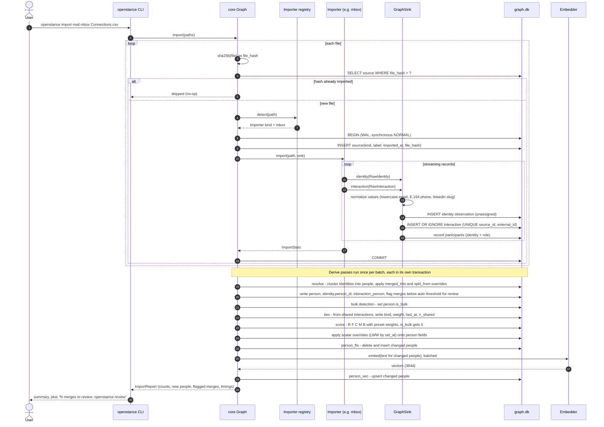
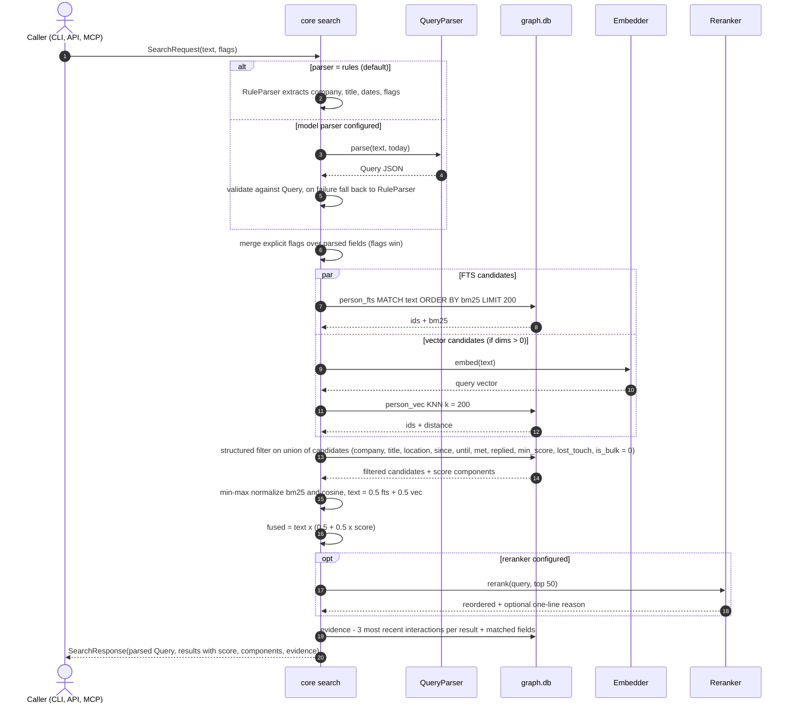
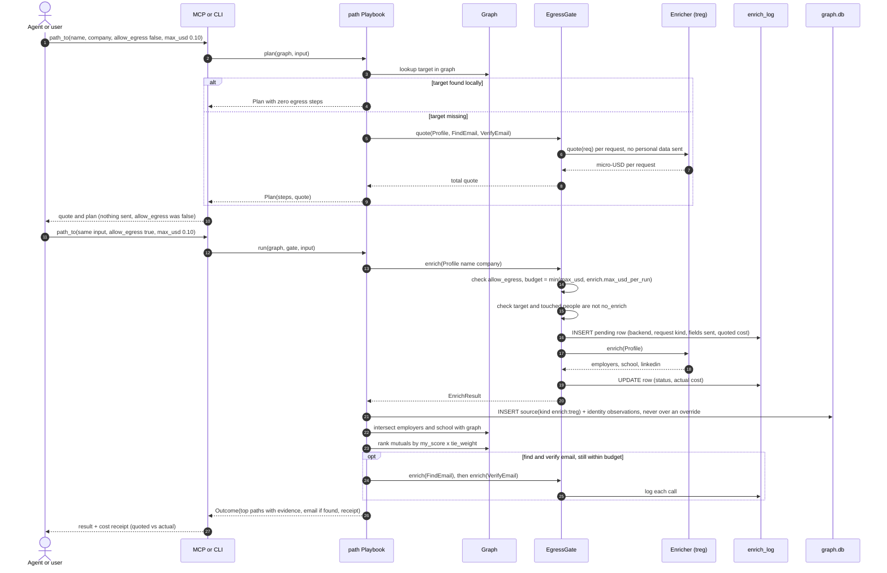
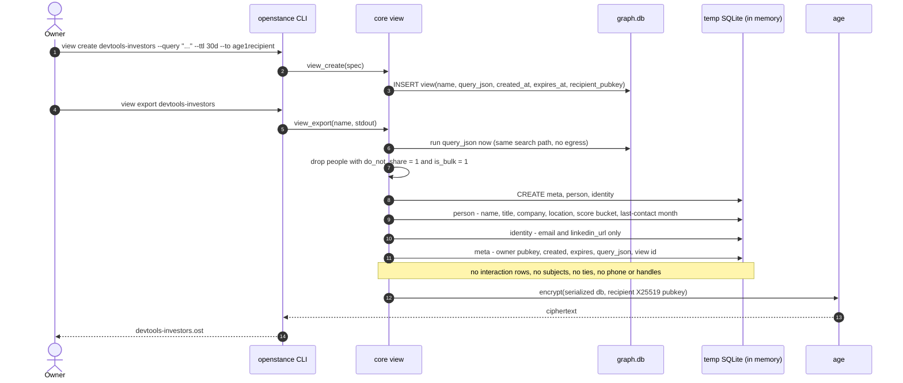
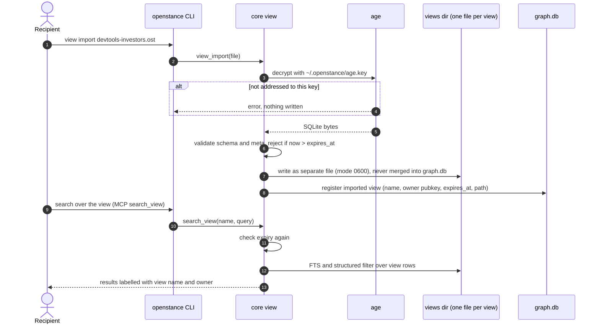
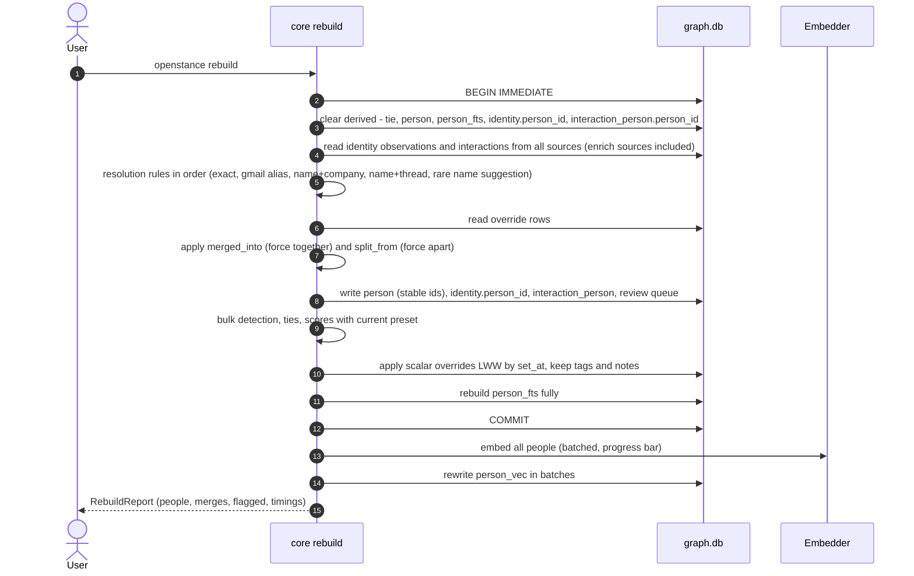
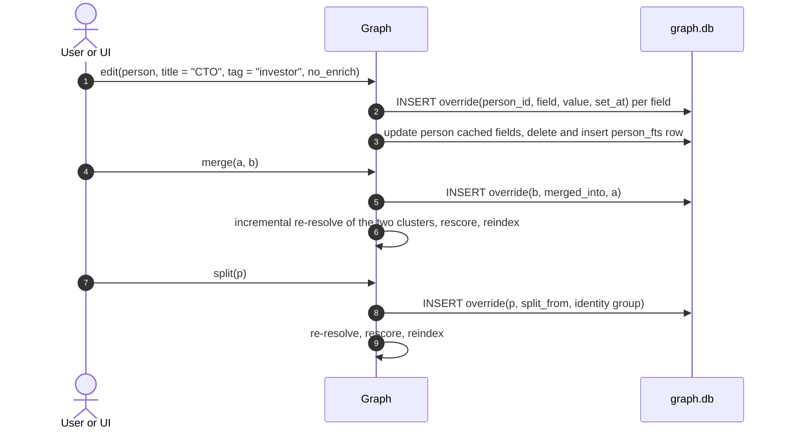

# Data flow

How data moves through openstance for the five flows that matter: import (with resolve, score, index), a search query, a playbook that may spend money, view export and import, and rebuild. Each flow lists its transaction boundaries and failure behaviour.

See also: [overview.md](overview.md), [crates-and-dependencies.md](crates-and-dependencies.md), [security-and-threat-model.md](security-and-threat-model.md), [data-model.md](../tech-spec/data-model.md).

---

## 0. Tables by role

| Role | Tables | Written by | Rebuildable |
|---|---|---|---|
| Raw (append-only) | `source`, `interaction` (except derived `direction`), `interaction_person` participants by handle (`identity_id`, `role`, `slot`, name/title/company/location hints), identity observations (`identity.kind`, `identity.value`, `source_id`) | importers via `GraphSink`, enrichment (`source.kind = 'enrich:<name>'`) | no: this is the ground truth |
| User edits | `override` | `edit`, `merge`, `split`, `review`, tags/notes | no: survives every rebuild |
| Derived | `person`, `identity.person_id` + `confidence` + `match_rule`, `interaction_person.person_id`, `interaction.direction`, `tie`, `person.score*`, `person.is_bulk` | resolve + score passes | yes |
| Indexes | `person_fts` (FTS5, content-storing, rowid = `person.id`), `person_vec` (vec0) | index pass | yes |
| Sharing | `view` | `view create` | no |
| Audit | `enrich_log` | `EgressGate` | no |
| Bookkeeping | `meta` (schema version, migration history, embedder fingerprint) | `Graph::open` | n/a |

Exact columns are in [data-model.md](../tech-spec/data-model.md).

---

## 1. Import -> resolve -> score -> index

`openstance import <file...>` (also `POST /import`). Each file is imported, then the derive passes run once for the whole batch.

Notes:

- **Importers never touch `person`.** They only see the `Sink`. A broken importer can be fixed and its source re-imported and re-derived without corrupting the graph, because nothing it wrote is derived state. (The CLI for removing a single source is not in the Phase 1-4 command list; see [interfaces.md](../tech-spec/interfaces.md).)
- **Dedupe** happens at two levels: `source.file_hash` makes re-importing the same file a no-op; `UNIQUE(source_id, external_id)` drops duplicate messages within one source. The same Message-ID seen in two different sources (two mailboxes) produces two interaction rows; resolution and scoring count distinct `external_id` per person so the same email is not double-counted.
- **Headers only.** With `import.email_bodies = false` (default) the mbox importer never reads past the header block of each message. Signatures for title/company are parsed only when bodies are opted in.
- **Incremental derive.** Resolution is incremental where it can be (new identities only touch clusters they join); scoring recomputes people whose interactions changed plus their tie neighbours. Full recomputation is `rebuild`.
- **Embedding** only runs when the configured embedder has `dims() > 0`. The embedding text is `display_name + title + company + bio + top subjects`. With the Null embedder, `person_vec` stays empty and search runs FTS-only.
- **Failure**: a parse error inside one file rolls back that file's transaction and reports it; other files in the batch still import. A failure in a derive pass leaves raw data committed; the next import or `rebuild` re-derives.

### Bulk-sender detection

Runs before scoring. A person is flagged `is_bulk = 1` when they sent 50+ messages with zero replies either way, or most of their messages carried `List-Unsubscribe` (`bulk_hint`). Bulk people get `score = 0` and are excluded from search unless the query sets `include_bulk`. A user can clear the flag with an override. See [scoring.md](../tech-spec/scoring.md).

---

## 2. Search query

`openstance search "fintech founders I've met" --since 2025-01` (also `GET /people?q=`, MCP `search_people`).

Notes:

- With no text (pure flags), there are no FTS/vector candidates; the structured filter runs over `person` ordered by `score DESC` (target under 50 ms).
- The **parsed `Query` is always returned** so the user or agent can see and edit the extracted filters and re-run without a model call.
- Hosted parser or reranker backends are egress (query text, and for rerankers the candidate fields). They run only when configured and are logged; see [security-and-threat-model.md](security-and-threat-model.md#4-egress-the-only-outbound-path).
- Evidence lines are deterministic facts (thread subject, meeting title, date, role). Prose explanations come only from a configured reranker.
- Fusion and candidate counts are defined in [search.md](../tech-spec/search.md); the score formula in [scoring.md](../tech-spec/scoring.md).

### how_connected (no egress)

`how_connected(target)`: resolve the target to a person, then for each mutual `m` with a tie to the target compute `path_strength = my_score(m) x tie_weight(m, target)`, keep the top 3, and attach evidence for each tie by joining `interaction_person` on both people (the shared interactions). No extra table, no network.

---

## 3. Path playbook with egress

`path_to` is the canonical flow that may spend money. The same pattern (plan, quote, gate, log) applies to `brief`, `refresh`, `watch` and `verify`.

Gate rules (enforced in core, not in the backend):

| Check | Result when it fails |
|---|---|
| `allow_egress == false` (default `allow_egress_default = false`) | return the `Plan` with quote, send nothing |
| running total + next quote > `min(max_usd, enrich.max_usd_per_run)` | abort with `OverBudget`, return partial outcome and receipt |
| a person the request is about has `no_enrich = 1` | skip that request, note it in the outcome |
| `enrich.backend = "none"` | `quote` is 0, `enrich` fails with `Disabled`; playbooks fall back to local-only steps |

The only branching in a playbook is "enough local data, skip egress". There is no open-ended agent loop. See [playbooks.md](../tech-spec/playbooks.md) and [enrichment.md](../tech-spec/enrichment.md).

---

## 4. View export and import

A view is a saved query materialized into a small SQLite file encrypted to one recipient. The recipient gets rows, never the graph.

### 4.1 Create and export

### 4.2 Import and query

- Expiry is enforced by the importer and at query time; beyond that it is advisory (the recipient has the bytes). Revocation is "do not re-export". See the honest limits in [security-and-threat-model.md](security-and-threat-model.md#8-honest-limits).
- Score is exported as a bucket (`strong`, `medium`, `weak`; thresholds `share.bucket_strong` / `share.bucket_medium`), and last contact as a month, so the recipient cannot reconstruct the owner's activity.
- Format details: [sharing-and-views.md](../tech-spec/sharing-and-views.md).

---

## 5. Rebuild

`openstance rebuild` makes the graph a pure function of raw rows plus overrides. It is the recovery path after an importer fix, a resolution rule change, a score preset change or an embedder change.

Requirements:

- **Idempotent**: `rebuild; rebuild` yields byte-identical derived rows (property test).
- **Stable person ids**: `person.id` is the anchor identity id, `MIN(identity.id)` of the cluster. Identity ids are insert-only, so a rebuild with the same sources and overrides yields the same ids, and `override.person_id` / `enrich_log.person_id` (anchor identity ids, no FK) keep resolving after merges. See [data-model.md](../tech-spec/data-model.md#5-stable-person-ids-anchor-identities).
- **Traceable participants**: `interaction_person` stores each participant by `identity_id` (raw) with a derived `person_id`, so re-deriving assignments needs no other table. See [data-model.md](../tech-spec/data-model.md#44-interaction_person-raw--person_id).
- Embedding runs after the commit so the graph is usable (FTS-only) while vectors rebuild. An embedder change (`dims` or `id` differs from the value stored in the db) forces a full `person_vec` rebuild.
- Target: under 60 s for 20k people and 500k interactions, excluding first-run embedding (under 90 s on CPU). See [performance-targets.md](../engineering/performance-targets.md).

---

## 6. Edits, merge and split

Scalar fields (`display_name`, `title`, `company`, `location`, `bio`, `do_not_share`, `no_enrich`) are last-write-wins by `set_at`, and removal is a row with `value = NULL`. Multi-valued fields (`tag`, `note`, `merged_into`, `split_from`) keep every row; removal deletes the row. Enrichment and re-import never write over an override.

---

## 7. Summary of what leaves the process

| Flow | Leaves the machine? | What |
|---|---|---|
| import, rebuild, search (default config), who, how_connected, review, edit, accounts, reconnect | no | |
| first embedder use | download only | model weights fetched, no user data sent |
| search with hosted parser/reranker/embedder | yes, config opt-in | query text, candidate fields (reranker), person text (hosted embedder at index time) |
| path, brief, refresh, watch, verify with `allow_egress = true` | yes, per call | the `EnrichRequest` fields, logged in `enrich_log` |
| view export | only as a file the user hands over | encrypted subset, no interactions |
| MCP results to an agent | to whatever model the agent uses | the tool result; see threat model |
