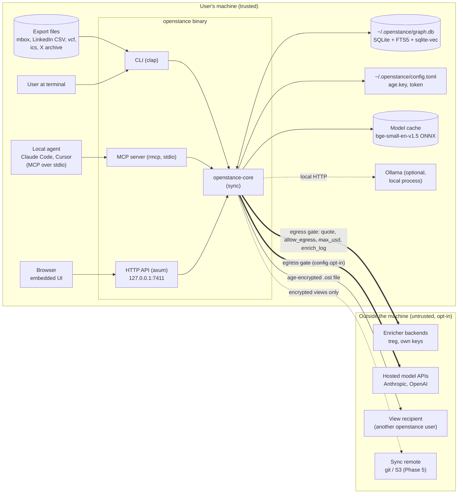
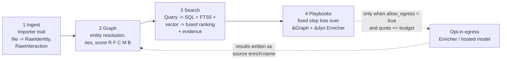
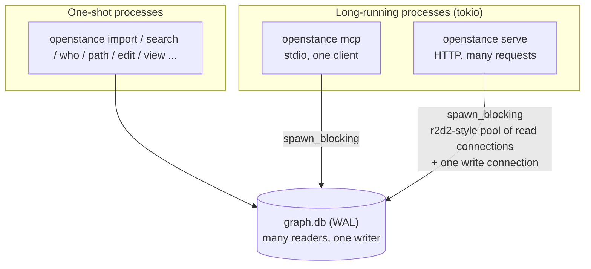

# Architecture overview

openstance is a local-first people-search engine: it turns the exports you already have (Gmail Takeout mbox, LinkedIn CSVs, contacts, calendars, X archives) into **one SQLite file on your machine**, and lets you search that graph from a CLI, an MCP server or a small local web UI. Outside data is pulled in only when you ask, per call, with the cost quoted first.

This document is the entry point for the architecture section. It explains the system context, the four local stages plus the opt-in egress gate, and the two big technology calls (Rust, SQLite). The detail lives in:

- [crates-and-dependencies.md](crates-and-dependencies.md) - workspace layout, crate responsibilities, traits, feature flags, where async lives
- [data-flow.md](data-flow.md) - sequence diagrams for import, search, playbooks with egress, views, rebuild
- [security-and-threat-model.md](security-and-threat-model.md) - assets, trust boundaries, egress controls, honest limits

Related specs: [data model](../tech-spec/data-model.md), [ingestion](../tech-spec/ingestion.md), [entity resolution](../tech-spec/entity-resolution.md), [scoring](../tech-spec/scoring.md), [search](../tech-spec/search.md), [models](../tech-spec/models.md), [enrichment](../tech-spec/enrichment.md), [playbooks](../tech-spec/playbooks.md), [interfaces](../tech-spec/interfaces.md), [sharing and views](../tech-spec/sharing-and-views.md), [configuration](../tech-spec/configuration.md).

> Naming: "openstance" is the working name (binary `openstance`, alias `ost`). The product overview recommends renaming; that is an open decision tracked in the ADR log ([ADR-0001](../decisions/0001-product-name.md)). Nothing in the architecture depends on the name.

---

## 1. System context



Everything inside the left box works with no network and no API key. The thick arrows are the only paths by which user data leaves the machine, and both go through the egress gate described in section 3. The `.ost` arrow is a file the user hands over deliberately; it is encrypted to the recipient's age public key.

### Actors

| Actor | Talks to | Transport | Notes |
|---|---|---|---|
| User | CLI | process args, stdout | `--json` gives the same JSON shape as the API and MCP |
| Local agent (Claude Code, Cursor) | MCP server | stdio, launched as `openstance mcp` | tools listed in [interfaces.md](../tech-spec/interfaces.md) |
| Remote agent connector (claude.ai, ChatGPT) | MCP over HTTP via `openstance serve` | HTTP on loopback + bearer token, usually exposed through a tunnel the user sets up | Phase 4; see threat model for what this implies |
| Browser | HTTP API + embedded UI | HTTP on 127.0.0.1:7411 + bearer token | the UI is a client of the API and nothing else |
| Enricher backend | core via `openstance-enrich` | HTTPS | off by default (`enrich.backend = "none"`) |
| Hosted model | core via `openstance-model` | HTTPS | off by default (local fastembed + RuleParser) |

---

## 2. The four local stages

The overview describes six layers (ingest, graph, search, playbooks, sharing, integrations). Architecturally the first four are a pipeline that runs entirely on the machine; sharing and integrations are surfaces over it.



| Stage | Input | Output | Network | Spec |
|---|---|---|---|---|
| 1. Ingest | export file | `source`, `interaction`, identity observations; never touches `person` | none | [ingestion.md](../tech-spec/ingestion.md) |
| 2. Graph | identities, interactions, overrides | `person`, `identity.person_id`, `interaction_person`, `tie`, cached `person.score`, `person.is_bulk` | none | [entity-resolution.md](../tech-spec/entity-resolution.md), [scoring.md](../tech-spec/scoring.md) |
| 3. Search | text and/or structured filters | ranked people with score components and evidence lines | none by default (local embedder) | [search.md](../tech-spec/search.md), [models.md](../tech-spec/models.md) |
| 4. Playbooks | person/target/company input | typed outcome + cost receipt | only through the egress gate | [playbooks.md](../tech-spec/playbooks.md), [enrichment.md](../tech-spec/enrichment.md) |

### Invariants the whole system relies on

1. **Sources are append-only.** Raw source and interaction rows are never edited. A bad importer can be fixed and its source re-imported.
2. **Derived data is a pure function of sources plus overrides.** `person`, `tie`, scores, `person_fts` and `person_vec` can be deleted and rebuilt by `openstance rebuild` with an identical result (property-tested; see [testing-strategy.md](../engineering/testing-strategy.md)).
3. **Overrides always win.** User edits live in the `override` table (scalar fields last-write-wins by `set_at`, multi-valued fields keep every row). Neither re-import, rebuild nor enrichment writes over an override.
4. **Importers never write people.** They emit records to a `Sink`; resolution and scoring are a separate pass that runs after every import.
5. **Core is synchronous and provider-agnostic.** `openstance-core` has no tokio and never imports a concrete importer, model or enricher; the binary wires concrete implementations in. See [crates-and-dependencies.md](crates-and-dependencies.md).
6. **One JSON shape everywhere.** CLI `--json`, HTTP API and MCP structured content are serialized from the same Rust types.
7. **Egress is explicit, quoted, budgeted and logged.** There is exactly one code path that sends user data off the machine for enrichment, and it lives behind `Enricher::quote` + `allow_egress` + `max_usd` + `enrich_log`.
8. **Bulk senders do not pollute the graph.** People flagged `person.is_bulk = 1` get score 0 and are excluded from search unless explicitly requested.

---

## 3. Opt-in egress

There are two kinds of outbound call, both off by default:

| Kind | Trigger | Default | Control |
|---|---|---|---|
| Enrichment (profile, find/verify email, company, web search) | a playbook step or `quote_enrich`/`path_to` MCP call | `enrich.backend = "none"`, `allow_egress_default = false` | per call: `quote` first, `allow_egress` must be true, total quoted cost must be <= `min(max_usd, enrich.max_usd_per_run)` (default 0.50 USD), `no_enrich` people skipped, every request + cost written to `enrich_log` |
| Hosted model (parser, reranker, embedder on Anthropic/OpenAI) | search when `[model]` points at a hosted backend | `embedder = fastembed`, `parser = rules`, `reranker = none` | opt-in by config only; the CLI warns once when a hosted backend is configured; calls are logged to `enrich_log` with backend `model:<name>` (see [security-and-threat-model.md](security-and-threat-model.md)) |

Non-user-data network access:

- **Model download.** fastembed fetches `bge-small-en-v1.5` (about 33 MB, quantized) on first use and caches it. No user data is sent. Air-gapped installs point `OPENSTANCE_MODEL_DIR` at a pre-downloaded copy.
- **Ollama** is a local process on `127.0.0.1:11434`; calls to it stay on the machine.
- No telemetry, no update checks, no crash reporting.

Enrichment results come back into stage 2 as identity and person fields with `source.kind = 'enrich:<name>'` (for example `enrich:treg`). treg is one `Enricher` implementation behind the trait, alongside `Null` and (later) own-keys; see [enrichment.md](../tech-spec/enrichment.md).

---

## 4. Why one binary and one file

**One binary.** The target users (founders, recruiters, sellers, community managers, and the agents they run) should go from "heard about it" to "searching my network" in five minutes:

```sh
cargo binstall openstance        # or: brew / curl | sh from cargo-dist installers
openstance init
openstance import ~/Downloads/takeout/mail.mbox ~/Downloads/Connections.csv ~/Downloads/contacts.vcf
openstance search "fintech founders I've met" --since 2025-01
```

No runtime (Node, Python, JVM), no daemon, no Docker. The same binary is the CLI, the MCP server (`openstance mcp`), the HTTP API and UI server (`openstance serve`). Release binaries are built by cargo-dist for macOS (arm64, x86_64), Linux (x86_64, arm64, musl) and Windows (x86_64); see [ci-and-release.md](../engineering/ci-and-release.md). Target binary size is under 40 MB without models.

**One file.** `~/.openstance/graph.db` is the product's data format:

- **Backup** is `cp`. Dotfile managers and Time Machine just work.
- **Portability**: `openstance export --format csv|json|vcf|parquet` at any time; the schema is documented and stable, so other tools can read the file directly.
- **Debuggability**: users and contributors can open the file in `sqlite3` and see exactly what the system believes and why (every tie and score component is a row).
- **Sharing** is a smaller file: a view is a materialized query in its own SQLite file, age-encrypted to a recipient (`*.ost`). See [sharing-and-views.md](../tech-spec/sharing-and-views.md).
- **Encryption at rest** is the disk's job by default (full-disk encryption recommended), with an optional SQLCipher build.

Files under `~/.openstance/`:

| Path | Purpose | Mode |
|---|---|---|
| `graph.db` (+ `-wal`, `-shm`) | the graph | 0600 |
| `config.toml` | configuration; every key has a default, file may be empty | 0600 |
| `age.key` | age X25519 identity for views (public key printed by `openstance init`) | 0600 |
| `token` | bearer token for the HTTP API, generated at `init` | 0600 |
| `views/` | decrypted imported views, one SQLite file per view, never merged into `graph.db` | 0700 |
| `models/` | cached ONNX model files (overridable by `OPENSTANCE_MODEL_DIR`) | 0700 |
| `logs/` | optional `tracing` file output, off by default | 0700 |

---

## 5. Why Rust

From the tech spec decision. The product is three things at once: a single static binary installed with one command, a fast parser of multi-GB mbox and archive files, and a local inference host for embeddings and small models. Rust is the only option that is strong on all three.

| Option | Ship speed | Runtime speed | Local ML | Single binary | Verdict |
|---|---|---|---|---|---|
| **Rust** | slower to write | fastest | fastembed, ort, candle, sqlite-vec all native | yes | **core, CLI, MCP, API** |
| Go | fastest to write | fast | cgo for ONNX, immature | yes | good fallback if Rust velocity becomes the problem |
| TypeScript (Bun) | fast | fine | transformers.js, slow on CPU | mostly | **web UI only** |
| Python | fast | slow parsing | best | no | no: users would need an environment |

Consequences:

- Contributors need Rust to add importers. To keep that bar low, importers are tiny crates/modules behind feature flags with a two-method trait (`detect`, `import`) and a synthetic fixture; see [crates-and-dependencies.md](crates-and-dependencies.md#7-adding-an-importer).
- The optional web UI is TypeScript + Vite, built separately and embedded into the binary as static files. It is a pure client of the HTTP API.

---

## 6. Why SQLite, not ClickHouse

### Sizing a heavy user

| Entity | Rows | Notes |
|---|---|---|
| people | ~20,000 | after resolution |
| identities | ~50,000 | emails, LinkedIn slugs, handles, phones |
| interactions | ~500,000 | every email header, meeting, DM |
| ties | ~100,000 | person-person edges |
| embeddings | ~20,000 x 384 dims | float32: 20,000 x 384 x 4 B = about 30 MB |
| **file size** | **200-500 MB** | including FTS5 index |

### What the queries need

| Operation | SQLite mechanism | Expected cost |
|---|---|---|
| `who`, `get_person`, `how_connected` | B-tree point lookups and small joins | microseconds per lookup; under 20 ms per command |
| Structured search | indexed filters on `person` | under 50 ms |
| Free-text search | FTS5 bm25 over 20k person documents (built from 500k interaction subjects) | low milliseconds |
| Semantic search | sqlite-vec brute-force cosine over 20k x 384 | under 10 ms |
| Edits (overrides, merges, notes, tags) | single-row inserts | microseconds, transactional |

No query in openstance scans more than this. Full targets are in [performance-targets.md](../engineering/performance-targets.md).

### Why ClickHouse is wrong here

- **It is a server.** The promise is "a file on your machine, no daemon". `clickhouse-local` exists but is a ~500 MB binary and still an analytics engine.
- **It is OLAP.** Built for billion-row scans and aggregations, with weak point lookups and no cheap row updates. openstance is mostly point lookups, small joins and frequent row edits.
- **No laptop-sized FTS5 equivalent, no vector index that beats brute force at 20k rows, no encryption-at-rest story for a shareable file.**
- **Backup, sync and sharing become infrastructure** instead of `cp`.

### Where columnar might earn a place later

Only in a cloud team tier, if a large org wants cross-member analytics ("which teams have warm coverage into Fortune 500 accounts"). The order of escalation is Postgres with materialized views, then DuckDB over exported Parquet, then ClickHouse only for a customer with 100M+ interactions. The schema is designed to export cleanly to Parquet (`openstance export --format parquet`) so that door stays open. See [pricing-and-cloud.md](../product/pricing-and-cloud.md).

### SQLite configuration

- `rusqlite` with the `bundled` feature (no system SQLite dependency; FTS5 compiled in).
- `sqlite-vec` loaded as a statically linked extension, registered at connection open.
- `PRAGMA journal_mode=WAL; PRAGMA synchronous=NORMAL; PRAGMA foreign_keys=ON; PRAGMA busy_timeout=5000;`
- Each import runs in a single transaction.
- Optional SQLCipher via the `sqlcipher` build feature (see [security-and-threat-model.md](security-and-threat-model.md)).

---

## 7. Process and concurrency model



- Several openstance processes may run at once (for example `openstance mcp` launched by an editor while the user runs `openstance import` in a terminal). SQLite WAL allows concurrent readers with a single writer; `busy_timeout` serializes writers.
- Long-running servers hold one write connection behind a mutex and a small pool of read connections. Core calls are synchronous and run on tokio's blocking pool.
- After a write from another process (import, rebuild), servers pick up new data on their next read; nothing is cached in memory across requests except the loaded embedding model and config.
- An import or rebuild takes the write lock for its whole transaction. Reads continue against the last committed snapshot.

---

## 8. Surfaces

| Surface | Command | Async | Auth | Spec |
|---|---|---|---|---|
| CLI | `openstance <cmd>` / `ost <cmd>` | no | OS user | [interfaces.md](../tech-spec/interfaces.md) |
| MCP (stdio) | `openstance mcp` | tokio | inherits the launching process | [interfaces.md](../tech-spec/interfaces.md) |
| HTTP API + UI | `openstance serve [--port 7411]` | tokio + axum | bearer token, loopback only | [interfaces.md](../tech-spec/interfaces.md) |
| MCP over HTTP | served by `openstance serve` | tokio | bearer token | [interfaces.md](../tech-spec/interfaces.md) |

Canonical MCP tools: `search_people`, `get_person`, `how_connected`, `path_to`, `brief`, `list_views`, `search_view`, `quote_enrich`. "Who knows someone at X" is `search_people` with a company filter followed by `how_connected`; there is no separate tool. Every tool that can spend money takes `allow_egress` (default `false`) and `max_usd`, and returns a quote instead of running when `allow_egress` is false.

---

## 9. Relationship to the v0.1 prototype

A browser-only v0.1 prototype (MIT, localStorage, CSV import, structured search, intro board) already exists. It is **reference and fixture source, not the product**: its CSV header aliases, dedupe-by-email/profile-URL behaviour, formula-injection-safe CSV export and fictional demo network inform the Rust importers and test fixtures. The Rust core replaces it. See [prototype-v0.1.md](../prototype-v0.1.md).

---

## 10. Build order

The architecture is built in the phases defined in [roadmap.md](../plan/roadmap.md):

| Phase | Architecture delivered |
|---|---|
| 0 (done) | v0.1 browser prototype as reference |
| 1 | `openstance-core` schema + migrations, `openstance-import` (mbox, linkedin_csv, vcf), resolution + review, scoring presets, RuleParser + FTS5 search, CLI |
| 2 | `openstance-model` fastembed + fusion, `who`, `how_connected`, `openstance-mcp`; public MVP and Show HN |
| 3 | `openstance-enrich` (Null + treg), `path` and `brief` playbooks, views with age, ics + x_archive importers |
| 4 | `openstance-api` + embedded UI, remaining playbooks, Ollama/Anthropic/OpenAI backends, cargo-dist releases |
| 5 | sync over git/S3, team federation, more importers, optional OAuth; then the cloud decision |

Details per phase: [phase-1.md](../plan/phase-1.md), [phase-2.md](../plan/phase-2.md), [phase-3.md](../plan/phase-3.md), [phase-4.md](../plan/phase-4.md), [phase-5-and-beyond.md](../plan/phase-5-and-beyond.md).
