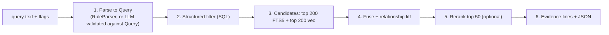

# ADR-0006: Hybrid retrieval with optional models

- **Status:** Accepted
- **Date:** 2026-10-20
- **Related:** [tech-spec/search.md](../tech-spec/search.md), [tech-spec/models.md](../tech-spec/models.md), [engineering/performance-targets.md](../engineering/performance-targets.md)

## Context

Users ask questions like "fintech founders I've actually met" or "people I lost touch with who are now at Anthropic". The incumbent pattern runs an LLM agent with web search on every query, which is metered, slow (async polling) and reported to drift on broad queries. The overview's thesis is that most of that work is deterministic and can run locally for $0.

The v0.1 prototype showed the value of visible "matched / missing" terms and of refusing to silently widen results, but its keyword-only search cannot handle semantic queries.

## Decision

Search is a six-step pipeline. **Only steps 1 and 5 may use a model, and both are optional.** With no model configured, the pipeline degrades to rules plus SQL plus FTS5, and still works.

- **Parse:** `QueryParser` trait. Default `RuleParser` (regex for company, title, dates, flags). Model parsers (Ollama, Anthropic, OpenAI-compatible) must emit JSON validated against `Query`; on failure, fall back to rules. The extracted filters are returned in the response and can be edited and rerun without a model.
- **Embed:** `Embedder` trait. Default `fastembed` `bge-small-en-v1.5` (384d, int8, CPU). Embedding text = `display_name + title + company + bio + top subjects`. Changing the embedder triggers a re-index; dims are stored.
- **Fuse:** bm25 and cosine each min-max normalized over the candidate set, combined 0.5/0.5, then multiplied by `(0.5 + 0.5 * score)` so a strong relationship lifts a weaker text match.
- **Rerank:** `Reranker` trait. Default `Null` (fused order). Alternatives: local `bge-reranker-base`, or an API model that also writes a one-line reason.
- **Evidence:** the three most recent interactions with that person plus the matched fields. Deterministic. Model prose is optional and labeled as such.
- Bulk people (`is_bulk = 1`) and, inside views, `do_not_share` people are excluded by default.

## Consequences

**Positive**

- $0 per query by default; sub-second; works offline.
- Targets: structured search under 50 ms, text search with embedder under 300 ms (20k people, M2 laptop).
- Search evals run in CI with `rules` parser and `none` reranker, so CI needs no model; a second tier runs with Ollama locally.
- Filters are visible, which addresses drift on broad queries: the user sees exactly what was searched.

**Negative**

- Without a model, natural-language parsing is limited to what `RuleParser` recognizes; broad fuzzy queries are weaker.
- First run downloads about 33 MB of model and embeds all people (target under 90 s for 20k).
- Fusion constants (0.5/0.5, top 200) are untuned guesses; tune in Phase 2 against the 50-query eval.

## Alternatives considered

| Option | Why not |
|---|---|
| LLM agent + web search per query | Metered cost, latency, drift; the thing the product exists to avoid |
| FTS5 only | Misses semantic matches ("ML" vs "machine learning", "devtools" vs "developer tools") |
| Vector only | Poor at exact names and companies; no hard constraints |
| Reciprocal rank fusion | Viable; min-max weighted fusion chosen because it composes with the relationship multiplier. Revisit after evals. |
| Mandatory local LLM | Large download, slow on CPU, excludes low-end machines |
