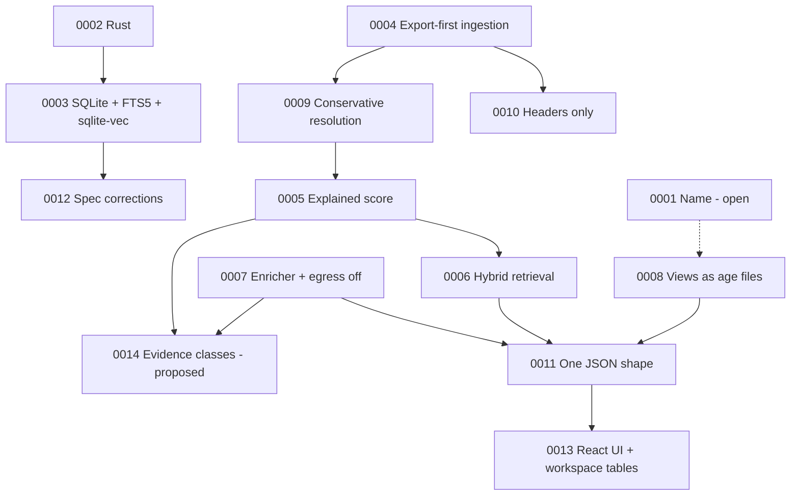

# Architecture Decision Records

This folder records the decisions that shape openstance: what was decided, why, what it costs, and what was rejected. If a doc elsewhere in [docs/](../README.md) disagrees with an accepted ADR, the ADR wins until it is superseded by a newer ADR.

## Index

| ADR | Title | Status | Phase it bites |
|---|---|---|---|
| [0001](0001-product-name.md) | Product name: openstance vs kith vs others | **Proposed (open)** | Before Phase 2 launch |
| [0002](0002-rust-for-core.md) | Rust for the core, CLI and servers | Accepted | 1 |
| [0003](0003-sqlite-fts5-sqlite-vec.md) | One SQLite file with FTS5 and sqlite-vec, not ClickHouse | Accepted | 1 |
| [0004](0004-export-first-ingestion.md) | Export-first ingestion over OAuth connectors | Accepted | 1 |
| [0005](0005-deterministic-explained-score.md) | Deterministic, explained relationship score | Accepted | 1 |
| [0006](0006-hybrid-retrieval-optional-models.md) | Hybrid retrieval with optional models | Accepted | 1 to 2 |
| [0007](0007-enricher-trait-egress-off.md) | Enricher trait, treg as one backend, egress off by default | Accepted | 3 |
| [0008](0008-views-as-encrypted-files.md) | Share views as age-encrypted files, never the graph | Accepted | 3 |
| [0009](0009-conservative-entity-resolution.md) | Conservative entity resolution with manual merge and split | Accepted | 1 |
| [0010](0010-email-headers-only-by-default.md) | Email headers only by default; bodies opt-in | Accepted (default may be revisited) | 1 |
| [0011](0011-one-json-shape-across-surfaces.md) | CLI, MCP and HTTP share one JSON shape | Accepted | 1 to 2 |
| [0012](0012-spec-corrections.md) | Corrections to the original tech spec (a to g and other reconciliations) | Accepted | 1 |
| [0013](0013-react-vite-web-ui-and-workspace.md) | Web UI in Vite + React + TypeScript; shortlist and introductions stored in the graph | Accepted | 4 |
| [0014](0014-evidence-classes-and-claim-provenance.md) | Evidence classes: every fact and edge says where it came from; only observed interactions or user assertions establish a relationship | **Proposed** | 4 to 5 |

### Pending decisions without an ADR yet

These are tracked in [risks-and-open-questions.md](../risks-and-open-questions.md) and get an ADR number when decided:

- Licence for the Rust core: MIT (as the prototype) vs Apache-2.0.
- ~~Whether v1 ships the web UI at all (Phase 4) or stays CLI + MCP.~~ Decided: it ships, see ADR-0013.
- Enrichment wallet margin for a future cloud tier.
- Whether email bodies ever become default-on (follows from Phase 2 evals; see ADR-0010).
- The definition of a "meaningful Show HN response" for the park criterion (Q12; proposal in [plan/launch.md](../plan/launch.md#park-criterion)).
- Telemetry: none (Q11, lean decided).

## How decisions relate



## Format (MADR-lite)

Each ADR is one Markdown file named `NNNN-short-slug.md`, numbered sequentially and never renumbered:

```markdown
# ADR-NNNN: Title

- **Status:** Proposed | Accepted | Superseded by ADR-XXXX | Deprecated
- **Date:** YYYY-MM-DD
- **Related:** links to tech-spec / plan docs

## Context
What forces are at play; facts, numbers, constraints.

## Decision
What we will do, specifically enough to implement.

## Consequences
Positive and negative results, and mitigations.

## Alternatives considered
Options rejected and why.
```

## Process

1. Open a PR adding `NNNN-slug.md` with status **Proposed**. Use the next free number.
2. Discuss on the PR. The maintainer merges with status **Accepted** or closes it.
3. To change an accepted decision, write a new ADR and set the old one to **Superseded by ADR-XXXX**. Do not rewrite history in an accepted ADR beyond typo fixes and link updates.
4. Changes to any of the following always require an ADR (from [plan/roadmap.md](../plan/roadmap.md)): privacy defaults (headers only, `enrich.backend = "none"`, `allow_egress_default = false`, `max_usd_per_run = 0.50`), the frozen `Importer`/`Sink` traits or `Query`/result JSON shapes after Phase 1, and any derived data written outside `rebuild`.

## Source documents

The ADRs were derived from the "openstance product overview" (13 pp.) and "openstance tech spec" (17 pp.) PDFs dated 2026-10-20, the v0.1 prototype ([prototype-v0.1.md](../prototype-v0.1.md)) and its sourced research notes. Where those sources conflict, [ADR-0012](0012-spec-corrections.md) records the resolution.
