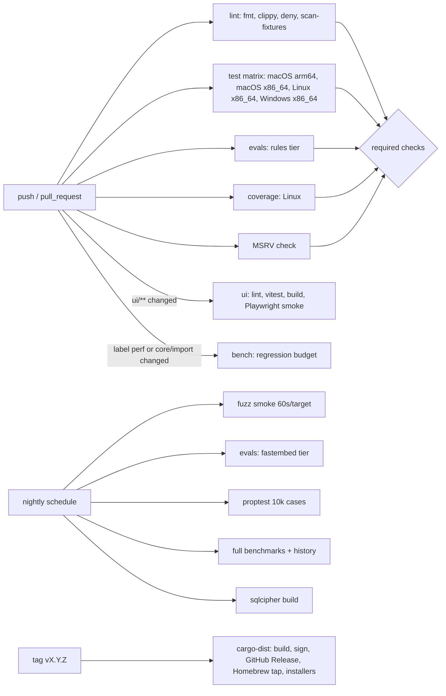

# CI and release

How every change is checked, how releases are cut, and how users install openstance. CI runs on GitHub Actions; release artifacts are built by `cargo-dist`.

Related: [testing-strategy.md](testing-strategy.md), [performance-targets.md](performance-targets.md), [conventions.md](conventions.md), [dev-setup.md](dev-setup.md), [../plan/phase-4.md](../plan/phase-4.md) (release binaries milestone), [../plan/launch.md](../plan/launch.md).

## Pipeline overview



## Workflows

| File | Trigger | Jobs |
|---|---|---|
| `.github/workflows/ci.yml` | `push` to `main`, `pull_request` | lint, test matrix, msrv, evals (rules), coverage, ui (path-filtered), bench (conditional) |
| `.github/workflows/nightly.yml` | `schedule: "0 3 * * *"`, `workflow_dispatch` | fuzz smoke, fastembed evals, long proptests, full benches, sqlcipher build, prototype tests (weekly) |
| `.github/workflows/release.yml` | tag `v*` | generated by `cargo dist init`; do not hand-edit except through `dist-workspace.toml` |
| `.github/workflows/docs.yml` | changes under `docs/**` | markdown link check (lychee, offline mode for relative links), mermaid syntax check |

## ci.yml in detail

### Lint (ubuntu-latest)

```yaml
- uses: dtolnay/rust-toolchain@stable
  with: { components: "rustfmt, clippy" }
- uses: Swatinem/rust-cache@v2
- run: cargo fmt --all -- --check
- run: cargo clippy --workspace --all-targets --all-features -- -D warnings
- run: cargo clippy --workspace --all-targets --no-default-features -- -D warnings
- uses: EmbarkStudios/cargo-deny-action@v2       # licenses, advisories, bans (single libsqlite3-sys)
- run: cargo xtask scan-fixtures                 # no real contact data
- run: cargo xtask gen-fixtures && git diff --exit-code fixtures/
- run: cargo xtask schema-dump --check           # docs/tech-spec/data-model.md SQL block matches head schema
```

### Test matrix

```yaml
strategy:
  fail-fast: false
  matrix:
    include:
      - { os: macos-14,        target: aarch64-apple-darwin }
      - { os: macos-13,        target: x86_64-apple-darwin }
      - { os: ubuntu-24.04,    target: x86_64-unknown-linux-gnu }
      - { os: windows-2022,    target: x86_64-pc-windows-msvc }
steps:
  - uses: actions/checkout@v4
  - uses: dtolnay/rust-toolchain@stable
  - uses: Swatinem/rust-cache@v2
    with: { key: "${{ matrix.target }}" }
  - uses: taiki-e/install-action@v2
    with: { tool: cargo-nextest }
  - run: cargo nextest run --workspace --all-features --profile ci
  - run: cargo test --workspace --doc
```

Notes:

- Tests run with the hash embedder and no network; `OPENSTANCE_TEST_MODELS` is unset. Any test reaching the network fails (nextest profile `ci` sets `OPENSTANCE_DENY_NETWORK=1`, which makes the HTTP clients in our crates refuse to connect).
- Linux runs on ubuntu-24.04, not 22.04: the prebuilt ONNX Runtime that `ort` (via fastembed) links is built against glibc 2.38 and GCC 13's libstdc++, so default-feature Linux builds need glibc >= 2.38 to link and run.
- Linux aarch64 and musl targets are built at release time (cross-compiled via cargo-dist) and smoke-tested there; they are not in the per-PR matrix to keep CI under ~12 minutes.
- Windows paths: tests use `Path`/`PathBuf` everywhere and `tempfile`; CRLF is set via `.gitattributes` (`fixtures/** -text` so fixture bytes are identical on all OSes).

### MSRV

```yaml
- uses: dtolnay/rust-toolchain@1.92
- run: cargo check --workspace --all-features --locked
```

### Evals (rules tier)

```yaml
- run: cargo xtask eval --tier rules --baseline fixtures/evals/baseline-rules.json --fail-on-regression
```

Gates (from [testing-strategy.md](testing-strategy.md#search-evals)): zero `must_not` violations; Recall@5 drop <= 0.02; MRR drop <= 0.03. The job posts a metrics table as a PR comment (via `marocchino/sticky-pull-request-comment`).

### Coverage

`cargo llvm-cov nextest --workspace --all-features --lcov --output-path lcov.info`, then `cargo xtask coverage --check` against per-crate floors in `xtask/coverage.toml`. The lcov file is uploaded as an artifact (and to Codecov if the project enables it; not required).

### UI (only when `ui/**` changes)

```yaml
- uses: pnpm/action-setup@v4
- uses: actions/setup-node@v4
  with: { node-version: 22, cache: pnpm, cache-dependency-path: ui/pnpm-lock.yaml }
- run: pnpm -C ui install --frozen-lockfile
- run: pnpm -C ui lint && pnpm -C ui test && pnpm -C ui build
- run: cargo build -p openstance --features ui && pnpm -C ui e2e     # Playwright against `openstance serve` on fixtures
```

### Benchmarks (conditional)

Runs when the PR has the `perf` label or touches `crates/openstance-core/src/{search,score,resolve,rebuild}/**` or `crates/openstance-import/**`. Details and budgets are in [performance-targets.md](performance-targets.md#regression-budget-in-ci).

### Required checks for merge

`lint`, `test (all four targets)`, `msrv`, `evals-rules`, `coverage`, plus `ui` when it ran. Bench is advisory on shared runners except for the hard absolute thresholds listed in the performance doc.

### Caching

- `Swatinem/rust-cache` keyed by target.
- fastembed model cache for nightly evals: `actions/cache` on `~/.cache/openstance-models` keyed by model name + version, with `OPENSTANCE_MODEL_DIR` pointing there.
- Synthetic benchmark graph: `actions/cache` on `target/synth/` keyed by the generator's source hash + seed.

## Nightly

| Job | Command | On failure |
|---|---|---|
| Fuzz smoke | `cargo xtask fuzz-smoke --secs 60` (nightly toolchain, Linux) | open issue with crash artifact (synthetic by construction) |
| fastembed evals | `cargo xtask eval --tier fastembed` | issue + metrics artifact |
| Long proptests | `PROPTEST_CASES=10000 cargo test --release --workspace --test '*props*'` | failing seed committed in fix PR |
| Full benches | `cargo xtask bench --full --history gh-pages` | issue if over budget |
| SQLCipher | `cargo build -p openstance --features sqlcipher` + core tests | issue |
| Prototype (weekly) | `npm test` in the prototype directory | issue |
| Dependency audit | `cargo deny check advisories` | issue |

Nightly failures open or update a single tracking issue per job (`gh issue` via a small script) rather than spamming.

## Release

### Tooling: cargo-dist

`cargo dist init` generates `release.yml` and `dist-workspace.toml`. Configuration:

```toml
[dist]
cargo-dist-version = "0.x"            # pinned; bump deliberately
ci = "github"
installers = ["shell", "powershell", "homebrew"]
tap = "<org>/homebrew-tap"
publish-jobs = ["homebrew"]
targets = [
  "aarch64-apple-darwin",
  "x86_64-apple-darwin",
  "x86_64-unknown-linux-gnu",
  "aarch64-unknown-linux-gnu",
  "x86_64-unknown-linux-musl",
  "x86_64-pc-windows-msvc",
]
install-path = "CARGO_HOME"
checksum = "sha256"
github-attestations = true            # SLSA provenance via GitHub artifact attestations
precise-builds = true

[dist.github-custom-runners]
aarch64-unknown-linux-gnu = "ubuntu-24.04-arm"   # glibc >= 2.38 for the prebuilt ONNX Runtime
```

The `openstance` package declares the binary; the `ost` alias is produced as an extra binary target (`[[bin]] name = "ost"` with a tiny `main` that calls the same entry point) so every installer ships both. Embedded UI: the release workflow runs `pnpm -C ui build` before `cargo dist build` (a `[dist] build-local-artifacts` pre-step via `github-build-setup`).

Release artifacts never include models; fastembed downloads on first use into `~/.openstance/models/`. Binary size budget: under 40 MB (checked in the release job and in nightly benches).

### Install channels

| Channel | Command | Source |
|---|---|---|
| Shell installer (macOS/Linux) | `curl --proto '=https' --tlsv1.2 -LsSf https://github.com/<org>/openstance/releases/latest/download/openstance-installer.sh \| sh` | cargo-dist |
| PowerShell (Windows) | `irm https://github.com/<org>/openstance/releases/latest/download/openstance-installer.ps1 \| iex` | cargo-dist |
| Homebrew | `brew install <org>/tap/openstance` | formula pushed to `<org>/homebrew-tap` by cargo-dist |
| cargo-binstall | `cargo binstall --git <repo-url> openstance` (plain `cargo binstall openstance` once on crates.io) | prebuilt archives from GitHub Releases; `[package.metadata.binstall]` in the bin crate points at the cargo-dist archive naming |
| From source | `cargo install --locked --git <repo-url> openstance` (crates.io once ADR-0001 is decided) | git / crates.io |

`[package.metadata.binstall]` in `crates/openstance/Cargo.toml`:

```toml
[package.metadata.binstall]
pkg-url = "{ repo }/releases/download/v{ version }/openstance-{ target }{ archive-suffix }"
bin-dir = "openstance-{ target }/{ bin }{ binary-ext }"
pkg-fmt = "txz"

[package.metadata.binstall.overrides.x86_64-pc-windows-msvc]
pkg-fmt = "zip"
```

crates.io publishing: all workspace crates are published in dependency order (`cargo publish -p openstance-core` ... `-p openstance`) by a `publish-crates` job after the GitHub Release succeeds, using a crates.io token stored as an environment secret with required reviewers. **The job stays disabled until the product name is decided** ([ADR-0001](../decisions/0001-product-name.md); [P4-CI-03](../plan/phase-4.md)): publishing or reserving crate names would commit to a name, and a rename would leave orphaned crates. Until then, installs use the GitHub Release archives (shell, Homebrew, `cargo binstall` with `--git`/manifest metadata) or `cargo install --git`.

macOS signing and notarization: not required for the shell/Homebrew installers (no Gatekeeper quarantine on curl/brew installs). If a `.pkg` or downloadable zip is offered later, add Developer ID signing and notarization via cargo-dist's macOS signing support; tracked in [../risks-and-open-questions.md](../risks-and-open-questions.md).

### Cutting a release

1. Ensure `main` is green, including the latest nightly.
2. `cargo xtask release-prep X.Y.Z`: bumps workspace version (all crates share one version), updates `CHANGELOG.md` from Conventional Commits since the last tag (`git-cliff`), runs `cargo dist plan`.
3. Open a `release: vX.Y.Z` PR; review the changelog text by hand (it is user-facing).
4. Merge, then tag: `git tag -s vX.Y.Z -m "openstance X.Y.Z" && git push origin vX.Y.Z`.
5. `release.yml` builds all targets, creates the GitHub Release with archives, checksums, attestations and installers, pushes the Homebrew formula, then `publish-crates` runs.
6. Smoke test on a clean machine per OS: install via Homebrew/shell/binstall, `openstance --version`, `openstance init`, import fixtures, `search`, `mcp` handshake.

Pre-releases: tags like `v0.3.0-rc.1` produce GitHub pre-releases and skip Homebrew and crates.io.

## Versioning

openstance follows SemVer. Before 1.0, minor bumps (`0.x`) may break; patch bumps never do. What counts as the public contract:

| Surface | Breaking change examples |
|---|---|
| CLI | removing/renaming a command or flag; changing `--json` field names or types; changing exit code meaning |
| JSON shapes (CLI/MCP/HTTP) | removing or renaming a field; adding fields is non-breaking |
| MCP tools | renaming/removing one of the eight tools or a required argument; changing the `allow_egress` default (never allowed) |
| HTTP API | route or auth changes |
| Config | removing a key or changing a default in a way that increases egress or cost (never allowed without a major/minor bump and a changelog warning) |
| Library traits | changing `Importer`, `Sink`, `Enricher`, `Embedder`, `QueryParser`, `Reranker`, `Playbook` signatures |
| `.ost` view format | changing the inner schema or `meta` fields so older binaries cannot read it |

### Schema versions vs app versions

- The database schema has its own monotonically increasing version (`meta.schema_version` + `PRAGMA user_version`), independent of the app version. The changelog notes "schema N -> N+1" when it moves.
- Upgrading the app runs migrations automatically after backing up `graph.db` to `graph.db.bak-v<N>`. Downgrading is not supported: an older binary refuses to open a newer schema (exit code 10, `schema_too_new`, message names the required version).
- `.ost` files carry `meta.format_version`. Readers accept their own and older format versions; exporters write the newest. A format bump is at least a minor release.
- Every migration ships with a test that upgrades a fixture database from each previous released schema version (see [testing-strategy.md](testing-strategy.md#integration-tests)).

## Changelog

- `CHANGELOG.md` at the repo root, Keep a Changelog format (`Added`, `Changed`, `Deprecated`, `Removed`, `Fixed`, `Security`), generated by `git-cliff` from Conventional Commits and edited by hand at release time.
- Every user-visible PR either has a `feat`/`fix`/`perf` commit subject that reads well in the changelog, or adds a line under `## [Unreleased]` itself.
- Mandatory callouts: schema version changes, any change to default egress/cost/privacy behavior, new network destinations, MSRV bumps, `.ost` format bumps.
- The GitHub Release body is the changelog section for that version plus install commands.

## Secrets and permissions in CI

- Default `permissions: contents: read` at the workflow level; jobs that comment on PRs get `pull-requests: write`; release gets `contents: write`, `id-token: write`, `attestations: write`.
- Secrets: `HOMEBREW_TAP_TOKEN` (fine-grained, tap repo only), `CARGO_REGISTRY_TOKEN` (environment `crates-io` with required reviewers). No API keys for model or enrichment providers exist in CI; nothing in CI can spend money.
- Third-party actions pinned by commit SHA; Dependabot (or Renovate) updates them weekly along with Cargo and pnpm dependencies.
- PRs from forks run without secrets (standard `pull_request` trigger; no `pull_request_target`).
