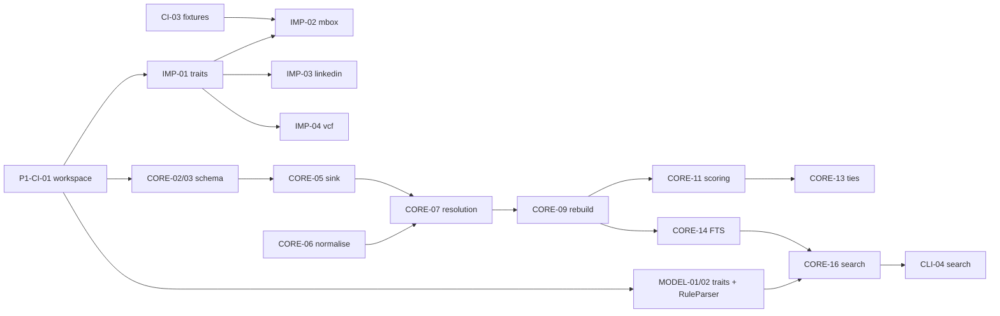

# Phase 1 (Week 1): local graph and a usable CLI

**Timebox:** 5 working days. **Release:** `v0.2.0` (source build only). **Previous:** [Phase 0, the v0.1 prototype](../prototype-v0.1.md). **Next:** [Phase 2](phase-2.md). **Overview:** [roadmap](roadmap.md).

## Goal

A user can run `openstance init`, import a Google Takeout mbox, a LinkedIn `Connections.csv` export, and a `.vcf`, check the merges the system was unsure about, and run `openstance search` with structured flags or free text. Results are ranked by an explained relationship score and come with evidence lines. Nothing touches the network and no model is involved.

This phase builds the foundation that every later feature depends on. It covers the schema, the importer contract, resolution, scoring, and the JSON result shape.

## Scope

In scope:

- Cargo workspace with all seven crates in place (some only hold traits for now). See [crates and dependencies](../architecture/crates-and-dependencies.md).
- The full schema from [data model](../tech-spec/data-model.md): `source`, `person`, `identity`, `interaction`, `interaction_person`, `tie`, `override`, `view`, `enrich_log`, `person_fts` (FTS5, stores its own content), plus the `meta` housekeeping table. `person_vec` is created in Phase 2, because it needs the sqlite-vec extension. It is added by a separate migration.
- Importers: `mbox` (headers only), `linkedin_csv`, `vcf`.
- Entity resolution with confidence levels, flagged merges, and `openstance review`. See [entity resolution](../tech-spec/entity-resolution.md).
- Overrides, plus `edit`, `merge`, `split`, and `rebuild`.
- Bulk-sender detection (`person.is_bulk`) and the scoring components R, F, C, M, B with presets. See [scoring](../tech-spec/scoring.md).
- Tie derivation (ties are computed here so that Phase 2 can use them).
- Search: `RuleParser` + structured filters + FTS5 bm25 + the score multiplier, with evidence. See [search](../tech-spec/search.md).
- `openstance export --format csv|json`.
- `~/.openstance/config.toml` loading with defaults. See [configuration](../tech-spec/configuration.md).

Out of scope: embeddings, models, MCP, HTTP, enrichment, views, ics/x_archive, email bodies, release binaries. The full list is in the [roadmap](roadmap.md#what-is-out-of-scope-per-phase).

## Prerequisites

- Fixtures generated from synthetic people. The fictional contacts in the v0.1 prototype (`dist/demo.js`) are a starting point for names and companies. The CSV edge cases covered by the v0.1 tests (BOM, quoted commas, CRLF, multiline values, the LinkedIn preamble, formula injection on export, never deduping on name alone) are carried over as Rust tests. See [prototype-v0.1.md](../prototype-v0.1.md).
- [Dev setup](../engineering/dev-setup.md) and [conventions](../engineering/conventions.md) are agreed.

---

## Task breakdown

Tasks are in dependency order inside each crate. Each checkbox is meant to become one GitHub issue, titled with its ID.

### Workspace and CI (`ci`)

- [x] **P1-CI-01 Cargo workspace skeleton.** Create `crates/openstance-core`, `openstance-import`, `openstance-enrich`, `openstance-model`, `openstance-mcp`, `openstance-api`, `openstance`, plus `fixtures/` and `playbooks/`. Each crate compiles with an empty `lib.rs` or `main.rs`.
  - *Acceptance:* `cargo build --workspace` and `cargo test --workspace` pass. `cargo tree -p openstance-core` shows no dependency on tokio, axum, or rmcp. A CI check enforces the dependency direction described in [crates and dependencies](../architecture/crates-and-dependencies.md).
- [ ] **P1-CI-02 CI pipeline.** GitHub Actions on Linux and macOS runs `fmt --check`, `clippy -D warnings`, `test`, and `cargo deny`.
  - *Acceptance:* a PR with a clippy warning fails CI. The run finishes in under 10 minutes with caching. See [CI and release](../engineering/ci-and-release.md).
  - *Status:* `.github/workflows/ci.yml` is committed and every step passes locally, except `cargo deny`, which was not installed on the build machine. Open until the first GitHub run confirms the acceptance.
- [x] **P1-CI-03 Fixture generator.** Add `fixtures/gen` (a small Rust bin or script, committed together with its output) that writes `fixtures/mbox/small.mbox`, `fixtures/linkedin/Connections.csv`, `messages.csv`, `Invitations.csv`, and `fixtures/vcf/contacts.vcf`. All people are fictional. The files contain known overlaps: the same person by email in mbox and vcf, by name+company in LinkedIn, Gmail dot and plus aliases, one common-name collision that must not merge, and one bulk sender.
  - *Acceptance:* a `fixtures/EXPECTED.md` table lists the expected person count, the flagged-merge count, and the bulk-sender count. The resolution tests (P1-CORE-12) assert these exact numbers.

### `openstance-core`

- [x] **P1-CORE-01 Connection and pragmas.** Use `rusqlite` with the `bundled` feature. Every connection sets `journal_mode=WAL`, `synchronous=NORMAL`, and `foreign_keys=ON`.
  - *Acceptance:* a unit test reads back the pragmas. Opening a database in a path that does not exist creates the parent directory.
- [x] **P1-CORE-02 Migration runner.** Ordered SQL migrations live in `crates/openstance-core/migrations/NNNN_name.sql`. Applied versions are recorded in the `meta` table (`schema_version`, `migration.NNNN_name`) and mirrored to `PRAGMA user_version`, as in [data model](../tech-spec/data-model.md#8-migrations).
  - *Acceptance:* migrating a fresh database twice is a no-op. Opening a database whose version is newer than the binary knows fails with a clear error and does not change the database.
- [x] **P1-CORE-03 Initial schema migration `0001_init.sql`.** Write the 9 regular tables and `person_fts`, exactly as specified in [data model](../tech-spec/data-model.md). This includes `person.is_bulk INTEGER NOT NULL DEFAULT 0`; `tie(a, b, kind, weight, last_at, n_shared)` with `a < b`; `override(id INTEGER PRIMARY KEY, person_id, field, value, set_at)`; and `enrich_log`. Indexes: `identity(kind, value)` unique, `interaction(at)`, `interaction_person(person_id)`, `tie(a)`, `tie(b)`, `person(score DESC)`, `person(last_contact DESC)`.
  - *Acceptance:* a schema snapshot test compares `sqlite_master` with a golden file. `person_fts` is a regular FTS5 table that stores its own content (not `content=''`), with columns `display_name, title, company, location, bio, subjects`.
  - *Note:* the original spec PDF lists "eight tables", leaves out `is_bulk`, uses a composite primary key on `override`, and has a contentless FTS table. The fixed version is the one documented in [data model](../tech-spec/data-model.md).
- [x] **P1-CORE-04 Config loading.** Read `~/.openstance/config.toml` (and `--config`) into a typed `Config`. Every key has a default, so a missing file and an empty file behave the same.
  - *Acceptance:* `openstance config` prints the effective config as TOML. An unknown key produces a warning, not an error. The defaults match [configuration](../tech-spec/configuration.md), including `enrich.backend = "none"`, `allow_egress_default = false`, `max_usd_per_run = 0.50`, `import.email_bodies = false`, and `score.half_life_days = 180`.
- [x] **P1-CORE-05 `Sink` implementation (staging writer).** This takes the `RawIdentity` and `RawInteraction` streams from an importer and writes `source`, `interaction`, `interaction_person` (with role), and pending identities, all in one transaction per import. Dedupe uses `source.file_hash` (the whole file) and `UNIQUE(source_id, external_id)`.
  - *Acceptance:* importing the same file twice leaves the row counts unchanged and prints "already imported". If an importer panics or returns an error partway through, the database is unchanged (rollback test).
- [x] **P1-CORE-06 Normalisation library.** Names: NFKC, lowercase, strip honorifics and emoji, collapse whitespace. Emails: lowercase, plus Gmail dot and plus folding. Phones: E.164 via a small parser, using the region from config. LinkedIn: canonical slug. Companies: strip Inc/Ltd/Pvt/LLC/GmbH and map known domains to names.
  - *Acceptance:* table-driven tests with at least 40 cases, including non-Latin names, `ab+x@gmail.com`, `a.b@googlemail.com`, and `Dr. Jane O'Neil`.
- [ ] **P1-CORE-07 Resolution rules.** Apply the ordered rules from [entity resolution](../tech-spec/entity-resolution.md): exact identity (1.0, auto), Gmail and plus aliasing (0.98, auto), name+company (0.85, auto and flagged), name+mutual thread (0.75, auto and flagged), rare name only (0.5, suggested only), common name only (0, never). Use a top-5k common names list. Jaro-Winkler at 0.92 or above only creates suggestions.
  - *Acceptance:* the fixture assertions in P1-CORE-12 pass. Every identity row records its confidence. Flagged merges can be listed.
  - *Status:* the rules, confidences, fixture assertions and review queue are done. Open: `crates/openstance-core/data/given_names.txt` and `surnames.txt` are a hand-compiled seed of about 500 names each, not a top-5k list from public statistics (the build had no network access to fetch them).
- [x] **P1-CORE-08 Override model.** Write and read `override` rows. Scalar fields (`display_name, title, company, location, bio, do_not_share, no_enrich`) are last-write-wins by `set_at`, and a `NULL` value is a tombstone. Multi-valued fields (`tag, note, merged_into, split_from`) keep every row, and removal deletes the row.
  - *Acceptance:* unit tests cover two edits to `title` (the later one wins), a tombstone that restores the derived value, two tags that both survive, and removing one tag.
- [x] **P1-CORE-09 Rebuild.** `rebuild()` drops all derived data (person, identity links, ties, scores, `person_fts`), replays every source in import order through resolution, applies overrides (including `merged_into` and `split_from`), then runs bulk detection, scoring, ties, and the FTS rebuild.
  - *Acceptance:* a property test (proptest) checks that `rebuild` run twice gives byte-identical derived tables, and that `rebuild` after any sequence of imports and edits equals a fresh import of the same sources followed by the same edits. A `split_from` holds even when a later import matches exactly.
- [x] **P1-CORE-10 Bulk-sender detection.** A sender with 50 or more messages and zero replies in either direction, or with a `List-Unsubscribe` header on most messages, gets `person.is_bulk = 1` and `score = 0`.
  - *Acceptance:* the fixture bulk sender is flagged, and a busy two-way correspondent is not. Bulk people are left out of `search` unless `--include-bulk` is passed.
- [x] **P1-CORE-11 Scoring.** Compute the components R = `exp(-ln(2) * days_since_last / half_life_days)`, F = `1 - exp(-n/20)`, C = `min(1, replies_from_them / max(1, messages_from_you))` with threads they started counting double, M = `1 - exp(-n_meetings/3)`, and B = `channels_seen / 4`. Combine them with the weights. With no score config, the weights are R .35, F .20, C .25, M .15, B .05. The presets `founder`, `recruiter`, `seller`, and `community` use the table in [scoring](../tech-spec/scoring.md). Explicit `weights = {...}` overrides the preset. All components are stored or derivable for "why 0.81".
  - *Acceptance:* a golden test checks 10 hand-computed people to 1e-6. R = 0.5 exactly at 180 days. Changing the weights without updating the golden file fails CI.
- [x] **P1-CORE-12 Resolution fixture tests.** Import all P1 fixtures and assert the exact person count and flagged-merge count from `fixtures/EXPECTED.md`. The common-name pair stays separate, and the Gmail alias pair is merged.
  - *Acceptance:* these tests are part of `cargo test`.
- [x] **P1-CORE-13 Tie derivation.** For every pair of people who share an interaction (cc'd together, same thread, LinkedIn mutual where available), upsert `tie(a<b, kind, weight, last_at, n_shared)`. The weight is the count of shared interactions with the same recency decay, normalised as described in [scoring](../tech-spec/scoring.md). Evidence is never stored. It is found by joining `interaction_person` on both people.
  - *Acceptance:* a fixture test checks that two people cc'd together on 3 threads have `n_shared = 3`, and that the evidence query returns exactly those 3 interactions. The self-person (the owner) never appears in `tie`.
- [x] **P1-CORE-14 FTS maintenance.** Changing a person (import, edit, merge) runs delete+insert on `person_fts` with `rowid = person.id`. `subjects` is the space-joined subjects of that person's interactions (capped, most recent first). `rebuild` fully repopulates it.
  - *Acceptance:* editing a title makes it searchable straight away without a rebuild. After a merge, the merged person's old rowid returns no FTS hits.
- [x] **P1-CORE-15 `Query` type and RuleParser glue.** Define `Query` as in [search](../tech-spec/search.md) (text, company, title, location, industry, since, until, met_in_person, replied, min_score, lost_touch, include_bulk, limit). The RuleParser lives in `openstance-model` (P1-MODEL-02). Core only consumes `Query`.
  - *Acceptance:* `Query` round-trips through serde JSON without loss. It is the format later stored in `view.query_json`.
- [x] **P1-CORE-16 Search, structured + FTS.** Build SQL from the structured filters, take the top 200 FTS bm25 candidates when `text` is set, min-max normalise bm25, and multiply by `(0.5 + 0.5 x score)`. With no text, order by score. Attach evidence: the 3 most recent interactions (kind, date, subject, direction) and the matched fields.
  - *Acceptance:* the structured query `--company stripe --met` runs in under 50 ms on the 20k-person perf fixture (see [performance targets](../engineering/performance-targets.md)). Every result includes `score`, the five components, `matched_fields`, and `evidence[]`. Bulk and `merged_into` people are excluded.
- [x] **P1-CORE-17 Search evaluation harness (first tier).** Add `evals/search.toml` with at least 20 queries (growing to 50 by Phase 2) and the expected top-5 person IDs on the fixtures, run with `parser = rules` and `reranker = none`.
  - *Acceptance:* `cargo test -p openstance-core --test search_eval` reports recall@5 and fails below the threshold recorded in the file.
- [x] **P1-CORE-18 Export.** `export --format csv|json` writes people, identities, score components, and overrides applied. The CSV escapes formula cells (`=`, `+`, `-`, `@` get a leading apostrophe), as the v0.1 prototype does.
  - *Acceptance:* round-trip test: JSON export, then a parse, gives the same person count and fields. The formula-injection test is ported from v0.1.

### `openstance-import`

- [x] **P1-IMP-01 Traits.** Define `Importer { kind, detect, import }`, `Sink { identity, interaction }`, `RawIdentity`, `RawInteraction`, `ImportStats`, and an importer registry with detection order. These traits are frozen at the end of Phase 1. See [ingestion](../tech-spec/ingestion.md).
  - *Acceptance:* the docs build includes rustdoc examples for a toy importer. A `MemorySink` test helper exists.
- [x] **P1-IMP-02 mbox importer (headers only).** Stream-parse `From, To, Cc, Date, Subject, Message-ID, In-Reply-To, List-Unsubscribe`. Bodies are skipped without being buffered. Direction is determined from the owner's addresses (from config, or inferred as the most frequent `From`). Handle Takeout quirks: `From ` line escaping, encoded headers (RFC 2047), and malformed dates (skip the message and count it).
  - *Acceptance:* a 5 GB synthetic mbox imports in under 2 minutes with RSS under 500 MB (perf job). The fixture yields the expected interactions. `--bodies` returns "not supported until a later release". Malformed messages are counted in `ImportStats.skipped` with a reason.
  - *Status:* on the 500k-message synthetic mbox, staging (`import --no-resolve`) takes 12.8 s at 194 MB peak RSS. A 1.2 GB variant (same messages with padded bodies) imports end to end, rebuild-lite included, in 40.8 s, which projects to about 45 s for 5 GB. End-to-end peak RSS is 592 MB, over the 500 MB target. The excess comes from core's rebuild-lite step, not the streaming parser; see exit criterion 3.
- [x] **P1-IMP-03 linkedin_csv importer.** Handle `Connections.csv` (skip the "Notes:" preamble, handle header aliases, treat `Connected On` as a connection interaction and not as last contact), `messages.csv` (dm interactions with direction), and `Invitations.csv`. Every export is stored as its own `source`, labelled with the export date, so later diffs (Phase 4 `watch`) work.
  - *Acceptance:* 5k rows import in under 2 s. The preamble and alias cases ported from v0.1 tests pass. The LinkedIn URL is normalised to a slug identity at confidence 1.0.
- [x] **P1-IMP-04 vcf importer.** Read vCard 3.0 and 4.0 from Apple and Google exports: names, emails, phones (to E.164), organisation, and title. Handle folded lines and quoted-printable.
  - *Acceptance:* the fixture vcf merges with mbox people by email at confidence 1.0. A contact with only a phone number creates a person with a phone identity.
- [x] **P1-IMP-05 Auto-detection.** `openstance import <file...>` sniffs each file (extension plus content) and picks an importer. `--as <kind>` forces one.
  - *Acceptance:* each fixture is detected correctly. An unknown file gives an error that lists the supported kinds.

### `openstance-model`

- [x] **P1-MODEL-01 Traits and Nulls.** Define `Embedder`, `QueryParser`, and `Reranker` as in [models](../tech-spec/models.md). `NullEmbedder` has `dims = 0`, and `NullReranker` keeps the fused order.
  - *Acceptance:* core compiles and runs search using only these traits.
- [x] **P1-MODEL-02 RuleParser.** A regex and keyword parser for company (`at X`, `@X`, `from X`), title keywords (founder, cto, pm, investor, recruiter, and others), dates (`since 2025`, `last year`, `in the last 6 months`), flags (`met`, `met in person`, `replied`, `lost touch`), and location (`in Bengaluru`). Whatever is not recognised becomes `text`.
  - *Acceptance:* table tests with at least 40 phrases. `"fintech founders I've met since 2025"` parses to title=[founder], industry=[fintech], met_in_person=true, since=2025-01-01. The parser never fails. In the worst case all input becomes `text`.

### `openstance` (CLI)

- [x] **P1-CLI-01 clap skeleton + `ost` alias.** Global flags `--db`, `--config`, `--json`, `-v`. `ost` is installed as a second `[[bin]]` (or a symlink created by the installer) that behaves the same way.
  - *Acceptance:* `openstance --help` and `ost --help` list the same commands. `--json` works on every read command.
- [x] **P1-CLI-02 `init`.** Create `~/.openstance/`, `graph.db`, and a commented `config.toml`, and record the owner's email addresses (prompted, or `--me a@x.com`). The age keypair and the HTTP token are created lazily in later phases.
  - *Acceptance:* running it a second time is a no-op that prints the existing paths.
- [x] **P1-CLI-03 `import`.** Show progress (rows/s), print `ImportStats`, then run rebuild-lite (resolve, score, and FTS for the affected people) or a full `rebuild` when needed.
  - *Acceptance:* importing the three fixture files in one command prints the person, identity, interaction, and flagged-merge counts.
- [x] **P1-CLI-04 `search`.** Accept `"<text>"` with `--company --title --location --since --until --met --replied --min-score --lost-touch --include-bulk --limit --json`. Without `--json`, print a table: name, title @ company, score, then one evidence line per result. `--explain` prints the parsed `Query` so the user can see and edit the filters it extracted.
  - *Acceptance:* the same query gives identical results with and without `--json`. `--explain` output can be pasted back as flags.
- [x] **P1-CLI-05 `review`.** List flagged merges and suggestions with their confidence and the rule that matched, then confirm or split each one interactively, or in bulk (`--accept-all-above 0.85`, `--json` for scripts).
  - *Acceptance:* confirming writes `merged_into`, and splitting writes `split_from`. Both survive `rebuild`.
- [x] **P1-CLI-06 `edit`, `merge`, `split`.** `edit <person> --title --company --location --tag --untag --note --no-share/--share --no-enrich/--enrich`. `<person>` resolves an id, an email, or a unique name (if the name is ambiguous, the command lists candidates).
  - *Acceptance:* every edit is an override row, and `rebuild` keeps it.
- [x] **P1-CLI-07 `rebuild`, `export`, `config`.** These are thin wrappers over the core functions.
  - *Acceptance:* `rebuild` on the 20k-person perf fixture finishes in under 60 s.

### Docs (`docs`)

- [x] **P1-DOC-01 README quickstart (build from source).** Covers init, import, review, and search, plus what is not there yet.
- [x] **P1-DOC-02 Importer authoring guide.** Write `CONTRIBUTING` notes on adding an importer behind a feature flag, linking to [ingestion](../tech-spec/ingestion.md).

### Parallelisation



Three streams can run at the same time: importers (IMP-*), the core graph (CORE-02..14), and the parser plus CLI shell (MODEL-*, CLI-01/02).

---

## Deliverables

- Tagged `v0.2.0`, built from source with `cargo install --path crates/openstance`.
- `fixtures/` with synthetic mbox, LinkedIn CSVs, and vcf, plus `EXPECTED.md`.
- Golden files for scoring (10 people) and the schema snapshot.
- First-tier search eval with at least 20 queries.
- CLI commands: `init`, `import`, `rebuild`, `review`, `search`, `edit`, `merge`, `split`, `export --format csv|json`, `config`.

## Demo script (Phase 1, about 3 minutes, internal)

Recorded for the changelog and used as a smoke test. Run it on the fixtures, never on real data.

```sh
cargo install --path crates/openstance
export OPENSTANCE_CONFIG=$PWD/fixtures/config.toml   # fixture owner + gmail.test alias domains
openstance init --me owner@example.com
openstance import fixtures/mbox/small.mbox fixtures/linkedin/Connections.csv fixtures/linkedin/messages.csv \
  fixtures/linkedin/Invitations.csv fixtures/vcf/contacts.vcf
#  -> 30 people, 44 identities, 193 interactions, 4 flagged, 1 bulk   (numbers from EXPECTED.md)
openstance review                       # confirm 3, split 1 (or --confirm <id> / --split <id>)
openstance search --company "Northwind" --met
#  -> no results (no meeting importer until Phase 3); "try: drop met_in_person -> 4 results"
openstance search "founders I've met since 2025" --explain
#  -> query: title=[founder] since=2025-01-01 met_in_person=true
openstance edit "Priya Raman" --title "CTO" --tag investor-intro
openstance rebuild                      # edit survives
openstance search "Priya Raman" --json | jq '.results[0].person | {title, score}'   # title is CTO
openstance export --format csv > people.csv
```

The script was last run end to end against a temporary home with the release binary at the close of Phase 1. Its numbers match `fixtures/EXPECTED.md`. The original draft of this script used placeholder numbers (412 people, 6 flagged), imported only three files, and read `.results[0].title`; the result JSON nests person fields under `.person` ([interfaces](../tech-spec/interfaces.md) section 1.6).

## Exit criteria

All of the following must be true to close Phase 1:

1. Every P1 task box is checked, or explicitly moved to a later phase with an issue link.
2. `cargo test --workspace` is green on Linux and macOS, including the rebuild-idempotence property test, the scoring golden test, and the resolution fixture counts.
3. Performance on the perf fixture (20k people, 500k interactions): 5 GB mbox import under 2 min and under 500 MB RSS, LinkedIn 5k rows under 2 s, rebuild under 60 s, structured search under 50 ms.
4. With network access blocked (for example `unshare -n` on Linux), the full demo script succeeds.
5. The `Importer` and `Sink` traits and the `Query` and result JSON shapes are reviewed and frozen. Later changes need an ADR.

## Risks

| Risk | Likelihood | Impact | Mitigation |
|---|---|---|---|
| mbox edge cases (encodings, broken Takeout exports) eat the week | high | high | Skip and count malformed messages. Never abort the import. Start with the fixture plus one real (private, uncommitted) Takeout from the maintainer |
| Resolution merges people wrongly and users lose trust | medium | high | Conservative rules, every merge visible with its confidence, `split_from` sticks. Prefer missing a merge over a wrong one |
| Scoring that "feels wrong" on real data | medium | medium | Components are visible, weights are editable, presets exist. Collect feedback with `who` in Phase 2 |
| Week 1 is too full (schema + 3 importers + resolution + scoring + search) | high | medium | Cut order if behind: Invitations.csv first, then `--lost-touch`, then `export json`. Never cut the rebuild property test |
| Owner identity detection is wrong, so every direction is wrong | medium | high | `init --me` is explicit. Show the detected addresses after the first import |

See also [risks and open questions](../risks-and-open-questions.md).
