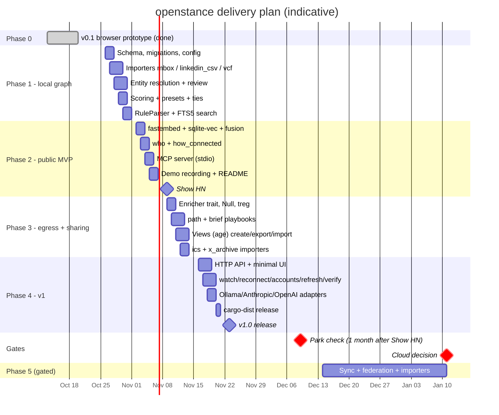
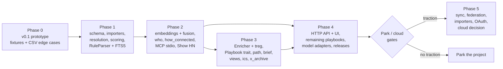

# Roadmap

This is the delivery plan for openstance: a local-first, open-source people-search engine that turns your exports (mail, LinkedIn, contacts, calendar, X) into one SQLite file you can search from a CLI, an MCP server, or a small local web UI.

The plan follows two sources. The [product overview](../product/vision.md) asks for an MVP in "about two weeks". The tech spec asks for four one-week milestones. They fit together like this: **Phase 1 and Phase 2 (weeks 1-2) are the public MVP and the Show HN launch. Phases 3 and 4 (weeks 3-4) finish the v1 feature set in public while launch feedback comes in.** Phase 5 starts only if the launch gains traction.

Related documents:

- Per-phase plans: [phase-1.md](phase-1.md), [phase-2.md](phase-2.md), [phase-3.md](phase-3.md), [phase-4.md](phase-4.md), [phase-5-and-beyond.md](phase-5-and-beyond.md)
- Launch plan: [launch.md](launch.md)
- Architecture: [overview](../architecture/overview.md), [crates and dependencies](../architecture/crates-and-dependencies.md)
- Targets that every phase is measured against: [performance targets](../engineering/performance-targets.md), [testing strategy](../engineering/testing-strategy.md)
- Open decisions, including the product name: [decisions](../decisions/README.md), [risks and open questions](../risks-and-open-questions.md)

---

## Phase overview

| Phase | Timebox | Theme | Headline deliverable | Primary crates touched | Public? |
|---|---|---|---|---|---|
| 0 | done | Prototype | v0.1 browser app (MIT, localStorage, CSV import, structured search, intro board). Kept as reference and fixture source, not the product. See [prototype-v0.1.md](../prototype-v0.1.md) | none (JS) | no |
| 1 | Week 1 | Local graph + CLI | `openstance import` of mbox, LinkedIn CSV, and vcf; entity resolution with `review`; explained scores with presets; `openstance search` with RuleParser + FTS5 | `openstance-core`, `openstance-import`, `openstance-model` (traits + Null/rules), `openstance` | repo can be public, not announced |
| 2 | Week 2 | Semantic search + agents = **public MVP** | fastembed embeddings + fusion, `who`, `how_connected`, `openstance mcp` (stdio), 60-second demo recording, **Show HN** | `openstance-model`, `openstance-core`, `openstance-mcp`, `openstance` | **launch** |
| 3 | Week 3 | Egress + sharing | `Enricher` trait with Null and treg, `path` and `brief` playbooks, `view create/export/import` (age), ics and x_archive importers | `openstance-enrich`, `openstance-core`, `openstance-import`, `openstance-mcp` | release |
| 4 | Week 4 | Surfaces + v1 release | `openstance serve` (HTTP API) + minimal UI, `watch` / `reconnect` / `accounts` / `refresh` / `verify` playbooks, Ollama/Anthropic/OpenAI parser and reranker, cargo-dist release binaries | `openstance-api`, `ui/`, `openstance-core`, `openstance-model`, CI | v1.0 release |
| 5 | post-launch, gated | Sync, teams, more sources | `openstance sync` over git/S3, team federation, whatsapp/slack/discord/telegram/notes/imap/pst importers, optional OAuth, then the cloud-tier decision | `openstance-core`, `openstance-import`, new sync module | gated on traction |

### Timeline

Dates are indicative and assume a start on Monday 2026-10-26 with one full-time maintainer. Slipping a week is acceptable. Changing the order is not, because each phase depends on the one before it.

---

## Dependencies between phases

What each phase needs from the one before it:

| Consumer | Needs from earlier phases | Why |
|---|---|---|
| Phase 2 fusion | `person_fts` (Phase 1), cached `person.score` (Phase 1) | Fusion multiplies the text rank by `(0.5 + 0.5 x score)` |
| Phase 2 `how_connected` | `tie` rows with `n_shared`, `weight`, `last_at` (Phase 1 rebuild) | Path strength = `my_score(mutual) x tie_weight(mutual, target)` |
| Phase 2 MCP | The JSON result types from Phase 1 search (`SearchResult`, `Evidence`, `ScoreBreakdown`) | One JSON shape on every surface, see [interfaces](../tech-spec/interfaces.md) |
| Phase 3 `path` / `brief` | `how_connected` (Phase 2), `who` evidence (Phase 2) | Playbooks reuse graph queries and add egress |
| Phase 3 views | Phase 1 search `Query` serialised to `query_json`; `do_not_share` override (Phase 1) | A view is a saved query materialised at export time |
| Phase 4 `watch` | Several `linkedin_csv` sources kept as separate `source` rows (Phase 1), `Enricher` (Phase 3) | Diff between the two most recent exports, plus profile checks |
| Phase 4 `refresh` / `verify` | `Enricher`, `quote`, `enrich_log`, budget enforcement (Phase 3) | These playbooks spend money |
| Phase 4 HTTP API / UI | Every core function and playbook (Phases 1-3) | The API is a thin layer over the same functions as the CLI |
| Phase 4 model adapters | `QueryParser` / `Reranker` traits and the Null implementations (Phases 1-2) | Adapters plug into existing traits; core does not change |
| Phase 5 sync | `.ost` view format and age keys (Phase 3) | Sync moves encrypted views around and nothing else |

Work that can run in parallel inside a phase is called out in each phase document. Across phases, the importer work (Phase 3 ics/x_archive, Phase 5 importers) only depends on the `Importer` and `Sink` traits being stable. Those traits are frozen at the end of Phase 1.

---

## What is out of scope, per phase

Scope cuts are part of the plan. Anything below that shows up in a PR during the named phase is deferred, however small it is.

| Phase | Explicitly out of scope |
|---|---|
| 1 | Embeddings, any model call, MCP, HTTP, enrichment or any network egress, views and sharing, ics / x_archive / whatsapp importers, email bodies (the `--bodies` flag exists only as a stub that errors with "not yet supported"), UI, release binaries (people build from source) |
| 2 | Enrichment and treg, playbooks other than `how_connected`, views, HTTP API, MCP over HTTP, LLM query parsing or reranking (RuleParser and the Null reranker only), Windows-specific packaging |
| 3 | HTTP API and UI, `watch` / `reconnect` / `accounts` / `refresh` / `verify`, OwnKeys enricher implementations beyond a stub, sync of views (`openstance sync`), LLM adapters |
| 4 | Sync, team federation, OAuth, live IMAP, whatsapp/slack/discord/telegram/notes/pst importers, mobile, any hosted service, Tauri desktop shell, SQLCipher builds (the flag may be documented, it is not tested in CI) |
| 5 | A hosted service of any kind before the cloud decision gate passes; a pooled multi-tenant contact database (never planned, see [pricing and cloud](../product/pricing-and-cloud.md)) |

Never in scope, in any phase:

- Network egress without a quote first and an `enrich_log` row (see [enrichment](../tech-spec/enrichment.md)).
- Telemetry or analytics calls from the binary. Launch metrics come from public signals only (see [launch.md](launch.md#metrics-to-watch)).
- Vendoring treg's skill file, or third-party promotion in `playbooks/*.md` skills.
- Copying Happenstance branding or copy, or building a parody of it. The comparison stays factual (see [competitive analysis](../product/competitive-analysis.md)).
- Open-ended agent loops. Playbooks have fixed step lists (see [playbooks](../tech-spec/playbooks.md)).

---

## Decision gates

There are three gates. Each one has a date, an owner (the maintainer), and a written outcome that goes into [decisions](../decisions/README.md) as an ADR.

### Gate A: launch readiness (end of Phase 2)

Show HN goes out only when every item below is true. The full checklist is in [launch.md](launch.md#launch-checklist).

- Phase 1 and Phase 2 exit criteria are met ([phase-1.md](phase-1.md#exit-criteria), [phase-2.md](phase-2.md#exit-criteria)).
- The 60-second demo recording runs on the synthetic fixtures with no API key and no network.
- Building from a clean macOS or Linux machine with `cargo install --git ...` works.
- The naming decision in ADR-0001 is either made or deliberately deferred. The launch posts use "openstance" unless ADR-0001 says otherwise.

### Gate B: park criterion (Show HN + 1 month)

Rule: **if there is no meaningful Show HN response within a month of launch, park the project.** "Park" means: freeze the repo with a clear status note in the README, keep the MIT release available, and stop feature work. It does not mean deleting anything.

"Meaningful response" is judged against the signals in [launch.md](launch.md#park-criterion). It is mostly about qualitative signs (strangers importing their own data and filing issues, people contributing importers) and much less about star counts. The proposed thresholds there are a starting point. They should be confirmed before launch so the call cannot be rationalised afterwards.

### Gate C: cloud decision (about 4 weeks after v1.0, only if Gate B passes)

The spec says: "After that, decide on cloud based on who shows up." The questions to answer, using what was learned from issues, discussions, and direct conversations with users:

| Question | Evidence that says "build cloud" | Evidence that says "stay OSS-only" |
|---|---|---|
| Do people run openstance on more than one device? | Repeated requests for sync; people sharing `rsync`/Syncthing hacks | Single-laptop usage dominates |
| Do people want agents to reach the graph while the laptop is closed? | Requests for claude.ai / ChatGPT connectors and phone agents | Stdio MCP in Claude Code / Cursor is enough |
| Do teams try federation over git/S3? | Several teams running Phase 5 federation | No team usage |
| Do people pay for enrichment? | Sustained use of treg / own keys with a budget | Enrichment stays off |

The outcome is one of: (1) build the cloud tier as scoped in [pricing and cloud](../product/pricing-and-cloud.md) and [phase-5-and-beyond.md](phase-5-and-beyond.md#cloud-tier-decision); (2) stay OSS-only and keep shipping importers; (3) park. Pricing numbers ($8/mo individual, $12/seat team, enrichment at cost plus a margin) are indicative only until this gate.

---

## Cross-cutting rules for every phase

1. **The graph is a pure function of sources plus overrides.** Any feature that writes derived data outside `rebuild` needs an ADR.
2. **Every phase ends with a tagged release** (`v0.2.0` after Phase 1, `v0.3.0` after Phase 2, and so on, with `v1.0.0` after Phase 4). Version numbers continue from the v0.1 prototype even though the Rust core replaces it.
3. **Schema changes are migrations** recorded in the `meta` table. No phase edits an already-released migration.
4. **The JSON shapes are a public contract from Phase 2 on.** A breaking change needs a version bump and a changelog entry.
5. **The performance targets are CI gates as soon as the feature they measure exists** (see [performance targets](../engineering/performance-targets.md)).
6. **Privacy defaults never change without an ADR:** email headers only, `enrich.backend = "none"`, `allow_egress_default = false`, `enrich.max_usd_per_run = 0.50`.

## Issue labelling

Every task in the phase documents has a stable ID in the form `P<phase>-<AREA>-<nn>` (for example `P1-CORE-07`). Use it as the GitHub issue title prefix. Labels: `phase-1` ... `phase-5`, the crate name (`core`, `import`, `enrich`, `model`, `mcp`, `api`, `cli`, `ui`, `ci`, `docs`), and `good-first-issue` for importer and fixture tasks.
