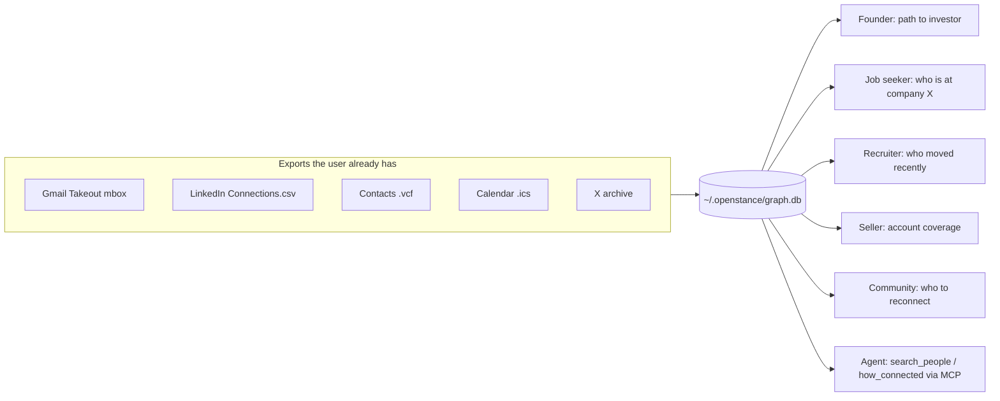

# Personas and use cases

> Status: accepted for v1 planning. Owner: product. Last reviewed: 2026-10-20.
> Read with [vision.md](vision.md). Commands and tool names follow [../tech-spec/interfaces.md](../tech-spec/interfaces.md); playbook steps follow [../tech-spec/playbooks.md](../tech-spec/playbooks.md).

The personas below are design targets, not research findings. No customer interviews have been run yet; the Phase 1/2 pilot (8 to 12 independent founders, ideally inside one community, 20 to 30 real questions each) is what validates or kills them. Each persona lists the **phase** in which its core job becomes possible, so the roadmap and the use cases stay in step.

## Summary

| Persona | Core job | Primary surface | Scoring preset | Core job available |
|---|---|---|---|---|
| Founder raising | Find warm paths to specific investors; brief the connector | CLI + Claude Code (MCP) | `founder` | Phase 2 (search, how_connected); Phase 3 (path, brief) |
| Job seeker | Find people at target companies and who can refer | CLI, later UI | `recruiter` or `founder` | Phase 2; Phase 4 (accounts, watch) |
| Recruiter | Map talent in own network, catch job changes | CLI + UI | `recruiter` | Phase 2; Phase 4 (watch, refresh) |
| Seller | Warm coverage of a target account list | CLI + agent | `seller` | Phase 4 (accounts) |
| Community manager | Know who is in the community, connect members, re-engage | CLI + UI, shared views | `community` | Phase 3 (views); Phase 5 (federated team views) |
| AI agent | Answer people questions inside a larger task, without spending money unasked | MCP | inherits user config | Phase 2 |



## Persona 1: Founder raising

**Who.** Pre-seed to Series A founder, technical or not, running a raise or a hiring push. 2k to 20k people across Gmail, LinkedIn and calendar. Uses Claude Code or Cursor daily. Sensitive about uploading their investor and customer graph anywhere.

**Jobs to be done.**
- When I have a target investor list, I want to see which ones I can reach warmly and through whom, so I spend asks on the paths most likely to work.
- When I pick a connector, I want a short, factual brief (last thread, last meeting, mutuals) so the ask is easy to forward.
- When I am heads-down, I want to know which strong relationships are going cold, so I can reconnect before I need them.

**Example queries.**
```sh
openstance search "seed investors in devtools I've actually met" --met
openstance search "fintech founders who replied to me this year" --since 2026-01 --replied
openstance who "jane@acme.vc"                 # score components + evidence
openstance path "Priya Raman, Lightspeed"      # Phase 3; quotes egress if target not in graph
openstance brief 4182                          # 10-line markdown for the ask
openstance reconnect                           # Phase 4; zero cost
```

**Journey (Phase 2 MVP).**

```mermaid
sequenceDiagram
  actor F as Founder
  participant CLI as openstance CLI
  participant DB as graph.db
  F->>CLI: openstance init
  F->>CLI: openstance import takeout.mbox Connections.csv contacts.vcf
  CLI->>DB: sources, identities, interactions; resolve; score; index
  CLI-->>F: 6,412 people, 37 flagged merges
  F->>CLI: openstance review
  F->>CLI: openstance search "devtools investors I've met" --met
  CLI-->>F: ranked people + extracted filters + evidence lines
  F->>CLI: openstance who 4182
  CLI-->>F: R .71 F .42 C .80 M .49 B .50, last 3 interactions
  F->>CLI: (in Claude Code) "who can intro me to Lightspeed?"
  Note over CLI: search_people company=Lightspeed, then how_connected
```

**Acceptance (persona-level).** From a fresh install with three exports, the founder gets a useful investor shortlist in under 5 minutes, each result shows why it matched (fields + dated evidence), and nothing has left the machine.

## Persona 2: Job seeker

**Who.** Senior IC or manager looking for the next role. Network mostly in LinkedIn and a personal Gmail; strong ties at two or three former employers.

**Jobs to be done.**
- When I shortlist companies, I want to see who I know there now, who used to work there, and who is one hop away, so I ask for referrals from the right person.
- When an old colleague changes jobs, I want to notice, because their new company may be hiring.

**Example queries.**
```sh
openstance search "engineering managers at Stripe or Plaid" --company stripe --company plaid
openstance search "people I lost touch with who are now at Anthropic" --company anthropic
openstance accounts target-companies.txt      # Phase 4: current / alumni / one-hop coverage table
openstance watch                              # Phase 4: diff the latest two LinkedIn exports
```

**Notes.** "Lost touch" maps to the `lost_touch` filter (high frequency, low recency). Job-change detection works from keeping every LinkedIn export as its own `source`; the periodic profile check on the top 100 is egress and is quoted first.

## Persona 3: Recruiter

**Who.** In-house or agency recruiter, or a founder doing their own hiring. Large, shallow LinkedIn network, many one-off email threads with candidates.

**Jobs to be done.**
- When I open a role, I want candidates from my own network ranked by relationship, not by keyword alone.
- When profiles are stale, I want to refresh only the ones worth refreshing, with the cost shown first.
- When someone I placed or courted moves company, I want to know.

**Example queries.**
```sh
openstance search "senior rust engineers in Berlin" --title engineer --location berlin
openstance search "designers I interviewed in 2025" --since 2025-01 --until 2025-12
openstance refresh                            # Phase 4: people with empty title/company and 5+ interactions; quote first
openstance export --format csv > shortlist.csv
```

**Preset.** `recruiter` weights recency and breadth (R .35 F .20 C .15 M .10 B .20) because reachability across channels matters more than meeting history. See [../tech-spec/scoring.md](../tech-spec/scoring.md).

## Persona 4: Seller

**Who.** Founder-led sales or an early AE with a target account list of 50 to 500 companies.

**Jobs to be done.**
- When I get a target account list, I want a warm-coverage table (current employees I know, alumni, one-hop paths) so I prioritize accounts where I have an in.
- Before I send, I want a verified email and the mutual who replied to me most recently.

**Example queries.**
```sh
openstance accounts fortune500-fintech.txt --json > coverage.json   # zero egress
openstance search "VP engineering at companies in coverage.json"
openstance verify 9127                        # Phase 4; one verify call, quoted
```

**Preset.** `seller` weights reciprocity and meetings (R .25 F .15 C .30 M .25 B .05).

## Persona 5: Community manager

**Who.** Runs a founder community, an accelerator cohort, a Slack or Discord with a few hundred to a few thousand members. Wants to connect members, not hoard a graph.

**Jobs to be done.**
- When a member asks "does anyone know someone at X?", I want to answer quickly without exposing everyone's contacts.
- When I curate an intro list (for a demo day, an investor dinner), I want to share exactly that slice, read-only, with an expiry.
- When engagement drops, I want a list of high-history, decaying relationships to re-engage.

**Example queries.**
```sh
openstance search "climate founders in the 2025 cohort" --tag cohort-2025
openstance view create climate-investors --query '{"text":"climate investors","met_in_person":true}' --ttl 30d --to age1...
openstance view export climate-investors > climate-investors.ost
openstance reconnect
```

**Notes.** Views exclude anyone flagged `do_not_share` and contain no interaction rows: recipients get the person, the score bucket and last-contact month, never email subjects ([../tech-spec/sharing-and-views.md](../tech-spec/sharing-and-views.md)). Federated team search across members' views is Phase 5 and is the only "group" story; there is no pooled database.

**Preset.** `community` emphasizes frequency over recency (R .15 F .40 C .25 M .10 B .10).

## Persona 6: AI agents as users

**Who.** Claude Code, Cursor, ChatGPT/claude.ai connectors and other MCP clients acting for one of the personas above. Agents are a first-class user: they call more often than humans, chain tools, and must never spend the user's money without permission.

**What an agent needs from openstance.**
- Stable tool names and one JSON shape (the same as `openstance search --json`).
- Structured, checkable evidence it can quote, so it does not invent relationships.
- A safe default: every money-spending tool takes `allow_egress` (default `false`) and `max_usd`, and returns a quote instead of running when egress is not allowed.
- A skill file per playbook in `playbooks/` that says when to call which tool. The skill text contains no third-party promotion.

**Canonical tools** (full schemas in [../tech-spec/interfaces.md](../tech-spec/interfaces.md)):

| Tool | Typical agent use | Spends money |
|---|---|---|
| `search_people` | "who do I know at Stripe", "fintech founders I met" | no |
| `get_person` | expand a result: identities, recent interactions, mutuals | no |
| `how_connected` | top 3 paths with evidence to someone in the graph | no |
| `path_to` | path to a stranger; may look up employers/school | yes, gated |
| `brief` | 10-line markdown for an intro ask | optional web search, gated |
| `list_views` / `search_view` | query a shared view someone sent | no |
| `quote_enrich` | price an enrichment before asking the user | no (returns a quote) |

There is deliberately no `who_knows` tool. "Who knows someone at Stripe?" is `search_people` with `company: ["stripe"]` followed by `how_connected` on the results.

**Example agent transcript (Claude Code, Phase 3).**

```text
User: Find me a warm intro to someone on the payments team at Stripe.

-> search_people {"text":"payments", "company":["stripe"], "limit":10}
<- 3 people in graph; top: id 2231 "Alex Kim, Payments PM, Stripe", score 0.41, evidence: ...
-> how_connected {"target":"2231"}
<- path 1: you -> Dana Lee (score 0.82) -> Alex Kim (tie: 6 shared threads, last 2026-08-14)
-> brief {"person":"2231"}
<- markdown brief (no egress; allow_egress=false, web step skipped)

Agent: Dana Lee is your strongest path (you emailed 14 times this year, she replies; she and
Alex share 6 threads, latest 2026-08-14 "Q3 payments review"). Draft ask below.
I can also look up Alex's recent public posts for about $0.01. Want me to?
```

If the user says yes, the agent re-calls `brief` with `web: true, allow_egress: true, max_usd: 0.05`; the call and its cost are written to `enrich_log`.

## Cross-cutting use cases

| ID | Use case | Steps | Egress | Phase |
|---|---|---|---|---|
| UC-1 | Import and first search | `init`, `import <files>`, `search` | none | 1 |
| UC-2 | Review flagged merges | `review`, `merge`, `split` | none | 1 |
| UC-3 | Correct a person | `edit <id> --title ... --tag ... --no-share --no-enrich`; survives `rebuild` | none | 1 |
| UC-4 | Explain one relationship | `who <id>`: components R F C M B, evidence | none | 2 |
| UC-5 | Who knows someone at a company | `search --company X`, then `how_connected` | none | 2 |
| UC-6 | Path to a stranger | `path "<name, company>"`; quote, confirm, run | profile, find, verify (quoted) | 3 |
| UC-7 | Intro brief | `brief <id>` | optional web search (quoted) | 3 |
| UC-8 | Share a slice | `view create`, `view export`, recipient `view import` | none | 3 |
| UC-9 | Account mapping | `accounts companies.txt` | none | 4 |
| UC-10 | Stale-row refresh | `refresh`; quote, budget cap | n profiles (quoted, capped) | 4 |
| UC-11 | Job-change watch | `watch` | up to 100 profiles (quoted) | 4 |
| UC-12 | Reconnect digest | `reconnect` | none | 4 |
| UC-13 | Verify before send | `verify <id>` | 1 verify (quoted) | 4 |
| UC-14 | Leave with everything | `export --format csv|json|vcf|parquet`, or copy `graph.db` | none | 1 |

## Anti-use-cases

openstance is not built for, and the docs should not advertise:

- Finding strangers' personal contact details at scale (it is not a data vendor; egress is per-call, user-initiated, and capped).
- Mass outreach or sending email on the user's behalf.
- Monitoring individuals. `watch` only diffs the user's own exports and checks the user's own top contacts, quoted.
- Treating a LinkedIn connection or a cc as consent to be introduced. A path is evidence of reachability, not willingness; the user still asks the connector.

## Related documents

- [vision.md](vision.md), [competitive-analysis.md](competitive-analysis.md), [pricing-and-cloud.md](pricing-and-cloud.md)
- [../tech-spec/search.md](../tech-spec/search.md), [../tech-spec/playbooks.md](../tech-spec/playbooks.md), [../tech-spec/sharing-and-views.md](../tech-spec/sharing-and-views.md)
- [../plan/roadmap.md](../plan/roadmap.md)
