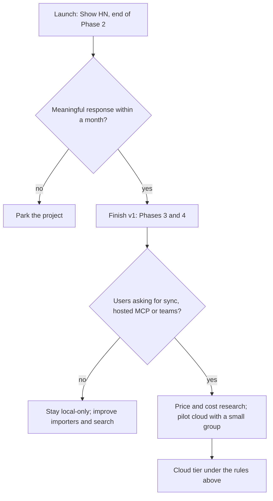

# Pricing and cloud

> Status: **proposal**. Nothing here is built before Phase 5, and the cloud tier itself is gated on post-launch traction ([../plan/phase-5-and-beyond.md](../plan/phase-5-and-beyond.md)). Prices are indicative, not researched; no revenue or margin projection is justified yet. Owner: product. Last reviewed: 2026-10-20.

## Model in one paragraph

Follow the open-source pattern that has worked for products like Plausible, Cal.com and Immich: make the thing the incumbent meters structurally free, own the data format, and sell only the parts that are genuinely painful to self-host. For openstance that means **search, the file, every importer, scoring, playbooks, MCP, CLI and HTTP API are free forever**. A future cloud tier sells convenience: encrypted multi-device sync, hosted endpoints that work while the laptop is closed, hosted view sharing, team administration, scheduled playbooks, managed OAuth connectors and a managed enrichment wallet.

## Free versus paid

| Capability | Free (OSS, local) | openstance cloud (paid, proposed) |
|---|---|---|
| Search | Unlimited, offline, all filters, local embeddings | Same; no search metering in any tier |
| Importers | All built-in and community importers | Same |
| Scoring, resolution, overrides | All | Same |
| Playbooks | Run by hand: `path`, `brief`, `accounts`, `refresh`, `watch`, `reconnect`, `verify` | **Scheduled** playbooks (weekly reconnect digest, job-change watch, stale-row refresh) delivered to email or Slack |
| Agent access | `openstance mcp` (stdio) and `openstance serve` on `127.0.0.1:7411` | **Hosted MCP endpoint** so claude.ai, ChatGPT and phone agents can query without the laptop on (see constraint below) |
| Sync | Copy the file; or sync views over your own git remote / S3 bucket (Phase 5) | **End-to-end encrypted sync** of `graph.db` across devices; openstance cannot read it |
| Sharing | Views exported as age-encrypted `.ost` files with TTL | **Hosted view links** with TTL enforcement, revocation and an access log |
| Teams | Federated views over your own git/S3 remote (Phase 5) | **Team workspace**: federated search across members' shared views, SSO, admin, audit; still no pooled contact database |
| Live connectors | Bring your own OAuth app for Gmail/Outlook (Phase 5, optional); IMAP with app passwords | **Managed OAuth connectors** (openstance carries the Google/Microsoft app verification) |
| Enrichment | Bring your own treg key or provider keys (Clearbit, PDL, Apollo); openstance adds no markup | **Managed enrichment wallet** (below) |
| Models | Local embeddings and local models; your own API keys | Hosted rerank/explain for users who do not want to run a model |
| UI | Local web UI over the HTTP API | Web and mobile UI over the synced file |
| Export | `openstance export --format csv\|json\|vcf\|parquet`, always | Same, plus one-command full export of cloud data |

## Indicative prices

| Plan | Price | Includes |
|---|---|---|
| Local | **$0 forever** | Everything in the free column |
| Individual cloud | **$8 / month** (indicative) | E2E sync, hosted MCP, scheduled playbooks, managed connectors |
| Team | **$12 / seat / month** (indicative) | Individual cloud plus team workspace, SSO, admin, audit |
| Enrichment | Pay as you go | Prepaid wallet; per-call provider cost plus a small margin (margin is an open question) |

For reference, Happenstance Pro is listed at $24/person/month billed annually, with $30 monthly in its indexed pricing description, and API/MCP usage is billed in separate credits ([competitive-analysis.md](competitive-analysis.md)). The proposed cloud prices are lower because ingestion, scoring and search cost openstance nothing per query; they are not yet backed by demand or willingness-to-pay research. Before any price is published: interview pilot users, measure per-active-user infrastructure, storage, support and model costs, and revisit.

## Rules for the cloud tier

These keep the open-source pitch honest. A proposed cloud feature that breaks one of these rules is rejected.

1. **No feature works only in cloud except multi-device sync and hosted endpoints.** Anything that can run on the user's machine (search, playbooks, sharing, teams over git/S3) stays in the free binary. Cloud may make it scheduled, hosted or managed; it may not make it exclusive.
2. **The synced file is encrypted client-side.** openstance cloud stores ciphertext. Keys never leave the user's devices unless the user explicitly opts in to a feature that requires server-side access (see the hosted MCP constraint).
3. **Walk away in one command.** A cloud user can export everything and leave: `openstance export` plus `graph.db` itself. No export is ever paywalled.
4. **No search metering, ever.** Paid tiers charge for hosting, scheduling, management and outside data, never for queries over the user's own graph.
5. **No pooled contact database.** Team features federate over views each member chooses to share. There is no central table of everyone's contacts.
6. **Egress rules are identical to local.** `allow_egress` defaults to false, every egress is quoted first, per-run and per-person caps apply, `do_not_share` and `no_enrich` are always respected, and every call is logged ([../tech-spec/enrichment.md](../tech-spec/enrichment.md)).
7. **Prices are enforced server-side and shown before spending.** Budgets live where the money is spent, not only in the UI.

### Constraint: hosted MCP versus end-to-end encryption

A hosted MCP endpoint that answers queries while the laptop is off needs to read the graph, which conflicts with rule 2. Options, to be decided before building (tracked in [../risks-and-open-questions.md](../risks-and-open-questions.md)):

| Option | Privacy | Availability | Notes |
|---|---|---|---|
| A. Relay to the user's own device | Server never decrypts | Only while a device is online | Simplest honest option |
| B. Explicit opt-in server-side decryption of the user's graph, isolated per user | Server can read while serving | Always on | Must be a separate, clearly labeled consent; off by default |
| C. Hosted MCP over shared views only | Server holds only the view slices the user exported for that purpose | Always on | Narrower answers; consistent with "share slices, never the graph" |

Recommendation for the first cloud release: **A + C**, with B only if users ask for it and accept the tradeoff explicitly.

## Enrichment wallet

Enrichment is the only part of the product with a real per-call cost. It is off by default (`enrich.backend = "none"`).

**Bring your own key (free tier).** The user configures a backend (`treg` or `ownkeys`) with their own credentials. openstance quotes each call through `Enricher::quote`, enforces `enrich.max_usd_per_run` (default `0.50`), logs request and cost to `enrich_log`, and adds no markup. treg is one implementation of the `Enricher` trait, alongside `none` and own keys; openstance does not depend on it and does not promote it.

**Managed wallet (cloud).**

| Aspect | Proposal |
|---|---|
| Funding | Prepaid balance; top up in fixed amounts; no auto-recharge by default |
| Routing | Calls routed through a managed enricher backend at provider cost plus a small, published margin |
| Caps | Per-run cap (same as local), per-person cost cap, monthly cap; all user-set; hard stop at zero balance |
| Quotes | Same quote-before-call flow; agents receive a quote when `allow_egress` is false |
| Receipts | Per-call receipt (playbook, request kind, person id, cost) mirrored to the local `enrich_log` |
| Billing | One invoice across providers |
| Refunds | Failed or empty provider responses refunded to the wallet where the provider refunds us |
| Open | Margin percentage; minimum top-up; whether to pass provider price changes through automatically |

Example quote shown before a `path` run, in the shape returned by `quote_enrich` (schema in [../tech-spec/interfaces.md](../tech-spec/interfaces.md)):

```text
openstance path "Priya Raman, Lightspeed"
Target not in your graph. This playbook will make up to 3 outside calls:
  profile lookup   name=Priya Raman company=Lightspeed     $0.010
  find email       domain=lsvp.com                          $0.008
  verify email                                              $0.002
  total (max)                                               $0.020   budget $0.50
Sent to: <configured enricher>. Nothing else leaves this machine.
Proceed? [y/N]
```

The dollar figures above are illustrative only.

## Licensing and cost honesty

- The v0.1 prototype is MIT. The Rust core is planned as MIT as well; if a future server product needs a different licensing strategy, decide it **before** accepting outside contributions to that component. Existing MIT releases stay MIT. This is a product decision, not legal advice; see [../decisions/README.md](../decisions/README.md).
- Open source does not make compute, enrichment, security reviews or maintenance free. Track per-active-user infrastructure, model, enrichment, storage and support costs separately from day one of any cloud work.

## When to build the cloud tier

The cloud tier is a Phase 5 decision, not a v1 deliverable.



Signals that justify starting cloud work: repeated requests for multi-device sync or always-on agent access, at least one community or team willing to pilot federated views, and enrichment usage high enough that a wallet saves users real friction.

## Related documents

- [vision.md](vision.md), [competitive-analysis.md](competitive-analysis.md), [personas-and-use-cases.md](personas-and-use-cases.md)
- [../tech-spec/enrichment.md](../tech-spec/enrichment.md), [../tech-spec/sharing-and-views.md](../tech-spec/sharing-and-views.md), [../tech-spec/configuration.md](../tech-spec/configuration.md)
- [../plan/phase-5-and-beyond.md](../plan/phase-5-and-beyond.md), [../risks-and-open-questions.md](../risks-and-open-questions.md)
