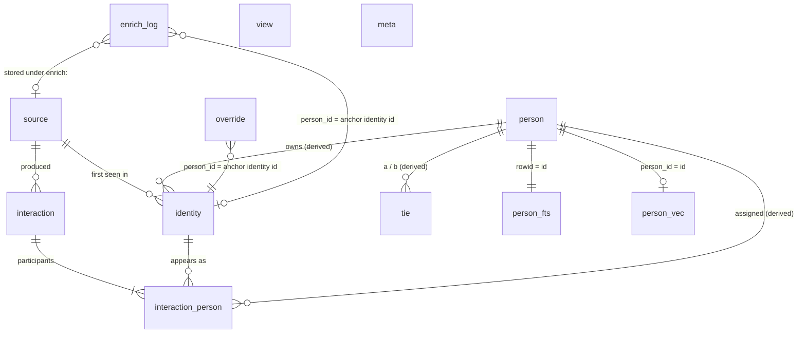
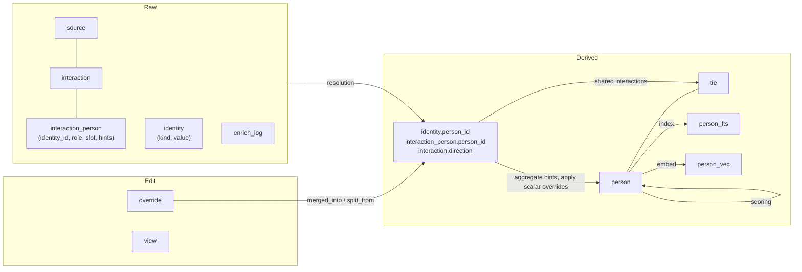

# Data model

Status: build-ready spec for Phase 1 (schema and migrations), extended in Phase 3 (`enrich_log`, `view`).
Owner crate: `openstance-core` (`crates/openstance-core/migrations/`, `crates/openstance-core/src/db/`).

Related: [ingestion.md](ingestion.md) (writes the raw tables), [entity-resolution.md](entity-resolution.md) (writes `person`, `identity.person_id`, `interaction_person.person_id`), [scoring.md](scoring.md) (score columns, `tie`), [search.md](search.md) (`person_fts`, `person_vec`), [enrichment.md](enrichment.md) (`enrich_log`), [sharing-and-views.md](sharing-and-views.md) (`view`, the `.ost` file schema), [configuration.md](configuration.md), [../architecture/data-flow.md](../architecture/data-flow.md), [../decisions/0003-sqlite-fts5-sqlite-vec.md](../decisions/0003-sqlite-fts5-sqlite-vec.md), [../decisions/0009-conservative-entity-resolution.md](../decisions/0009-conservative-entity-resolution.md).

---

## 1. Principles

One SQLite file per user, default `~/.openstance/graph.db`. Every column falls into one of three classes, and the class decides who may write it:

| Class | What it is | Who writes | Survives `openstance rebuild`? |
|---|---|---|---|
| **Raw** | What an export or an enrichment response said. | Importers (through the `Sink`), the enrichment gate. Insert-only. | Yes, never touched. |
| **Derived** | Anything computed from raw + overrides: people, assignments, ties, scores, search indexes. | Resolution, scoring and indexing passes only. | Deleted and recomputed. |
| **Edit** | The user's corrections: overrides, saved views. | `openstance edit/merge/split/review`, `view create`, HTTP `POST /edits`, MCP. | Yes, replayed on top of derived data. |

Four invariants follow and are enforced by tests (see [../engineering/testing-strategy.md](../engineering/testing-strategy.md)):

1. **Raw rows are immutable.** No code path issues `UPDATE` on a raw column. The only deletion of raw rows is the explicit `openstance source rm <id>` / `openstance import --replace <id>` (section 8) and `openstance enrich forget <person>`.
2. **Derived data is a pure function of raw rows + overrides + config.** `rebuild` twice gives byte-identical derived tables (property test). Incremental resolution after an import must equal a full rebuild (property test).
3. **Overrides always survive and always win.** Nothing but the user deletes an override row. A rebuild never loses an edit, and no importer or enricher writes a field that has an override.
4. **Nothing is stored that the user did not choose to import.** Email bodies, message text and DM content are never stored. With `import.email_bodies = true` bodies are read once to extract signature hints and then dropped (see [ingestion.md](ingestion.md#61-mbox-phase-1)).

### Differences from the original tech spec PDF

The PDF said "eight tables". The resolved schema is **nine regular tables** (`source`, `person`, `identity`, `interaction`, `interaction_person`, `tie`, `override`, `view`, `enrich_log`) plus two virtual tables (`person_fts`, `person_vec`) plus one housekeeping table (`meta`, holding the schema version and migration history). The fixes:

| # | PDF | Resolved | Why |
|---|---|---|---|
| a | 8 tables, no `enrich_log` DDL | `enrich_log` added | The PDF's enrichment section requires an audit table but never defined it. |
| b | "gets `kind='bulk'`" (person has no `kind`) | `person.is_bulk INTEGER NOT NULL DEFAULT 0` | Bulk is a person-level derived flag. Bulk people get score 0 and are excluded from search by default. |
| c | "every tie points at the source rows" with no table for it | Evidence is `interaction_person` joined on both people. `tie` stores `kind, weight, last_at, n_shared`. | No extra table, no duplication. |
| d | `exp(-days/half_life)` gives R = 0.37 at the half-life | `R = exp(-ln(2) * days_since_last / half_life_days)` | R = 0.5 at 180 days, so "half-life" means what it says. Owned by [scoring.md](scoring.md). |
| e | `override` PK `(person_id, field, value)` cannot express "change title twice" or "remove" | `id INTEGER PRIMARY KEY`, last-write-wins scalars, multi-valued rows, NULL tombstones | Section 4.7. |
| f | `person_fts ... content=''` (contentless) | Regular, content-storing FTS5 keyed by `rowid = person.id` | Contentless tables cannot be updated row by row or return column values for highlighting. |
| g | Default weights `[0.35, 0.20, 0.25, 0.15, 0.05]` | Unchanged. Presets as in [scoring.md](scoring.md). | |

Further additions that the PDF did not specify, needed to make "rebuild is a pure function of sources" actually hold:

- `interaction_person.identity_id` (raw) and `interaction_person.slot`: participants are stored by **handle**, not by person, so the person assignment can be recomputed. Two handles in the same `slot` of one interaction are asserted by the source to be the same human (one vCard, one LinkedIn connection row).
- `interaction_person.*_hint` columns: the name, title, company and location the source showed **for that participant in that record**. Person fields are aggregated from these at rebuild time, so re-importing or removing a source never leaves stale values behind.
- `interaction.kind = 'contact'`: a vCard or CSV row is stored as a zero-weight `contact` interaction so its handles and hints have a raw home. `contact` rows never count toward any score component and never create ties.
- `interaction.dir_hint` (raw) vs `interaction.direction` (derived), `interaction.thread_key`, `interaction.list_unsub`.
- `identity.match_rule` (derived): which resolution rule attached the identity, so `review` and `who` can explain it.
- `person.score_r .. score_b`, `is_self`, `n_interactions`: cached derived columns so the UI can show "why 0.81" without recomputation.
- **Stable person ids.** `person.id` is always the smallest `identity.id` in the person's cluster (the *anchor identity*). Overrides and `enrich_log` refer to people by this anchor id, so a reference stays valid after merges, splits and rebuilds (section 5).

---

## 2. Entity-relationship diagram



Data flow between the classes:



---

## 3. Full DDL

This is `crates/openstance-core/migrations/0001_init.sql`, except the `person_vec` block, which ships as `0002_vectors.sql` in Phase 2 together with the sqlite-vec extension ([../plan/phase-2.md](../plan/phase-2.md)). Connection-level pragmas are applied by the connection opener, not the migration (section 7).

```sql
-- ============================================================
-- openstance schema v1
-- Times are unix seconds (INTEGER, UTC). Booleans are INTEGER 0/1.
-- Money is integer micro-USD. JSON columns are TEXT (UTF-8 JSON).
-- ============================================================

-- ------------------------------------------------------------
-- Housekeeping: schema version, migration history, index fingerprints.
-- ------------------------------------------------------------
CREATE TABLE meta (
  key   TEXT PRIMARY KEY,
  value TEXT NOT NULL
) WITHOUT ROWID;
-- keys written by the migrator and passes:
--   schema_version            '1'
--   migration.0001_init       '<applied_at unix seconds>:<blake3 of sql>'
--   created_by                'openstance 0.2.0'
--   embedder_id               'fastembed:bge-small-en-v1.5'
--   embedder_dims             '384'
--   embedder_state            'ready' | 'building'   (see models.md)
--   scored_at                 '<unix seconds>'       (see scoring.md)
--   score_config_hash         '<blake3 of effective [score] config>'
--   normalizer_version        '1'   (see entity-resolution.md)
--   last_rebuild_at           '<unix seconds>'
--   self_identity_ids         '[12, 873]'  (derived cache, see section 4.3)

-- ------------------------------------------------------------
-- RAW: where data came from. One row per import run or enrichment run.
-- ------------------------------------------------------------
CREATE TABLE source (
  id               INTEGER PRIMARY KEY,
  kind             TEXT    NOT NULL,     -- mbox | imap | linkedin_csv | x_archive | vcf | ics
                                         -- | whatsapp | csv | enrich:<backend>
  label            TEXT,                 -- 'work gmail', 'linkedin 2026-10'
  path             TEXT,                 -- path as given on the command line (display only)
  imported_at      INTEGER NOT NULL,
  file_hash        TEXT,                 -- 'blake3:<hex>'; NULL for imap and enrich:*
  importer_version INTEGER NOT NULL DEFAULT 1,
  stats_json       TEXT                  -- ImportStats, see ingestion.md
);
CREATE UNIQUE INDEX source_file_hash ON source(file_hash) WHERE file_hash IS NOT NULL;

-- ------------------------------------------------------------
-- RAW (+ derived columns): every handle that points at a human.
-- A pure dictionary of normalized handles; one row per (kind, value) ever seen.
-- ------------------------------------------------------------
CREATE TABLE identity (
  id          INTEGER PRIMARY KEY,
  kind        TEXT    NOT NULL CHECK (kind IN
                ('email','phone','linkedin_url','x_handle','x_user_id',
                 'ig_handle','name_company','name_local')),
  value       TEXT    NOT NULL,           -- normalized, see entity-resolution.md section 2
  source_id   INTEGER NOT NULL REFERENCES source(id),  -- first source that produced it
  -- derived (written only by resolution):
  person_id   INTEGER REFERENCES person(id) DEFERRABLE INITIALLY DEFERRED,
  confidence  REAL,                       -- confidence of the rule that attached it; 1.0 for the anchor
  match_rule  TEXT,                       -- anchor | exact | gmail_alias | name_company
                                          -- | name_thread | override | enrich
  UNIQUE (kind, value)
);
CREATE INDEX identity_person ON identity(person_id);

-- ------------------------------------------------------------
-- RAW (+ one derived column): an event between me and one or more people.
-- ------------------------------------------------------------
CREATE TABLE interaction (
  id          INTEGER PRIMARY KEY,
  source_id   INTEGER NOT NULL REFERENCES source(id),
  kind        TEXT    NOT NULL CHECK (kind IN
                ('email','meeting','dm','mention','follow','connection','contact')),
  at          INTEGER NOT NULL,           -- event time; for 'contact' the card REV or import time
  subject     TEXT,                       -- email subject, meeting title; never a body
  external_id TEXT    NOT NULL,           -- Message-ID, event UID[/RECURRENCE-ID], or a
                                          -- synthesized stable hash (ingestion.md section 5)
  thread_key  TEXT,                       -- Gmail X-GM-THRID, else root of References, else Message-ID;
                                          -- LinkedIn CONVERSATION ID; X conversationId
  dir_hint    TEXT CHECK (dir_hint IN ('in','out','mutual','none')),  -- importer's own knowledge
  list_unsub  INTEGER NOT NULL DEFAULT 0, -- 1 if List-Unsubscribe or Precedence: bulk|list|junk
  -- derived:
  direction   TEXT CHECK (direction IN ('in','out','mutual','none')),
  UNIQUE (source_id, external_id)
);
CREATE INDEX interaction_at        ON interaction(at);
CREATE INDEX interaction_global_id ON interaction(kind, external_id);   -- cross-source dedupe
CREATE INDEX interaction_thread    ON interaction(thread_key) WHERE thread_key IS NOT NULL;

-- ------------------------------------------------------------
-- RAW (+ one derived column): who took part, by handle.
-- ------------------------------------------------------------
CREATE TABLE interaction_person (
  interaction_id INTEGER NOT NULL REFERENCES interaction(id) ON DELETE CASCADE,
  identity_id    INTEGER NOT NULL REFERENCES identity(id),
  role           TEXT    NOT NULL CHECK (role IN
                   ('from','to','cc','bcc','attendee','organizer','sender','recipient',
                    'member','subject')),   -- 'subject' = the person a contact/connection/follow is about
  slot           INTEGER NOT NULL DEFAULT 0, -- same slot in one interaction = same human (source-asserted)
  name_hint      TEXT,                       -- display name as shown in this record
  title_hint     TEXT,
  company_hint   TEXT,
  location_hint  TEXT,
  -- derived:
  person_id      INTEGER REFERENCES person(id) DEFERRABLE INITIALLY DEFERRED,
  PRIMARY KEY (interaction_id, identity_id, role)
) WITHOUT ROWID;
CREATE INDEX interaction_person_person   ON interaction_person(person_id, interaction_id);
CREATE INDEX interaction_person_identity ON interaction_person(identity_id);

-- ------------------------------------------------------------
-- DERIVED: one row per human after resolution. id = anchor identity id.
-- ------------------------------------------------------------
CREATE TABLE person (
  id             INTEGER PRIMARY KEY,       -- = MIN(identity.id) of the cluster, never AUTOINCREMENT
  display_name   TEXT,
  title          TEXT,
  company        TEXT,
  location       TEXT,
  bio            TEXT,
  first_seen     INTEGER,                   -- earliest interaction.at (contact rows excluded)
  last_contact   INTEGER,                   -- latest interaction.at with direction in/out/mutual
  n_interactions INTEGER NOT NULL DEFAULT 0,
  score          REAL    NOT NULL DEFAULT 0, -- weighted sum, see scoring.md
  score_r        REAL    NOT NULL DEFAULT 0, -- recency      [0,1]
  score_f        REAL    NOT NULL DEFAULT 0, -- frequency    [0,1]
  score_c        REAL    NOT NULL DEFAULT 0, -- reciprocity  [0,1]
  score_m        REAL    NOT NULL DEFAULT 0, -- meetings     [0,1]
  score_b        REAL    NOT NULL DEFAULT 0, -- breadth      [0,1]
  is_bulk        INTEGER NOT NULL DEFAULT 0, -- newsletter / bulk sender: score 0, hidden from search
  is_self        INTEGER NOT NULL DEFAULT 0, -- the user; never in results, never in ties
  do_not_share   INTEGER NOT NULL DEFAULT 0, -- materialized from override
  no_enrich      INTEGER NOT NULL DEFAULT 0  -- materialized from override
);
CREATE INDEX person_score        ON person(score DESC);
CREATE INDEX person_last_contact ON person(last_contact DESC);
CREATE INDEX person_company      ON person(company COLLATE NOCASE);

-- ------------------------------------------------------------
-- DERIVED: person <-> person edges from shared interactions.
-- Evidence = interactions where both a and b appear in interaction_person.
-- ------------------------------------------------------------
CREATE TABLE tie (
  a        INTEGER NOT NULL REFERENCES person(id) DEFERRABLE INITIALLY DEFERRED,
  b        INTEGER NOT NULL REFERENCES person(id) DEFERRABLE INITIALLY DEFERRED,
  kind     TEXT    NOT NULL CHECK (kind IN ('email','meeting','dm')),
  weight   REAL    NOT NULL,   -- [0,1]: 1 - exp(-D / tie_scale), D = decay-weighted shared count; see scoring.md
  last_at  INTEGER NOT NULL,   -- most recent shared interaction
  n_shared INTEGER NOT NULL,   -- count of shared interactions of this kind
  PRIMARY KEY (a, b, kind),
  CHECK (a < b)
) WITHOUT ROWID;
CREATE INDEX tie_b ON tie(b);  -- tie(a) is served by the primary key prefix

-- ------------------------------------------------------------
-- EDIT: user corrections that survive rebuilds.
-- person_id is an ANCHOR IDENTITY ID (see section 5), deliberately not a FK to person.
-- ------------------------------------------------------------
CREATE TABLE override (
  id        INTEGER PRIMARY KEY,
  person_id INTEGER NOT NULL,
  field     TEXT    NOT NULL CHECK (field IN
              ('display_name','title','company','location','bio','do_not_share','no_enrich',
               'is_bulk',                                       -- scalars
               'tag','note','merged_into','split_from')),        -- multi-valued
  value     TEXT,          -- NULL = tombstone (scalars only)
  set_at    INTEGER NOT NULL
);
CREATE INDEX override_person ON override(person_id, field, set_at);
CREATE INDEX override_field  ON override(field);
CREATE UNIQUE INDEX override_multi_unique ON override(person_id, field, value)
  WHERE field IN ('tag','merged_into','split_from');

-- ------------------------------------------------------------
-- EDIT: saved queries, the unit of sharing. See sharing-and-views.md.
-- ------------------------------------------------------------
CREATE TABLE view (
  id               INTEGER PRIMARY KEY,
  name             TEXT    NOT NULL UNIQUE,
  view_id          TEXT    UNIQUE,     -- ULID, assigned on first export; meta.view_id in the .ost file
  query_json       TEXT    NOT NULL,   -- serialized Query, see search.md
  created_at       INTEGER NOT NULL,
  expires_at       INTEGER,            -- NULL = no TTL
  recipient_pubkey TEXT,               -- age X25519 recipients ('age1...'), newline-separated
  origin           TEXT    NOT NULL DEFAULT 'local' CHECK (origin IN ('local','imported')),
  owner_pubkey     TEXT,               -- for imported views
  file_path        TEXT,               -- for imported views: decrypted copy under ~/.openstance/views/
  last_exported_at INTEGER
);

-- ------------------------------------------------------------
-- RAW: audit of every request that left the machine. Written by the egress gate.
-- Column semantics are owned by enrichment.md section 6.
-- person_id is an ANCHOR IDENTITY ID, deliberately not a FK to person.
-- ------------------------------------------------------------
CREATE TABLE enrich_log (
  id               INTEGER PRIMARY KEY,
  run_id           TEXT    NOT NULL,   -- ULID, one per playbook invocation
  at               INTEGER NOT NULL,
  backend          TEXT    NOT NULL,   -- 'treg' | 'ownkeys' | 'mock' | 'model:<provider>'
  provider         TEXT,
  playbook         TEXT,               -- 'path' | 'refresh' | ... | 'quote_enrich'
  person_id        INTEGER,            -- NULL for company / web search
  op               TEXT    NOT NULL,   -- 'profile' | 'find_email' | 'verify_email' | 'company' | 'web_search'
                                       -- | 'parse' | 'rerank' | 'embed' (hosted model calls)
  request_json     TEXT    NOT NULL,   -- exactly the outbound fields
  quoted_micro_usd INTEGER NOT NULL,
  cost_micro_usd   INTEGER,
  status           TEXT    NOT NULL CHECK (status IN
                     ('quoted','sent','ok','not_found','error','blocked')),  -- schema v3
  error            TEXT,
  source_id        INTEGER REFERENCES source(id),
  response_json    TEXT                -- normalized EnrichData; replayed by rebuild
);
CREATE INDEX enrich_log_run    ON enrich_log(run_id);
CREATE INDEX enrich_log_person ON enrich_log(person_id);
CREATE INDEX enrich_log_at     ON enrich_log(at);

-- ------------------------------------------------------------
-- DERIVED: search indexes.
-- Regular (content-storing) FTS5, rowid = person.id. Updated by delete+insert
-- whenever a person row changes; fully rebuilt by `openstance rebuild`.
-- ------------------------------------------------------------
CREATE VIRTUAL TABLE person_fts USING fts5(
  display_name, title, company, location, bio,
  tags,        -- space-joined override tags
  handles,     -- emails, linkedin slugs, x handles (so 'stripe.com' and 'jdoe' match)
  subjects,    -- space-joined bag of interaction subjects, newest first, capped (section 4.10)
  tokenize = 'unicode61 remove_diacritics 2',
  prefix = '2 3'
);

-- 0002_vectors.sql (Phase 2). sqlite-vec. Dimension comes from meta.embedder_dims at creation time; changing the
-- embedder drops and recreates this table (see models.md). '+text_hash' is an auxiliary
-- column (sqlite-vec >= 0.1.6) used to skip re-embedding unchanged people.
CREATE VIRTUAL TABLE person_vec USING vec0(
  person_id INTEGER PRIMARY KEY,
  embedding float[384],
  +text_hash TEXT
);

INSERT INTO meta(key, value) VALUES ('schema_version', '1'), ('normalizer_version', '1');
```

Notes on the DDL:

- **Notes are not in `person_fts`.** Override notes are free prose and often negative ("not an investor"); the v0.1 prototype excluded notes from retrieval for exactly this reason and has a test for it. Notes are shown in `who`/`get_person`, never matched. See [../prototype-v0.1.md](../prototype-v0.1.md).
- **Deferred foreign keys to `person`.** A rebuild deletes and reinserts `person` inside one transaction; deferred FKs are checked only at `COMMIT`.
- **No FK from `override` or `enrich_log` to `person`.** Both store an anchor identity id, which keeps resolving to the right person after merges (section 5). An FK to `person.id` would break when a merge removes the absorbed person's row.
- `WITHOUT ROWID` on `interaction_person` and `tie`: their primary keys are their access paths, which saves one B-tree each.

---

## 4. Table reference

### 4.1 `source` (raw)

| Column | Type | Null | Meaning |
|---|---|---|---|
| `id` | INTEGER PK | no | |
| `kind` | TEXT | no | Importer `kind()` string, or `enrich:<backend>` for enrichment runs. |
| `label` | TEXT | yes | Human label. Default: `<kind> <yyyy-mm-dd>`; `--label` overrides. |
| `path` | TEXT | yes | Path as given. Display only; never re-read automatically. |
| `imported_at` | INTEGER | no | When the import committed. |
| `file_hash` | TEXT | yes | `blake3:<hex>` of the input file (or of the zip as a whole). Unique: re-importing the same bytes is a no-op. |
| `importer_version` | INTEGER | no | Bumped by an importer when its output changes; `openstance doctor` lists sources imported by an older version and suggests `import --replace`. |
| `stats_json` | TEXT | yes | `ImportStats` from [ingestion.md](ingestion.md#3-traits-and-record-types). |

Each LinkedIn export is its own source row, kept forever; the `watch` playbook diffs the two most recent (see [playbooks.md](playbooks.md)).

### 4.2 `identity` (raw dictionary + derived assignment)

| Column | Class | Meaning |
|---|---|---|
| `kind` | raw | See the kind table below. |
| `value` | raw | Normalized form (lowercased email, E.164 phone, LinkedIn slug, ...). Rules in [entity-resolution.md](entity-resolution.md#2-normalization). Gmail aliasing is **not** applied here; it is a resolution rule, so changing it never requires re-import. |
| `source_id` | raw | First source that produced this handle. Informational. |
| `person_id` | derived | The person this handle belongs to. |
| `confidence` | derived | 1.0 anchor/exact, 0.98 gmail alias, 0.85 name+company, 0.75 name+thread, 1.0 override, <= 0.9 enrich. |
| `match_rule` | derived | Which rule attached it; shown by `who` and `review`. |

Identity kinds:

| `kind` | `value` example | Produced by |
|---|---|---|
| `email` | `jane.doe@stripe.com` | mbox, imap, linkedin_csv (Email Address), vcf, ics, csv, enrich |
| `phone` | `+14155550123` (E.164) | vcf, whatsapp, csv |
| `linkedin_url` | `jane-doe-0a1b2c` (slug only) | linkedin_csv, vcf URL, csv, enrich |
| `x_handle` | `janedoe` (no `@`) | vcf/csv URLs, enrich |
| `x_user_id` | `123456789` | x_archive (the archive contains numeric ids, not handles) |
| `ig_handle` | `jane.doe` | vcf/csv URLs |
| `name_company` | `jane doe\|stripe` | csv rows with name + company and no other handle |
| `name_local` | `whatsapp\|jane doe` | Names that only exist inside one importer's world (WhatsApp senders not saved as a phone, CSV rows with a name only). Scoped by importer kind so the same name from two importers never collapses into one row. |

`UNIQUE(kind, value)` means the same handle seen in ten sources is one row. Every identity is referenced by at least one `interaction_person` row or one `enrich_log` response; `openstance gc` removes identities that are referenced by neither and not named by an override (after `source rm`).

### 4.3 `interaction` (raw + `direction`)

| Column | Class | Meaning |
|---|---|---|
| `kind` | raw | `email`, `meeting`, `dm`, `mention`, `follow`, `connection`, `contact`. |
| `at` | raw | Event time, UTC seconds. For `connection`, LinkedIn "Connected On" (date, midnight UTC). For `contact`, vCard `REV` or the import time. |
| `subject` | raw | Subject or meeting title only. Truncated to 512 chars. Never a body. |
| `external_id` | raw | Dedupe key, unique per source. See [ingestion.md](ingestion.md#5-dedupe). |
| `thread_key` | raw | Groups an email thread / conversation. Used for reciprocity ("thread they started") and the name+thread resolution rule. |
| `dir_hint` | raw | What the importer knew without knowing who "me" is (X `following.js` = out, `follower.js` = in, LinkedIn Invitations Direction). |
| `list_unsub` | raw | Bulk signal from headers. |
| `direction` | derived | Recomputed at rebuild: if a self identity has role `from`/`sender`/`organizer` -> `out`; else if a self identity is any other participant -> `in` (meetings -> `mutual`); else `dir_hint`; else `none`. |

**Self.** The user's own handles come from config `[me] identities = ["email:rohan@example.com", "linkedin_url:rohan-sharma"]`, plus auto-detection at first import (the `From` that dominates Gmail's `Sent` label; the LinkedIn profile owner from `Profile.csv`), which `openstance init`/first import proposes and writes to config after confirmation. The person cluster containing any self identity gets `is_self = 1`. The resolved ids are cached in `meta.self_identity_ids`. Key definition: [configuration.md](configuration.md).

**Global dedupe.** For `email` and `meeting`, `external_id` (Message-ID, event UID) is globally unique, so the Sink skips an interaction whose `(kind, external_id)` already exists in **any** source (index `interaction_global_id`). This prevents a Takeout mbox and a later IMAP sync from double-counting frequency.

### 4.4 `interaction_person` (raw + `person_id`)

| Column | Class | Meaning |
|---|---|---|
| `identity_id` | raw | The handle that appeared. |
| `role` | raw | `from`, `to`, `cc`, `bcc` (only in sent mail), `attendee`, `organizer`, `sender`, `recipient`, `member` (group DM), `subject` (the person a contact/connection/follow row is about). |
| `slot` | raw | Participant number within the interaction. Rows sharing `(interaction_id, slot)` are one human according to the source (one vCard with two emails and a phone = three rows, slot 0). |
| `*_hint` | raw | What this record showed for that participant: email display name, LinkedIn First+Last / Position / Company, vCard FN/TITLE/ORG/ADR locality. |
| `person_id` | derived | Copy of `identity.person_id`, denormalized so scoring, ties and evidence are single-index lookups. |

Tie evidence query (canonical, used by `how_connected`, `path`, `brief`):

```sql
SELECT i.id, i.kind, i.at, i.subject, i.source_id
FROM interaction_person x
JOIN interaction_person y ON y.interaction_id = x.interaction_id AND y.person_id = :b
JOIN interaction i        ON i.id = x.interaction_id
WHERE x.person_id = :a
  AND i.kind IN ('email','meeting','dm')
GROUP BY i.id
ORDER BY i.at DESC
LIMIT :n;
```

### 4.5 `person` (derived)

Field precedence when building a row (highest first), shared with [enrichment.md](enrichment.md#7-writing-results-without-clobbering-edits):

1. `override` scalar for that field (latest `set_at`; tombstone removes the override).
2. `enrich:*` facts from `enrich_log.response_json`, newest first.
3. Importer hints from `interaction_person`, by source priority, then most recent.

Source priority for importer hints:

| Field | Priority (first non-empty wins, ties broken by latest `interaction.at`, then highest `interaction.id`) |
|---|---|
| `display_name` | linkedin_csv First+Last > vcf FN > csv name > ics CN > most frequent email display name with >= 2 tokens > whatsapp/name_local > prettified email local part (`jane.doe` -> `Jane Doe`) |
| `title` | linkedin_csv Position (latest export) > vcf TITLE > csv > email signature (opt-in) |
| `company` | linkedin_csv Company (latest export) > vcf ORG > csv > company name from a non-freemail email domain via the domain map |
| `location` | vcf ADR locality > csv > signature |
| `bio` | csv `notes`/`bio` column only. Never synthesized. |

`is_bulk`, `score*`, `first_seen`, `last_contact`, `n_interactions` are computed by [scoring.md](scoring.md); bulk people get `score = 0` and all components 0. `is_bulk` can be corrected with the `is_bulk` scalar override (`openstance edit <p> --not-bulk`).

### 4.6 `tie` (derived)

One row per unordered pair and channel, `a < b`. Derived from interactions of kind `email`, `meeting`, `dm` where both people appear. Excluded: self, bulk people, and interactions with more than `score.tie_max_participants` (default 20) people, so an all-hands invite or a 300-person cc does not tie everyone together. `weight = 1 - exp(-D / tie_scale)` where `D = sum(exp(-ln2 * days_since(at) / half_life_days))` over shared interactions, so weight is in [0, 1]; `n_shared` is the plain count. Formula ownership: [scoring.md](scoring.md#82-weight).

LinkedIn exports contain no mutual-connection data, so there is no `linkedin_mutual` tie kind; the PDF's mention of it is dropped.

### 4.7 `override` (edit)

`id INTEGER PRIMARY KEY, person_id, field, value, set_at`.

| Field | Kind | Value | Semantics |
|---|---|---|---|
| `display_name`, `title`, `company`, `location`, `bio` | scalar | text; `''` = explicitly empty | Latest `set_at` wins (ties: higher `id`). |
| `do_not_share`, `no_enrich`, `is_bulk` | scalar | `'1'` / `'0'` | Same. |
| `tag` | multi | tag text, lowercased | Every row applies. Remove = `DELETE` the row. |
| `note` | multi | free text | Every row applies, shown newest first. Remove = `DELETE`. |
| `merged_into` | multi | anchor id of the other person | Must-link constraint. Remove = `DELETE` (that is "unmerge"). |
| `split_from` | multi | anchor id of the other side | Cannot-link constraint. Remove = `DELETE`. |

Scalar removal is an insert, not a delete: a row with `value IS NULL` and a newer `set_at` is a tombstone that means "no override; fall back to derived". This keeps scalar history auditable (`openstance edit <p> --history`). An empty string is different: it means "this field is empty on purpose", which also blocks enrichment from filling it.

Resolving a scalar:

```sql
SELECT value FROM override
WHERE person_id IN (/* every identity id in the person's cluster */) AND field = :field
ORDER BY set_at DESC, id DESC
LIMIT 1;           -- NULL value or no row => use the derived value
```

The `IN (cluster identities)` is what makes overrides follow people through merges (section 5): an edit made on the absorbed person still applies, and when two merged people both have a `title` override, the newest wins.

One exception, for privacy: `do_not_share` and `no_enrich` take the latest value per anchor identity and are then OR'd across the cluster, so a merge can never silently clear a privacy flag. See [entity-resolution.md](entity-resolution.md#4-overrides).

### 4.8 `view` (edit)

Saved queries. `query_json` is the serialized `Query` from [search.md](search.md). `origin='imported'` rows point at decrypted view files received from others. Full semantics, the `.ost` file layout and TTL enforcement: [sharing-and-views.md](sharing-and-views.md).

### 4.9 `enrich_log` (raw)

One row per request that left the machine. Semantics owned by [enrichment.md](enrichment.md#6-enrich_log). `response_json` of `status='ok'` rows is replayed by rebuild as `enrich:*` facts (precedence level 2 in 4.5) and as enrichment identities (see [entity-resolution.md](entity-resolution.md#7-enrichment-identities)).

### 4.10 `person_fts` and `person_vec` (derived)

`person_fts` row for person `p`, `rowid = p.id`:

| Column | Content |
|---|---|
| `display_name`, `title`, `company`, `location`, `bio` | from `person` |
| `tags` | space-joined `tag` overrides |
| `handles` | space-joined emails (and their domains), LinkedIn slugs, X handles |
| `subjects` | distinct subjects of the person's `email`/`meeting`/`dm` interactions, newest first, capped at 200 subjects or 8 KB |

Maintenance: on any change to a person (import touching them, edit, merge, split) the writer runs `DELETE FROM person_fts WHERE rowid = :id; INSERT INTO person_fts(rowid, ...) VALUES (:id, ...)` in the same transaction. `openstance rebuild` does `DELETE FROM person_fts` and reinserts all. Bulk and self people are not indexed.

`person_vec`: one 384-d float vector per non-bulk, non-self person, from `display_name + title + company + bio + top 20 subjects`. `text_hash = blake3(text)`; the embed pass skips people whose hash is unchanged. If `meta.embedder_id` differs from the configured embedder, the table is dropped and recreated with the new dimension and every person is re-embedded. Embedding runs after the rebuild transaction commits, in batches of 256, each in its own transaction; search falls back to FTS-only for people without a vector. See [models.md](models.md) and [search.md](search.md).

---

## 5. Stable person ids (anchor identities)

`person.id = MIN(identity.id)` over the identities in the person's cluster. Identity ids are insert-only and never reused, so:

- A rebuild with the same sources and overrides yields the same person ids (required for idempotence).
- A new import that adds identities to an existing person never changes its id (new identity ids are larger).
- When two people merge, the merged person takes the smaller id. The larger id is no longer a person id, but it is still an identity id **inside** the merged cluster.
- Every place that stores a person reference outside the derived tables (`override.person_id`, `enrich_log.person_id`, ids held by MCP clients or scripts) stores an anchor identity id. Resolving it is always: "the person whose cluster contains identity `X`":

```sql
SELECT person_id FROM identity WHERE id = :ref;
```

So `openstance who 4021` keeps working after person 4021 is merged into 3990, and `get_person` returns `{"id": 3990, "resolved_from": 4021}`.

Split caveat: if the user splits a person and moves the anchor identity to the new side, the split command swaps the sides (keeps the anchor on the "original" side and moves the complement) so existing references keep pointing at the side the user thinks of as the original. Details in [entity-resolution.md](entity-resolution.md#9-merge-and-split-commands).

---

## 6. Size estimates

Reference graph (the PDF's heavy user): 20k people, 50k identities, 500k interactions, ~1.5M participant rows (mean 3 per interaction), 100k ties, 20k vectors.

| Object | Rows | Bytes/row (data + indexes, approx.) | Size |
|---|---|---|---|
| `interaction` | 500k | 90 data (subject ~45, external_id ~40) + 70 indexes | ~80 MB |
| `interaction_person` | 1.5M | 25 data (hints mostly NULL; email display names ~15) + 25 for two indexes | ~75 MB |
| `identity` | 50k | 60 + 40 | ~5 MB |
| `person` | 20k | 250 + 40 | ~6 MB |
| `tie` | 100k | 40 + 15 | ~6 MB |
| `override` | ~2k | 60 | <1 MB |
| `enrich_log` | ~5k | 1.5 KB (request + normalized response) | ~8 MB |
| `person_fts` | 20k | content (~4 KB with subjects) + inverted index | ~120 MB |
| `person_vec` | 20k | 384 x 4 + overhead | ~31 MB |
| **Total** | | | **~330 MB** (inside the PDF's 200 to 500 MB range) |

A typical user (3k people, 60k interactions) is ~40 MB. A WAL file can temporarily reach the size of one import's writes (a 5 GB mbox with 500k messages writes ~150 MB of WAL); it is truncated by `PRAGMA wal_checkpoint(TRUNCATE)` after each import.

Size levers if needed later: drop `person_fts` content to `content=person` external-content mode (saves ~20 MB; deferred because it complicates the `subjects`/`handles` synthesized columns), cap `subjects` lower, `int8` vectors.

---

## 7. Connection settings and transactions

Applied by `openstance_core::db::open()` on every connection:

```sql
PRAGMA journal_mode = WAL;
PRAGMA synchronous = NORMAL;
PRAGMA foreign_keys = ON;
PRAGMA busy_timeout = 5000;
PRAGMA temp_store = MEMORY;
PRAGMA mmap_size = 268435456;   -- 256 MB
PRAGMA cache_size = -65536;     -- 64 MB
```

- One writer at a time. Writers take `BEGIN IMMEDIATE`. `openstance serve` / `openstance mcp` hold read connections and see a consistent snapshot while an import runs.
- Each import is one transaction (raw rows + incremental resolution + scoring of touched people + FTS update). A crash or Ctrl-C rolls back the whole import; the `source` row is part of that transaction, so re-running is safe.
- `rebuild` is one transaction for everything except embedding (section 4.10).
- The database file and WAL are created with mode `0600`; `~/.openstance/` with `0700`.

---

## 8. Migrations

- Location: `crates/openstance-core/migrations/NNNN_name.sql`, embedded with `include_str!` into an ordered static list. Forward-only; there are no down migrations.
- On open: read `meta.schema_version` (absent = empty db). If the db version is **higher** than the binary's newest migration, refuse to open with `error: graph.db was written by a newer openstance (schema 4 > 3); upgrade the binary`. Read-only commands may proceed if the newer schema is marked additive-compatible (a `compat_read_min` key in `meta`).
- Before applying any migration to a non-empty db, copy `graph.db` to `graph.db.bak-v<old>` (using SQLite's backup API, not `cp`, so the WAL is included). Keep the two most recent backups.
- Each migration runs in its own transaction and, on success, writes `meta.schema_version` and `migration.NNNN_name = '<applied_at>:<blake3 of sql>'`. `PRAGMA user_version` mirrors `schema_version` for quick inspection with the sqlite3 CLI.
- A migration that changes derived tables only may simply drop and recreate them and set `meta.needs_rebuild = 1`; the next command runs `rebuild` before doing anything else.
- Changing a raw table requires a data-preserving migration and a test that loads a fixture db at the previous schema (stored under `fixtures/db/schema-vN.db`) and checks row counts and invariants after migration.
- CI check: the blake3 of every shipped migration file is pinned in `migrations/CHECKSUMS`; editing an already-released migration fails the build.

### Source removal and replacement

The two sanctioned raw deletions, both one transaction followed by a rebuild of affected people:

```
openstance source list
openstance source rm <id>               # delete the source's interactions (cascades interaction_person),
                                        # then gc unreferenced identities
openstance import <file> --replace <id> # same as rm + import, keeps the label; used after an importer fix
```

Overrides are untouched by both. `gc` never deletes an identity whose id is referenced by `override.person_id`, `override.value` (for `merged_into`/`split_from`) or `enrich_log.person_id`, so an edit can never lose its anchor. Such an identity with no remaining observations becomes a person of its own only if an override still names it; `openstance doctor` lists these "edit-only" people so the user can delete the stale edits.

---

## 9. Export and Parquet compatibility

`openstance export --format csv|json|vcf|parquet [--out DIR] [--include-raw]`.

The schema is designed so every table exports to Parquet without transformation, keeping the door open for DuckDB/Postgres analytics in a future team tier (see [../product/pricing-and-cloud.md](../product/pricing-and-cloud.md)):

- Only scalar column types: INTEGER -> `INT64`, REAL -> `DOUBLE`, TEXT -> `BYTE_ARRAY (UTF8)`. No SQLite-specific affinities are relied on.
- Times are UTC seconds; exported as `INT64` with logical type `TIMESTAMP(MILLIS, isAdjustedToUTC=true)` after multiplying by 1000, plus the original column kept as-is when `--raw-times`.
- Ids are stable integers (anchor ids), so joins across exported files work.
- JSON columns (`stats_json`, `query_json`, `request_json`, `response_json`) are exported as UTF8 strings; DuckDB reads them with `json_extract`.
- `person_vec.embedding` exports as `FIXED_SIZE_LIST<FLOAT, 384>` in a separate `person_vec.parquet`; `person_fts` is not exported (it is rebuildable).
- One file per table: `source.parquet`, `identity.parquet`, `interaction.parquet`, `interaction_person.parquet`, `person.parquet`, `tie.parquet`, `override.parquet`, `view.parquet`, `enrich_log.parquet`.
- Default export excludes `do_not_share` people from `person`, `identity`, `interaction_person` and `tie`, and excludes `enrich_log` unless `--include-raw`. `--all` includes everything (the user's own backup).
- Implementation: `arrow` + `parquet` crates behind the `parquet` cargo feature of the `openstance` binary, to keep the default binary under 40 MB (see [../engineering/performance-targets.md](../engineering/performance-targets.md)).

CSV export reuses the v0.1 prototype's formula-injection guard (cells starting with `= + - @` get a leading apostrophe). JSON export is the same shape as `get_person` ([interfaces.md](interfaces.md)). The plain SQLite file itself is the primary format: `cp ~/.openstance/graph.db backup.db` is a valid backup when no writer is running, `openstance backup <file>` uses the backup API otherwise.

---

## 10. Acceptance criteria (Phase 1)

- [ ] `openstance init` on an empty directory creates `graph.db` at schema 1, with mode 0600, and `meta.schema_version = '1'`.
- [ ] Opening a db with a higher schema version fails with the exact error above; with a lower one, it backs up and migrates.
- [ ] A grep-based CI test asserts no `UPDATE` statement in the codebase targets raw columns (`source.*`, `identity.kind/value/source_id`, `interaction.*` except `direction`, `interaction_person.*` except `person_id`, `enrich_log.*`).
- [ ] Property test (proptest, 200 cases over generated fixtures + override sequences): `rebuild(); dump(); rebuild(); dump()` gives identical dumps of all derived tables; incremental import then compare with full rebuild gives identical dumps.
- [ ] Override replay: a `title` override set on person B survives `merge A B` (when A is the anchor) and `rebuild`; a NULL tombstone restores the derived title; an `''` override yields an empty title even if LinkedIn provides one.
- [ ] `person_fts` row count equals non-bulk, non-self person count after rebuild and after every import.
- [ ] Exported Parquet files load in DuckDB (`SELECT count(*) FROM 'person.parquet'`) with matching row counts (CI job with DuckDB CLI).
- [ ] The reference fixture graph (synthetic, 20k people / 500k interactions, generated by `cargo xtask gen-graph`) is under 500 MB on disk.
