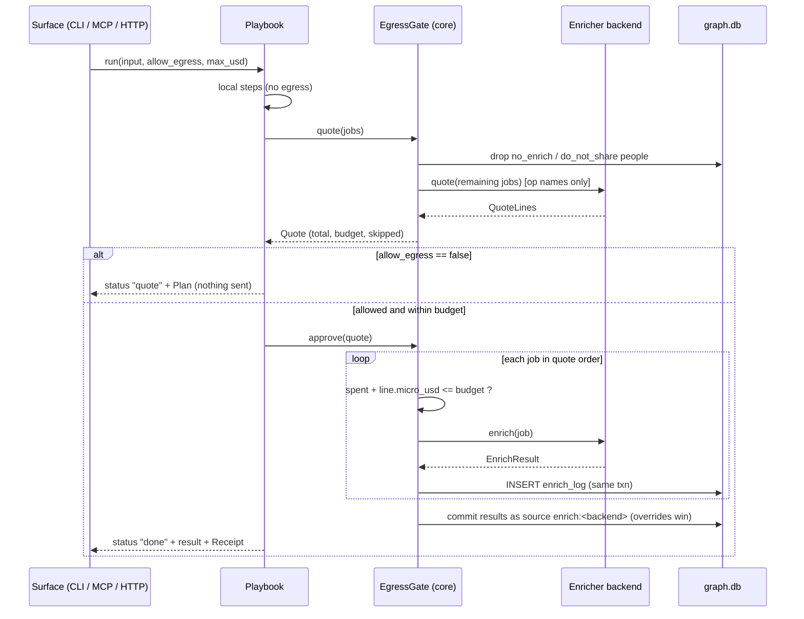

# Enrichment

Enrichment is the **only** path by which data about the user's contacts leaves the machine. It is off by default, every request is quoted before it is sent, every request that is sent is logged, and the rules that make this true live in `openstance-core`, not in the backends. A backend can be buggy or hostile; it still cannot spend more than the budget, touch a `no_enrich` person, or overwrite a user's edit.

Related: [playbooks.md](playbooks.md) (the only callers of enrichment), [configuration.md](configuration.md#enrich) (`[enrich]` keys), [interfaces.md](interfaces.md) (`quote_enrich`, `allow_egress`, `max_usd`), [data-model.md](data-model.md) (`enrich_log`, `source`), [../architecture/security-and-threat-model.md](../architecture/security-and-threat-model.md).

Lands in: **Phase 3** (trait, `Null`, `treg`, `MockEnricher`, `enrich_log`, and a compiled-out `OwnKeys` stub that reserves the config value). The full `OwnKeys` implementation is **unscheduled (after Phase 4)**. See [../plan/phase-3.md](../plan/phase-3.md) and [../plan/phase-4.md](../plan/phase-4.md).

---

## 1. Principles

| Rule | Where it is enforced |
| --- | --- |
| Enrichment is off unless `enrich.backend` is set to something other than `none`. | Config loader picks `NullEnricher`. |
| No request is sent without a quote first, and the quote total is shown to the caller. | `EgressGate::execute` refuses a request that has no matching quote line. |
| `allow_egress` defaults to `false` on every surface. When false, the caller gets the quote, not a result. | `EgressGate` + surfaces (CLI prompt, MCP/HTTP `status: "quote"`). |
| A per-run budget caps spend. Default `enrich.max_usd_per_run = 0.50`. | `EgressGate` aborts before the request that would cross it. |
| People flagged `no_enrich` are never sent, even by name. | Playbook planning filters them; `EgressGate` re-checks by `person_id`. |
| Every sent request and its cost are written to `enrich_log`. | `EgressGate`, in the same transaction as the result write. |
| Enrichment results never overwrite an `override`. | Resolution/field-precedence layer (see section 7). |
| Results are attributed to a `source` of kind `enrich:<backend>`, so a rebuild replays them and the user can see where a field came from. | `EgressGate::commit`. |

The model is "deterministic playbook, metered egress": there is no open-ended agent loop that decides to make more calls. Each playbook declares an egress maximum in its plan (see [playbooks.md](playbooks.md#9-egress-maximums-at-a-glance)).

---

## 2. Types

The trait and its data types live in the `openstance-enrich` trait crate, which core depends on with `default-features = false` (traits, types and `NullEnricher` only) and re-exports as `openstance_core::enrich`. Concrete backends sit behind cargo features of the same crate and are wired in by the binary, so core never depends on a concrete provider (see [../architecture/crates-and-dependencies.md](../architecture/crates-and-dependencies.md#2-dependency-direction)). Money is always integer **micro-USD** (`1 USD = 1_000_000`), never floats.

```rust
// openstance-enrich/src/lib.rs (re-exported as openstance_core::enrich)

pub type MicroUsd = u64;

/// One unit of outside work. Serialized with serde as {"kind": "...", ...fields}.
#[derive(Clone, Debug, Serialize, Deserialize, PartialEq, Eq, Hash)]
#[serde(tag = "kind", rename_all = "snake_case")]
pub enum EnrichRequest {
    /// Public professional profile: current employer, title, past employers, school, location.
    Profile { name: String, company: Option<String>, linkedin: Option<String> },
    /// Find a likely work email for a person at a domain.
    FindEmail { name: String, domain: String },
    /// Check deliverability of one address.
    VerifyEmail { email: String },
    /// Company facts by domain: canonical name, size, industry, location.
    Company { domain: String },
    /// Generic web search (used by `brief` for recent posts).
    WebSearch { query: String },
}

impl EnrichRequest {
    pub fn op(&self) -> &'static str; // "profile" | "find_email" | "verify_email" | "company" | "web_search"
    /// The exact fields that will leave the machine, for display and for enrich_log.
    pub fn outbound_fields(&self) -> Vec<(&'static str, String)>;
}

/// A request bound to the person it is about (None for Company/WebSearch not tied to a person).
#[derive(Clone, Debug, Serialize, Deserialize)]
pub struct EnrichJob {
    pub person_id: Option<i64>,
    pub request: EnrichRequest,
}

#[derive(Clone, Debug, Serialize, Deserialize)]
pub struct QuoteLine {
    pub job: EnrichJob,
    pub micro_usd: MicroUsd,
    /// "exact" when the backend publishes a per-call price; "estimate" when it is
    /// derived from user-configured prices (OwnKeys) or a range.
    pub basis: QuoteBasis,
    /// Optional, informational: which upstream provider the backend expects to route to.
    pub provider_hint: Option<String>,
}

#[derive(Clone, Copy, Debug, Serialize, Deserialize)]
#[serde(rename_all = "snake_case")]
pub enum QuoteBasis { Exact, Estimate, Free }

#[derive(Clone, Debug, Serialize, Deserialize)]
pub struct Quote {
    pub backend: String,            // "treg", "ownkeys", "none", "mock"
    pub lines: Vec<QuoteLine>,
    pub total_micro_usd: MicroUsd,
    pub budget_micro_usd: MicroUsd, // effective budget for this run (section 5)
    pub within_budget: bool,
    /// Jobs removed during planning, with the reason, so the user sees what was NOT sent.
    pub skipped: Vec<Skipped>,
    pub quoted_at: i64,             // unix seconds
}

#[derive(Clone, Debug, Serialize, Deserialize)]
pub struct Skipped { pub person_id: Option<i64>, pub op: String, pub reason: SkipReason }

#[derive(Clone, Copy, Debug, Serialize, Deserialize)]
#[serde(rename_all = "snake_case")]
pub enum SkipReason { NoEnrich, DoNotShare, LocalDataSufficient, OverBudget, BackendNone, Unsupported }

#[derive(Clone, Debug, Serialize, Deserialize)]
pub struct EnrichResult {
    pub job: EnrichJob,
    pub cost_micro_usd: MicroUsd,   // actual, as reported by the backend
    pub provider: Option<String>,
    pub data: EnrichData,
    pub fetched_at: i64,
}

#[derive(Clone, Debug, Serialize, Deserialize)]
#[serde(tag = "type", rename_all = "snake_case")]
pub enum EnrichData {
    Profile(ProfileData),
    Email { email: String, confidence: f32 },
    Verification { email: String, status: VerifyStatus },
    Company(CompanyData),
    WebHits { hits: Vec<WebHit> },
    NotFound,
}

#[derive(Clone, Debug, Default, Serialize, Deserialize)]
pub struct ProfileData {
    pub display_name: Option<String>,
    pub title: Option<String>,
    pub company: Option<String>,
    pub company_domain: Option<String>,
    pub location: Option<String>,
    pub linkedin: Option<String>,          // canonical slug
    pub past_companies: Vec<String>,
    pub schools: Vec<String>,
    pub headline: Option<String>,          // becomes `bio` only if bio is empty
}

#[derive(Clone, Copy, Debug, Serialize, Deserialize)]
#[serde(rename_all = "snake_case")]
pub enum VerifyStatus { Deliverable, Undeliverable, Risky, Unknown }

#[derive(Clone, Debug, Default, Serialize, Deserialize)]
pub struct CompanyData { pub name: Option<String>, pub domain: String, pub industry: Option<String>,
                         pub size: Option<String>, pub location: Option<String> }

#[derive(Clone, Debug, Serialize, Deserialize)]
pub struct WebHit { pub title: String, pub url: String, pub snippet: Option<String>, pub published: Option<String> }
```

### 2.1 The trait

```rust
pub trait Enricher: Send + Sync {
    /// Stable backend id, used in config, `source.kind = "enrich:<name>"` and enrich_log.
    fn name(&self) -> &'static str;

    /// Which ops this backend can serve; unsupported ops are skipped at planning time.
    fn supports(&self, op: &str) -> bool;

    /// Cost in micro-USD for each job, BEFORE any call. Must not send any contact data.
    /// A backend that needs a network round-trip to price (e.g. a price catalog) may fetch
    /// prices, but only op names, never names/emails/domains.
    fn quote(&self, jobs: &[EnrichJob]) -> Result<Vec<QuoteLine>, EnrichError>;

    /// Perform one job. Called only by EgressGate, never by playbooks directly.
    fn enrich(&self, job: &EnrichJob) -> Result<EnrichResult, EnrichError>;
}

#[derive(Debug, thiserror::Error)]
pub enum EnrichError {
    #[error("enrichment is off: set enrich.backend")] Disabled,
    #[error("enrichment backend is not configured: {0}")] Config(String),
    #[error("operation not supported by backend: {0}")] Unsupported(String),
    #[error("authentication failed: {0}")] Auth(String),
    #[error("rate limited, retry after {0:?}s")] RateLimited(Option<u64>),
    /// The backend refused to spend (no balance, or no provider under the cost ceiling). Nothing charged.
    #[error("payment required: {0}")] Payment(String),
    #[error("upstream error: {0}")] Upstream(String),
    #[error("timeout")] Timeout,
}
```

The tech spec PDF shows `quote(&self, req: &EnrichRequest) -> Result<Quote>` per request. This doc batches it (`quote(&[EnrichJob]) -> Vec<QuoteLine>`) so a refresh of 40 people is one pricing call and one displayed total. Single-request quoting is the one-element case. `Enricher` is sync, like the rest of core. A backend that uses HTTP uses a blocking client (`ureq`), so tokio does not leak into core. See [../architecture/crates-and-dependencies.md](../architecture/crates-and-dependencies.md).

---

## 3. Backends

| Backend | `enrich.backend` | Phase | Supports | Pricing basis |
| --- | --- | --- | --- | --- |
| `NullEnricher` | `none` (default) | 3 | nothing | `free`. `enrich` always returns `Disabled` |
| `TregEnricher` | `treg` | 3 | profile, find_email, verify_email, company, web_search | upper bound of treg's catalog price: `estimate` when the routing plan has a price range, else `exact` |
| `OwnKeysEnricher` | `ownkeys` | stub in 3; full impl unscheduled (after 4) | depends on which provider keys are present | `estimate` from the user's configured price table |
| `MockEnricher` | test only (`mock`, behind the `mock` / `test-util` features) | 3 | all | configurable per op (default $0.01) |

### 3.1 NullEnricher

```rust
pub struct NullEnricher;
impl Enricher for NullEnricher {
    fn name(&self) -> &'static str { "none" }
    fn supports(&self, _: &str) -> bool { false }
    fn quote(&self, jobs: &[EnrichJob]) -> Result<Vec<QuoteLine>, EnrichError> { Ok(vec![]) }
    fn enrich(&self, _: &EnrichJob) -> Result<EnrichResult, EnrichError> { Err(EnrichError::Disabled) }
}
```

With `none`, planning marks every egress step `SkipReason::BackendNone` and playbooks run their local steps only. The output says so: `path` returns in-graph paths and a note `"target not in graph; enable an enricher to look up employers"`. A playbook never fails just because enrichment is off.

### 3.2 TregEnricher

treg is one implementation behind the trait. openstance does not depend on it, vendor its code, catalog or skill file, or promote it; it talks to treg over HTTP only. The reason to support it: one token reaches several profile, email and search providers, and provider choice and fallback stay on treg's side. The wire facts below were checked against treg 0.27 (developer notes: `dev/treg/INTEGRATION.md`).

- **Transport:** blocking HTTP (`ureq`, behind the `treg` cargo feature) to `enrich.treg.endpoint`. The default is `https://treg.to`; point it at a self-hosted router (for example `http://127.0.0.1:18790` in local development).
- **Auth:** the header `X-Treg-Token: <token>` (not `Authorization: Bearer`, which treg accepts only on its MCP front door). Use a team token or a `treg_...` API key, which has the team baked in. The token comes from the env var named by `enrich.treg.token_env` (default `OPENSTANCE_TREG_TOKEN`). openstance never writes it to `config.toml`, never logs it, never puts it in an error and redacts it in `Debug`. Without a token, quoting still works and `enrich` fails with `Auth` before any call.
- **Op mapping.** Every op is a routed tool, called as `POST {endpoint}/call/<id>` with a JSON body. The table lives in one place, `openstance-enrich/src/treg/map.rs`:

| `EnrichRequest` | treg routed tool | Body sent | Output fields used (`*` = required; empty means miss) |
| --- | --- | --- | --- |
| `Profile` | `treg.people.enrich` | `{linkedin_url}` or `{linkedin_handle}` if known, else `{full_name, domain}` | full_name\*, title, company, company_domain, linkedin_url, location |
| `FindEmail` | `treg.people.email.find` | `{full_name, domain}` | email\*, confidence |
| `VerifyEmail` | `treg.people.email.verify` | `{email}` | valid\*, status |
| `Company` | `treg.companies.enrich` | `{domain}` | name\*, domain, industry, employees, location |
| `WebSearch` | `treg.web.search` | `{q, limit: 10}` | results\* (title, url, snippet, published, read leniently) |

  treg's profile tool takes a company **domain**, not a name. A `Profile` request that has only a company name (`"Stripe"`) is sent as two calls: `treg.companies.enrich {name}` to get the domain, then `treg.people.enrich {full_name, domain}`. It is quoted as the sum of both, and its cost is the sum of both. A `Profile` with neither a LinkedIn identity nor a company is quoted at `0` (`basis = free`) and `enrich` returns `Unsupported` without any network call. The contract output has no past employers or schools; `past_companies` and `schools` are filled only when treg's output carries them.

- **Quoting:** `GET {endpoint}/catalog/endpoints/<id>`. The catalog is open, so no token and no contact data are sent, only the tool id. The price is the **upper** bound of `routing.plan[].usd` (`basis = estimate` when the plan holds different prices, `exact` when it holds one), or `endpoint.cost.usd` when there is no plan. Prices are cached in memory for the life of the process. A tool missing from the catalog (404) is `Unsupported`.
- **Spend ceiling:** every call sends `X-Treg-Route-Max-Cost: <quoted price in USD>`, so treg itself refuses to spend more than the quote. If no provider fits, treg answers `402 route_max_cost` and charges nothing.
- **Results:** a hit is `200 {"output": {...}, "raw": ..., "_treg": {"provider", "served_by", "outcome", "charged_micro", ...}}`. A miss is also `200`, with `_treg.outcome = "miss"` and null output fields; it maps to `EnrichData::NotFound` and is still logged, because misses are billed. `EnrichResult.provider` is `_treg.provider` (else the `X-Treg-Served-By` header).
- **Actual cost:** the `X-Treg-Cost-Micro` response header (micro-USD), else `_treg.charged_micro`, else the quoted price.
- **Errors:** `401`/`403` -> `Auth` (the gate stops the run); `402` (`insufficient_balance` or `route_max_cost`) -> `Payment`, nothing charged; `429` -> `RateLimited(Retry-After)`; `422 route_no_candidate`, `503 provider_capacity_unavailable`, other 5xx, a `202` with `_treg.outcome = "pending"`, and a body that is not JSON -> `Upstream`; a request or read that exceeds the timeout -> `Timeout`. Error bodies are `{"detail": ...}`, and a short form of `detail` goes into the error message.
- **Retries:** the backend never retries on its own, because a timed-out call may already have been charged. Retrying is the gate's decision (at most once on `RateLimited`/`Timeout`, and only if the retry still fits the budget).
- **Timeouts:** `enrich.timeout_secs` (default 20) per request, applied to the whole HTTP exchange.
- **Tests:** CI never calls treg. `crates/openstance-enrich/tests/treg.rs` runs `TregEnricher` against an in-process mock server with hand-written, treg-shaped bodies in `fixtures/enrich/treg/`, covering each request kind, a miss, 401, 402, 429, 5xx, a timeout and an unreachable host, and greps the tracing output for the token. One manual live test per release is recorded in the release checklist.

### 3.3 OwnKeysEnricher (unscheduled, after Phase 4)

In Phase 3 this is a stub behind the `ownkeys` feature: `supports` is false and `quote` and `enrich` return `Unsupported`, so `enrich.backend = "ownkeys"` is a reserved value that fails clearly. The planned design:

For users who already pay a data provider. Keys come from the environment only:

| Provider | Env var | Ops |
| --- | --- | --- |
| People Data Labs | `PDL_API_KEY` | profile, company |
| Apollo | `APOLLO_API_KEY` | profile, find_email, company |
| Clearbit | `CLEARBIT_API_KEY` | company (confirm the API is still offered when implementing; it is now part of HubSpot) |
| Any email verifier with a simple GET API | configured under `[enrich.ownkeys.verify]` | verify_email |

Provider plans are usually subscriptions or credit packs, not per-call prices, so OwnKeys quotes are always `basis = estimate`, based on `[enrich.ownkeys.prices]` (micro-USD per op). If an op has no configured price, it is quoted at `0` with `basis = estimate`, and the CLI prints `price unknown - set enrich.ownkeys.prices.<op>`. The budget then cannot protect the user, and the output says that plainly. When several keys can serve an op, `enrich.ownkeys.order` sets the preference order.

### 3.4 MockEnricher (tests)

Behind the `mock` feature (`test-util` implies it). It never touches the network.

```rust
let m = MockEnricher::from_fixtures()?            // fixtures/enrich/*.json; missing request -> NotFound
    .with_price("profile", 10_000)                // per-op quote; default $0.01 for every op
    .with_basis(QuoteBasis::Exact)
    .without_op("verify_email")                   // supports() false, calls return Unsupported
    .fail_on(req)                                 // Upstream error; fail_with(req, || EnrichError::Timeout)
    .quote_fails_with(|| EnrichError::Auth("x".into()))
    .with_fetched_at(1_760_918_400);              // deterministic results
m.calls();   // every enrich() job, in order (failed calls included)
m.quotes();  // every quote() batch, in order
m.events();  // both, interleaved: MockEvent::Quote(..) / MockEvent::Enrich(..)
```

A fixture file holds one entry or an array of `{"request": EnrichRequest, "data": EnrichData, "provider"?, "cost_micro_usd"?}`. A request with no entry returns `NotFound` at the quoted price, like a real miss.

Playbook tests assert all of the following against `calls` and `enrich_log`: quotes come before calls, totals are right, budget aborts happen before the crossing call, `no_enrich` people never appear in `calls`, results land under `source.kind = 'enrich:mock'`, and overridden fields are unchanged. See [../engineering/testing-strategy.md](../engineering/testing-strategy.md).

---

## 4. The egress gate

Playbooks never call `Enricher::enrich` directly. They hand jobs to `EgressGate`, which is the single choke point.

```rust
pub struct EgressGate<'a> {
    graph: &'a Graph,
    enricher: &'a dyn Enricher,
    run_id: String,              // ULID, shared by all rows of one run
    playbook: &'static str,
    budget: MicroUsd,
    spent: MicroUsd,
    approved: Option<Quote>,     // set once the caller allowed egress for this quote
}

impl<'a> EgressGate<'a> {
    /// Filter (no_enrich, do_not_share, unsupported), price, and compare to budget. No egress.
    pub fn quote(&mut self, jobs: Vec<EnrichJob>) -> Result<Quote>;
    /// Record that the caller allowed this exact quote (allow_egress = true / user said yes).
    pub fn approve(&mut self, q: &Quote);
    /// Send one job that appears in the approved quote; log it; return the result.
    pub fn execute(&mut self, job: &EnrichJob) -> Result<EnrichResult>;
    /// Persist results under source kind enrich:<backend>, respecting overrides.
    pub fn commit(&mut self, results: &[EnrichResult]) -> Result<CommitStats>;
    pub fn receipt(&self) -> Receipt;
}
```



### 4.1 Execution rules

1. `execute(job)` returns `Err(NotQuoted)` if `job` is not in the approved quote. An approval is for one quote and is not reusable.
2. Before each call: if `spent + line.micro_usd > budget`, stop. The remaining jobs are recorded in the receipt as `skipped: over_budget`, and the playbook returns partial results with `status: "partial"`.
3. After each call: `spent += result.cost_micro_usd`. If a backend reports an actual cost above its quote, the gate logs a warning, keeps the actual cost, and the budget check on the next job uses the real `spent`. The overrun is shown on the receipt.
4. `no_enrich` is checked again in `execute` by `person_id`, in case the flag changed between quote and run (for example in a long `watch`).
5. Errors are logged (`status = 'error'`) and do not abort the run unless the error is `Auth`, `Config`, `Disabled` or `Payment` (no balance: later calls would fail the same way).
6. Approval semantics per surface:
   - **CLI:** print the quote, then prompt `Send N requests for $X.XX? [y/N]`. `--yes` approves. A non-TTY run without `--yes` prints the quote and exits with code `3` (see [interfaces.md](interfaces.md#14-exit-codes)).
   - **MCP / HTTP:** `allow_egress: true` in the same call approves whatever quote that call produces, if it fits in `max_usd`. An agent that wants to show the user the price first calls with `allow_egress: false`, shows the quote, then calls again with `true`.

---

## 5. Budget

```
effective_budget =
    CLI:        --max-usd if given, else enrich.max_usd_per_run
    MCP / HTTP: min(max_usd if given, enrich.max_usd_per_run)
```

A human at the CLI can raise the budget for one run with an explicit flag. An agent cannot raise it past the configured ceiling. It can only lower it. To let agents spend more, the user edits `enrich.max_usd_per_run`. `max_usd: 0` is valid and means "local steps only".

A "run" is one playbook invocation (one `run_id`). There is no daily or monthly cap in the open-source build. Scheduled playbooks with caps are a cloud-tier topic (see [../product/pricing-and-cloud.md](../product/pricing-and-cloud.md)).

---

## 6. `enrich_log`

The DDL is owned by [data-model.md](data-model.md). The enrichment layer writes it as follows:

```sql
CREATE TABLE enrich_log (
  id              INTEGER PRIMARY KEY,
  run_id          TEXT    NOT NULL,              -- ULID, one per playbook invocation
  at              INTEGER NOT NULL,              -- unix seconds, when the request was sent
  backend         TEXT    NOT NULL,              -- 'treg' | 'ownkeys' | 'mock' | 'model:<provider>' (hosted parser/reranker/embedder calls, see models.md)
  provider        TEXT,                          -- upstream provider if reported
  playbook        TEXT,                          -- 'path' | 'refresh' | ... | 'quote_enrich'
  person_id       INTEGER,                       -- anchor identity id, deliberately no FK (data-model.md section 5); NULL for company / web search
  op              TEXT    NOT NULL,              -- 'profile' | 'find_email' | 'verify_email' | 'company' | 'web_search'
                                                 -- | 'parse' | 'rerank' | 'embed' (model:* rows)
  request_json    TEXT    NOT NULL,              -- exactly the outbound fields, nothing else
  quoted_micro_usd INTEGER NOT NULL,
  cost_micro_usd  INTEGER,                       -- actual; NULL if the call never completed
  status          TEXT    NOT NULL,              -- 'ok' | 'not_found' | 'error'
  error           TEXT,
  source_id       INTEGER REFERENCES source(id), -- the enrich:<backend> source the result was stored under
  response_json   TEXT                           -- normalized EnrichData; replayed by rebuild
);
CREATE INDEX enrich_log_run    ON enrich_log(run_id);
CREATE INDEX enrich_log_person ON enrich_log(person_id);
CREATE INDEX enrich_log_at     ON enrich_log(at);
```

- One row per request **sent**. Quotes that were never approved are not logged: nothing left the machine.
- `request_json` records the outbound payload exactly as sent, so the user can audit precisely what left the machine. Auth headers are never stored.
- `response_json` is the normalized `EnrichData`, not the raw provider body. It is the raw material that `openstance rebuild` replays (section 7). Like other source rows, it is kept until the user deletes it.
- Users read it with `openstance enrich log [--run <id>] [--since 30d] [--json]` or `GET /enrich-log`. Totals per run and per month are shown at the bottom.
- `openstance enrich forget <person>` deletes that person's `enrich_log` rows and the `enrich:*` facts derived from them, then rebuilds that person.

---

## 7. Writing results without clobbering edits

Each run that commits at least one result creates **one** `source` row:

```sql
INSERT INTO source (kind, label, imported_at, file_hash)
VALUES ('enrich:treg', 'refresh 01JABC...', :now, NULL);
```

Results become source data, just as an import does:

| `EnrichData` | Written as |
| --- | --- |
| `Profile` | `identity(kind='linkedin_url')` if present (confidence 0.95); field facts for `title`, `company`, `location`, `bio` (from `headline`, only if empty); `past_companies` and `schools` kept in `response_json` for `path` and `accounts` |
| `Email` | `identity(kind='email', confidence = result confidence, capped at 0.9)` |
| `Verification` | updates the verification status shown on that email identity (stored in `response_json`; surfaced in `get_person`) |
| `Company` | company-name normalization map entry for that domain (used by resolution's company normalization) |
| `WebHits` | not stored as person fields. Used only in the `brief` output, and kept in `enrich_log` |

Field precedence when (re)building a `person` row, from highest to lowest:

1. `override` (scalar fields: the latest `set_at` wins; a `NULL` value is a tombstone that removes the override and falls back to the levels below; `''` means "explicitly empty" and also blocks enrichment from filling the field, see [data-model.md](data-model.md#47-override-edit)). **Always wins.**
2. `enrich:*` facts, newest first.
3. Importer-derived values (LinkedIn CSV, signature parsing), newest first.

An enrichment that would change an overridden field is still logged, and its value is kept in `response_json`, but it is not applied. `get_person` shows it as a suggestion (`"suggested": {"title": "VP Eng (enrich:treg, 2026-11-02)"}`), so the user can accept it with `openstance edit`.

Identities from enrichment go through normal entity resolution. Enrichment never merges people directly. An `enrich:` email that collides with another person's identity creates a flagged suggestion in `openstance review`, not an automatic merge.

---

## 8. What leaves the machine, per op

| Op | Sent | Never sent |
| --- | --- | --- |
| `profile` | name, company (if known), LinkedIn slug (if known) | emails, phone, interactions, subjects, notes, tags, score |
| `find_email` | name, domain | everything else |
| `verify_email` | one email address | everything else |
| `company` | one domain | everything else |
| `web_search` | the query string, built by the playbook from name and company | everything else |

`do_not_share` people are also excluded from enrichment by default. Sending a name to a third party is a form of sharing. Set `enrich.respect_do_not_share = false` to change this. See [configuration.md](configuration.md#enrich).

---

## 9. Acceptance criteria (Phase 3 / 4)

- [ ] With default config, `openstance path "Jane Doe at Acme"` makes zero network connections. This is verified in CI with a test that fails on any socket open.
- [ ] Every playbook test with `MockEnricher` asserts that `quote` runs before the first `enrich` call.
- [ ] A budget of `$0.05` with ten `$0.01` jobs sends exactly five, returns `status: "partial"`, and logs five rows.
- [ ] A `no_enrich` person included in a refresh never appears in `MockEnricher.calls` and appears in `quote.skipped` with `no_enrich`.
- [ ] After `openstance edit 42 --title "CTO"` and an enrichment returning `title = "VP Eng"`, `person.title` is still `CTO` after the commit **and** after `openstance rebuild`.
- [ ] `openstance rebuild` reproduces enrich-derived fields from `enrich_log.response_json` with no network access.
- [ ] MCP `path_to` with `allow_egress: true, max_usd: 5.00` and config `max_usd_per_run = 0.50` uses a budget of `0.50`.
- [ ] The `treg` token never appears in `enrich_log`, logs at any level, or `openstance config` output (redacted as `***`).
