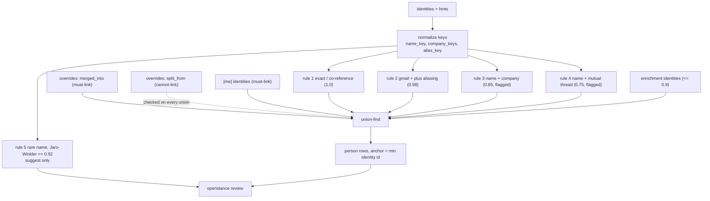

# Entity resolution

Status: build-ready for Phase 1 (rules 1 to 6, overrides, rebuild, `review`, `merge`, `split`). Enrichment identities (section 7) land in Phase 3.
Owner crate: `openstance-core` (`src/resolve/`: `normalize.rs`, `rules.rs`, `unionfind.rs`, `rebuild.rs`, `review.rs`; data files in `crates/openstance-core/data/`).

Related: [data-model.md](data-model.md) (tables, anchor ids, override semantics), [ingestion.md](ingestion.md) (what produces identities), [scoring.md](scoring.md) (runs after resolution), [enrichment.md](enrichment.md#7-writing-results-without-clobbering-edits), [interfaces.md](interfaces.md) (`review`, `merge`, `split`, `edit`, `who`), [../decisions/0009-conservative-entity-resolution.md](../decisions/0009-conservative-entity-resolution.md), [../engineering/testing-strategy.md](../engineering/testing-strategy.md).

---

## 1. Goals and stance

Resolution turns handles (`identity` rows) into humans (`person` rows). It is **conservative by design**: a wrong merge is worse than a missed one. A wrong merge puts one person's evidence on another and the user stops trusting every result; a missed merge shows two rows and costs one `openstance merge`. The v0.1 prototype already enforced "never merge by name alone" and has a test for it; that rule carries over.

Properties the implementation must have:

1. **Deterministic.** Same raw rows + overrides + config + data files = same clusters, same person ids, same confidences. No hash-map iteration order, no timestamps, no randomness in the algorithm.
2. **Explainable.** Every identity records the rule that attached it (`identity.match_rule`) and its confidence; `who` and `review` print them.
3. **Overrides win every time,** including over an exact match from a later import.
4. **Incremental equals full.** Resolution after an import gives exactly what `openstance rebuild` gives.
5. **Cheap.** Full clustering of 50k identities in under 2 s; the whole `rebuild` (resolution + scoring + ties + FTS) under 60 s on the 20k-person reference graph ([../engineering/performance-targets.md](../engineering/performance-targets.md)).



---

## 2. Normalization

Normalization happens in two places with different jobs:

- **Storage normalization** (in the Sink, at import): turns a raw handle into `identity.value`. Kept minimal and stable, because changing it requires re-import. Versioned by `meta.normalizer_version`.
- **Match keys** (in resolution, at every run): `name_key`, `company_keys`, `alias_key`. Computed fresh each time, so improving them never needs a re-import.

### 2.1 Storage normalization per identity kind

| Kind | Steps | Invalid (dropped, counted as `InvalidHandle`) |
|---|---|---|
| `email` | trim; strip `<>`, `mailto:`; NFKC; lowercase whole address; IDNA domain to ASCII (punycode); strip trailing dot of domain | no `@`, empty local part, domain without a dot, length > 254, `undisclosed-recipients` |
| `phone` | strip spaces, dots, dashes, parentheses; parse with the `phonenumber` crate using `[import] default_region` when there is no `+`; format E.164; extensions dropped | not a valid number for its region; no `+` and no default region |
| `linkedin_url` | parse as URL (add `https://` if missing); host must end in `linkedin.com`; path `/in/<slug>` -> `<slug>`; percent-decode; lowercase; strip trailing `/`, query, fragment, and locale suffix segments (`/en`); legacy `/pub/<name>/<a>/<b>/<c>` -> `pub:<name>/<a>/<b>/<c>` | company pages (`/company/`), `/school/`, posts |
| `x_handle` | strip `@`, `https://x.com/` or `twitter.com/` prefix, query; lowercase; must match `^[a-z0-9_]{1,15}$` | reserved paths (`home`, `intent`, `i`, `search`) |
| `x_user_id` | digits only | non-numeric |
| `ig_handle` | strip `@` / `instagram.com/`; lowercase; `^[a-z0-9._]{1,30}$` | `p`, `reel`, `explore` paths |
| `name_company` | `name_key(name) + "\|" + company_key(company)` | name_key with fewer than 2 tokens |
| `name_local` | `<importer kind> + "\|" + name_key(name)` | empty name_key |

### 2.2 `name_key(name)`

Applied to every name hint. Steps, in order:

1. NFKC.
2. Remove emoji and symbols (Unicode general categories `So`, `Sk`, `Cs`, `Co`), and quotes (`" ' “ ” ‘ ’`).
3. Remove bracketed segments: `Jane Doe (Stripe)`, `Jane Doe [EXT]`.
4. Remove trailing "via" and separator suffixes: ` via <anything>`, ` | <anything>`, ` - <anything>` when the remainder has at least 2 tokens (`Jane Doe | Stripe` -> `Jane Doe`; `Jean-Luc Picard` unaffected because there are no surrounding spaces).
5. If the string has exactly one comma and the part after it is not a known suffix: swap `Last, First` -> `First Last`. Otherwise drop commas.
6. Unicode lowercase (full case folding).
7. Replace `-`, `_`, `.` with spaces.
8. Drop honorific tokens anywhere at the start: `mr mrs ms miss mx dr prof sir dame lord lady rev fr shri sri smt kumari herr frau mme mlle sr sra`.
9. Drop suffix tokens anywhere at the end: `jr sr ii iii iv phd md mba cpa esq dds pe cfa obe mbe`.
10. Fold diacritics (NFD, drop combining marks): `josé` -> `jose`, `müller` -> `muller`. (Display names keep their diacritics; only the key is folded.)
11. Collapse whitespace; trim.

A name key is **matchable** (usable by rules 3 to 5 and Jaro-Winkler) only if:

- it has at least 2 tokens, or it is in a script written without spaces (Han, Hiragana, Katakana, Hangul, Thai) with at least 2 characters;
- it contains no digits and no `@`;
- it is not derived from an email local part (prettified `jane.doe` is a display fallback, never a match key);
- it does not come from a **multi-name handle**: an identity that carries more than 3 distinct name keys across all observations (for example `drive-shares-noreply@google.com` showing "Jane Doe (via Google Sheets)" for hundreds of people, or a mailing list rewriting `From`). Its name hints are ignored for matching.

A cluster's name keys are the set of matchable keys from all its identities' hints.

### 2.3 `company_keys`

A cluster's company keys are the union of:

- `company_key(s)` of every `company_hint` (LinkedIn Company, vCard ORG, CSV company, enrichment), where `company_key`: NFKC, lowercase, drop punctuation, drop a leading `the`, drop trailing legal-form tokens (`inc incorporated llc l l c ltd limited pvt private plc gmbh ag sa sas srl bv nv co corp corporation company pte pty oy ab as kk`), collapse whitespace, then map through the domain/alias map (below).
- For each email identity whose registrable domain (public suffix list, `psl` crate) is not a freemail domain: the mapped company key of that domain, else the domain's first label (`mail.stripe.com` -> `stripe.com` -> `stripe`).

Data files (all in `crates/openstance-core/data/`, versioned, accept contributions):

| File | Contents |
|---|---|
| `freemail.txt` | ~4k consumer mail domains (`gmail.com`, `googlemail.com`, `outlook.com`, `hotmail.*`, `live.com`, `yahoo.*`, `icloud.com`, `me.com`, `mac.com`, `proton.me`, `protonmail.com`, `aol.com`, `gmx.*`, `yandex.*`, `qq.com`, `163.com`, `rediffmail.com`, `fastmail.com`, ...) |
| `domains.toml` | domain -> company key, including multi-domain companies (`google.com`, `alphabet.com` -> `google`; `fb.com`, `meta.com` -> `meta`) |
| `given_names.txt`, `surnames.txt` | the "top-5k names list": 5,000 most common given names and 5,000 most common surnames, compiled from public multi-country statistics (US, UK, India, China, Nigeria, Brazil, Germany, ...), normalized with `name_key` |

User additions: `[resolution] company_aliases = { "stripe inc" = "stripe" }` and `[resolution] freemail_extra = [...]` in [configuration.md](configuration.md). Enrichment `Company` results also add domain -> name entries (see [enrichment.md](enrichment.md)).

### 2.4 `alias_key(email)` (rule 2)

```
alias_key("Jane.Doe+news@GoogleMail.com")
  local = "jane.doe+news", domain = "googlemail.com"      (already lowercased at storage)
  domain in {gmail.com, googlemail.com}  -> domain = "gmail.com"; local = remove all "."
  local contains "+" at position > 0     -> local = part before the first "+"
  => "janedoe@gmail.com"
```

| Applied | Not applied (deliberately) |
|---|---|
| Gmail and Googlemail: dots ignored, `+tag` stripped, `googlemail.com` = `gmail.com` | Dots on any other domain, including Google Workspace custom domains (where `jane.doe@` and `janedoe@` can be different users) |
| `+tag` stripped on **any** domain (corporate plus-addressing: `jane+recruiting@acme.com`) | `-tag` subaddressing (Yahoo disposable, some Postfix setups): too often a real part of the name |
| | Fastmail subdomain addressing (`anything@jane.fastmail.com`) |
| | Outlook/Hotmail dots (they are significant) |

Two email identities with the same `alias_key` and different `value` are joined by rule 2. The stored values stay distinct, so `who` shows exactly which addresses were seen.

### 2.5 Shared handles

Some handles belong to more than one human. They are allowed to exist but must not glue people together:

- **Role addresses:** local part in `info team hello contact sales support admin office hr jobs careers billing founders partners press accounts finance legal` (plus `[resolution] role_localparts_extra`).
- **Handles seen in more than one source-asserted card** with different matchable names (a family email or landline on two vCards).

A shared handle never causes a union through rule 1 co-reference. It attaches to a person only if exactly one cluster claims it through co-reference; otherwise it stays its own person (shown in `who` as a role address). Detected shared handles appear in `review` as information rows ("family@example.org is on 2 cards: Jane Doe, John Doe; kept separate").

---

## 3. The rules

Rules are evaluated in order; for any pair of clusters the **first** rule that matches decides, with the confidence below. Rules 1 to 4 merge; 5, 6 and Jaro-Winkler never merge.

| # | Rule | Join on | Confidence | Auto-merge | `match_rule` |
|---|---|---|---|---|---|
| 1 | Exact identity | Same normalized handle (email, LinkedIn slug, E.164 phone, X handle or id, IG handle): one `identity` row by construction. Plus **source-asserted co-reference**: handles in the same `(interaction_id, slot)` of a non-enrichment source (one vCard, one LinkedIn connection row, one CSV row) | 1.0 | yes | `exact` |
| 2 | Gmail aliasing | Same `alias_key`: `a.b@gmail.com` = `ab@gmail.com` = `ab+x@gmail.com`; corporate plus-addressing | 0.98 | yes | `gmail_alias` |
| 3 | Name + company | A shared matchable name key and a shared company key (company domain or normalized company string) | 0.85 | yes, flagged | `name_company` |
| 4 | Name + mutual thread | A shared matchable name key, and identities of both clusters appear in the same email thread (`thread_key`) or the same meeting | 0.75 | yes, flagged | `name_thread` |
| 5 | Name only, rare | A shared matchable name key that is **not common** (below) | 0.5 | no, suggested | - |
| 6 | Name only, common | A shared matchable name key that is common | 0 | never | - |

Supporting definitions:

- **Common name:** a name key whose first token is in `given_names.txt` **and** whose last token is in `surnames.txt` (`priya sharma`, `john smith`, `wei zhang`). Everything else is rare (`rohan quillfeather`). Single-script names without spaces use a separate `common_cjk.txt` list of full names.
- **Large-company guard (rule 3):** if the name is common **and** the shared company key has 50 or more people in the user's graph (`[resolution] large_company_threshold`), rule 3 does not merge; the pair becomes a suggestion with confidence 0.6. Two Priya Sharmas at Google are plausible; two Rohan Quillfeathers at Google are not.
- **Jaro-Winkler suggestions:** pairs of clusters with name keys that are not identical but have Jaro-Winkler similarity >= 0.92 (`strsim::jaro_winkler`) **and** at least one supporting signal (a shared company key, a shared thread or meeting, or both names rare). Shown with confidence `0.5 * jw`. Never auto-merged. Candidate generation is blocked: only names sharing the last token or the first 3 characters are compared, which keeps it under O(n log n) in practice.
- **Flagged** means merged but listed in `openstance review` until the user confirms (which pins it with an override) or splits.

The table differs from the original tech spec PDF in three conservative additions (source-asserted co-reference spelled out as part of rule 1, the shared-handle exception, the large-company guard). The confidences and the rule order are unchanged.

---

## 4. Overrides

Overrides win over rules every time. The resolution-relevant fields (full table semantics in [data-model.md](data-model.md#47-override-edit)):

| Override | Meaning in resolution |
|---|---|
| `merged_into` (`person_id = X`, `value = Y`) | **Must-link**: the identities `X` and `Y` are in the same person. Applied before any rule. |
| `split_from` (`person_id = X`, `value = Y`) | **Cannot-link**: the identities `X` and `Y` are never in the same person. Checked on **every** union, including rule 1 exact co-reference from a later import and must-links. |
| `[me] identities` (config; while empty, the handles adopted at import, `meta.me_adopted`) | Must-link among the user's own handles; the resulting cluster is `is_self`. |

Precedence and conflict handling:

1. Cannot-links beat must-links. If applying a must-link would put two cannot-linked identities in one cluster, that must-link is skipped and reported by `rebuild` and `doctor` as `conflicting override #<id>`.
2. Must-links are applied in `(set_at, id)` order, so the outcome of a conflict is deterministic.
3. Commands keep the override set consistent, so conflicts only arise from hand-edited databases or merges of old edits: `merge` deletes `split_from` rows between the two clusters; `split` deletes `merged_into` rows between the two sides.
4. Scalar field overrides follow people through merges because they are looked up by every identity id in the cluster (latest `set_at` wins). Exception for privacy flags: `do_not_share` and `no_enrich` take the latest value **per anchor identity** and then OR across the cluster, so a rule-based merge can never silently clear a privacy flag. To clear one on a merged person, `openstance edit <p> --share` writes `'0'` for every identity in the cluster that carries a `'1'`.

---

## 5. The rebuild algorithm

`openstance rebuild` makes the graph a pure function of `source`-derived raw rows, `enrich_log` responses, overrides and config. Resolution is steps 1 to 14; steps 15 onward belong to [scoring.md](scoring.md) and [search.md](search.md) but are listed so the order is unambiguous.

```text
 0. BEGIN IMMEDIATE. Load config ([me], [resolution], [score]) and data files.
 1. Load identities ordered by id: (id, kind, value, source kind).
 2. Load observations, one aggregate query each:
      name hints per identity       (interaction_person.name_hint, with counts)
      company hints per identity    (interaction_person.company_hint + enrich facts)
      co-reference groups           (interaction_id, slot) with >1 identity, non-enrich sources
      thread/meeting co-occurrence  (thread_key or meeting interaction_id) -> identity ids
 3. Compute match keys: name_key set per identity (drop non-matchable, mark multi-name
    handles), company_keys per identity, alias_key per email identity, shared-handle flags.
 4. Clear derived state:
      DELETE FROM tie; DELETE FROM person_fts; DELETE FROM person;
      UPDATE identity SET person_id = NULL, confidence = NULL, match_rule = NULL;
      UPDATE interaction_person SET person_id = NULL;
    (FKs to person are DEFERRABLE INITIALLY DEFERRED, checked at COMMIT.)
 5. Union-find over identity ids. union(a, b) always makes the smaller root the parent,
    so the root of every cluster is its minimum identity id (the anchor). Each union records
    (rule, confidence) on the absorbed root in a separate, never-compressed "union tree".
    Every union first checks cannot-links between the two clusters; a blocked union is
    counted (stats.blocked_by_override) and skipped.
 6. Must-links: [me] identities, then merged_into overrides in (set_at, id) order.
    Rule recorded: override, confidence 1.0.
 7. Rule 1: for each co-reference group in (interaction_id, slot) order, union its
    non-shared handles. Rule: exact, 1.0.
 8. Rule 2: group email identities by alias_key (groups ordered by min id); union members.
    Rule: gmail_alias, 0.98.
 9. Build cluster attributes: name keys, company keys, identity count, "has non-follow
    interaction".
10. Rule 3: for each name key (sorted), take the clusters having it (sorted by root id);
    walk them in order, merging each into the first earlier cluster with which it shares a
    company key, subject to the large-company guard. Cluster attributes are merged on union
    (so a later cluster can match through an earlier merge; this chaining stays within one
    name key). Rule: name_company, 0.85.
11. Rule 4: for each thread_key / meeting (sorted), group participating clusters by name key;
    union clusters in a group (sorted by root id). Rule: name_thread, 0.75.
12. Enrichment identities (section 7). Rule: enrich, <= 0.9.
13. Dormant filter: a cluster with no matchable or display name hint whose only interactions
    are 'follow' (x_archive ids) or that has no interactions at all and no override gets no
    person row; its identities keep person_id NULL.
14. Materialize:
      for each remaining cluster root r: INSERT person(id = r)
      for each identity x: person_id = root(x);
        confidence = min over the union-tree path from x to the root (anchor = 1.0);
        match_rule = the rule of the weakest edge on that path (anchor: 'anchor')
      UPDATE interaction_person SET person_id = identity.person_id
      is_self = 1 for the cluster containing any [me] identity
      interaction.direction recomputed from self participation (data-model.md 4.3)
15. Person fields: aggregate hints by source priority, apply enrich facts, apply scalar
    overrides (latest set_at; NULL tombstone falls back; privacy flags OR'd per section 4).
16. Bulk detection (ingestion.md section 8), then scoring and score components
    (scoring.md), then ties (data-model.md 4.6).
17. Rebuild person_fts for non-bulk, non-self people.
18. meta.last_rebuild_at = now. COMMIT. PRAGMA wal_checkpoint(TRUNCATE).
19. Outside the transaction: embed people whose text_hash changed (models.md).
```

### 5.1 Incremental resolution after an import

To guarantee "incremental equals full" without two algorithms, the import path **reruns steps 1 to 14 in memory over all identities** (cheap: under 2 s at 50k identities) and then **diffs** the result against the stored assignment:

- People whose identity set is unchanged and who gained no new interactions: untouched.
- People whose identity set changed (new identities, merges, dissolved clusters): person row, fields, score, ties and FTS row recomputed; removed person ids deleted (their anchors now resolve to the surviving person, [data-model.md section 5](data-model.md#5-stable-person-ids-anchor-identities)).
- People with new interactions: fields, score, ties, FTS recomputed.

Only steps 15 to 17 are restricted to affected people; that is where the time goes. The property test in section 11 imports fixtures in every order and in batches and checks the result equals a single full rebuild.

### 5.2 Complexity

| Step | Cost at 50k identities / 1.5M participant rows |
|---|---|
| Load + aggregate (step 2) | one scan of `interaction_person` with hints, ~0.5 to 1 s |
| Union-find (6 to 12) | near-linear, < 200 ms |
| Jaro-Winkler suggestions (on `review` only) | blocked candidates, < 500 ms |
| Materialize (14) | three bulk UPDATEs, ~2 to 4 s |
| Scoring + ties + FTS (15 to 17) | dominant cost; budget in [../engineering/performance-targets.md](../engineering/performance-targets.md) |

---

## 6. `who` explanation of a resolution

`openstance who jane@example.com` includes a resolution block (also in `get_person` JSON as `identities[]`):

```
Jane Doe  #4021   score 0.81 (R .92 F .64 C .88 M .70 B .50)
identities
  email         jane@example.com            anchor        1.00   mbox: work gmail
  email         jane.doe+cal@example.com    gmail_alias   0.98   ics: calendar 2026-10
  linkedin_url  jane-doe-0a1b2c             exact         1.00   linkedin 2026-10 (same row as jane@example.com)
  email         janed@gmail.example         name_thread   0.75   mbox: work gmail   FLAGGED
                  same name "jane doe"; both on thread "Q4 planning" (2026-09-14)
```

---

## 7. Enrichment identities

Enrichment (Phase 3+) can return a LinkedIn URL or an email for a person. The egress gate inserts the handle as an `identity` with `source_id` = the `enrich:<backend>` source, and the response stays in `enrich_log.response_json` ([enrichment.md](enrichment.md)). In step 12, for each `enrich_log` row with `status = 'ok'` in id order:

- Target = the cluster containing identity `enrich_log.person_id` (an anchor id).
- If the returned handle's cluster is a singleton with no observations except enrichment: union it into the target with rule `enrich`, confidence `min(result confidence, 0.9)` (a profile's LinkedIn URL counts as 0.95, so 0.9). A `split_from` cannot-link, or any override naming the handle, keeps it out.
- Otherwise (the handle already belongs to another person): **no union**. It becomes a suggestion in `review`: "enrich:treg says jane@acme.example belongs to Jane Doe #4021, but it belongs to J. Doe #8810".
- Enrichment never merges two existing people, and never overrides a `split_from`.

---

## 8. `openstance review`

The queue has three sections, each sorted by the higher score of the people involved, so the most important people get fixed first:

1. **Flagged merges**: people containing identities with `match_rule` in (`name_company`, `name_thread`). The flagged identities are shown as one block against the rest of the person.
2. **Suggestions**: rule 5 (rare name), Jaro-Winkler pairs, large-company-guard pairs, enrichment collisions. Computed on demand when `review` runs, excluding pairs already separated by a `split_from`.
3. **Info**: shared handles kept separate, conflicting overrides.

Interactive UX (TTY):

```
$ openstance review
31 flagged merges, 12 suggestions, 2 notes. Sorted by score.

[1/43] FLAGGED  name + company  0.85
  Jane Doe #4021  (score 0.81)
    jane@stripe.example         mbox: work gmail         212 interactions, last 2026-10-02
  + jane-doe-0a1b2c (LinkedIn)  linkedin 2026-10         "Product Manager at Stripe"
  why: same name "jane doe"; company "stripe" (email domain stripe.example = LinkedIn company "Stripe")

  [y] confirm   [s] split   [n] next   [d] details   [?] help   [q] quit
> y
  confirmed (override #188 merged_into)

[2/43] SUGGESTION  rare name  0.50
  Rohan Quillfeather #5120   r.quill@example.net        vcf: phone contacts
  Rohan Quillfeather #9932   linkedin rohan-quill       linkedin 2026-10  "Founder at Example Labs"
  why: identical uncommon name; no shared company, thread or handle

  [m] merge   [r] reject (never suggest again)   [n] next   [d] details   [q] quit
> r
  rejected (override #189 split_from)
```

| Key | Writes | Effect |
|---|---|---|
| `y` confirm (flagged) | `merged_into` rows pinning each flagged identity to the anchor | The identities' `match_rule` becomes `override`, confidence 1.0; no longer flagged |
| `s` split (flagged) | same as `openstance split` with the flagged block as the moved set | Two people from now on |
| `m` merge (suggestion) | `merged_into` | Merged at 1.0 |
| `r` reject (suggestion) | `split_from` between the two anchors | Never suggested again; never auto-merged, even by a future exact match |
| `n` / `q` | nothing | Skip / exit; progress is kept because every decision is committed immediately |
| `d` details | nothing | Shows each identity's sources, last 5 evidence lines, name and company hints |

Non-interactive and bulk forms (also used by the HTTP API and the web UI):

```
openstance review --json                               # the queue as JSON, no changes
openstance review --confirm-all [--rule name_company] [--min-confidence 0.85]
openstance review --reject-suggestions [--rule rare_name|jaro_winkler]
openstance review --confirm <person> | --split <person>
```

Each decision is its own small transaction followed by incremental re-resolution of the affected people, so the queue updates live.

---

## 9. Merge and split commands

Person references accepted by every command: a person id (or any former anchor id), an email, a LinkedIn URL or slug, a phone, an X handle, or a quoted name. A name that matches more than one person is an error that lists the candidates with ids.

### `openstance merge <a> <b> [<c>...]`

1. Resolve each argument to a cluster; refuse if any two are the same person.
2. Delete `split_from` rows linking any identity of one cluster with any identity of another.
3. Insert `merged_into(person_id = anchor(b), value = anchor(a))` for each extra argument (anchors are the current person ids).
4. Privacy flags: if any side has `do_not_share` or `no_enrich` set, write a fresh `'1'` override on the merged anchor (section 4).
5. Incremental re-resolution; print the merged person.

Merging into the self person is allowed (adding one of your own addresses) and prints a warning that the handle will stop appearing as a contact; it also suggests adding the handle to `[me] identities`.

`openstance merge --undo <a> <b>` deletes the `merged_into` rows between the two (only undoes override merges; a rule-based merge is undone with `split`).

### `openstance split <person> [--identity <handle-or-id>...]`

Without `--identity`, an interactive picker lists the person's identities with rule, confidence and source, and the user marks the ones to move out. Then:

1. Moved set `M`, kept set `K`. If `M` contains the anchor, swap the sets so the anchor stays on the kept side (existing references, overrides and MCP clients keep pointing at the side the user thinks of as the original); the command says so.
2. Delete `merged_into` rows linking any identity in `M` with any identity in `K`.
3. **Pin both sides:** `merged_into(person_id = m, value = anchor(M))` for each `m` in `M` except its anchor, and the same for `K`; plus `split_from(person_id = m, value = anchor(K))` for each `m` in `M`. Pinning both sides means no later rule or import can move an identity across the split in either direction, and the split holds even when a later import matches exactly.
4. Scalar overrides stay on the identity they were written against; the command prints which side each one landed on and offers to copy title/company/tags to the new person.
5. Incremental re-resolution; print both people.

`openstance split --undo <person-a> <person-b>` deletes the `split_from` rows between them (the pins remain, which is harmless; `--undo --unpin` removes them too).

### `openstance edit`

Field edits (`--title`, `--company`, `--tag`, `--note`, `--no-share`, `--no-enrich`, `--not-bulk`, `--unset title`) are specified in [interfaces.md](interfaces.md); they do not trigger re-clustering, only steps 15 to 17 for that person.

---

## 10. Edge cases

| Case | Behavior |
|---|---|
| Same person, work + personal email, never on one thread, no LinkedIn | Two people. Rule 5 suggestion if the name is rare; otherwise only a manual merge. Missed merge by design. |
| Work + personal email cc'd on one thread | Rule 4, flagged at 0.75. |
| Two different "Priya Sharma"s, one at Stripe, one at Acme | Common name, different companies: separate, no suggestion. |
| Two different "Priya Sharma"s both at Google (large company) | Large-company guard: suggestion 0.6, not merged. |
| Two "Rohan Quillfeather"s at the same startup | Rule 3, merged and flagged; user splits if wrong; the split holds forever. |
| `jane.doe@gmail.com`, `janedoe@gmail.com`, `JaneDoe+lists@googlemail.com` | One person via rule 2 (0.98). |
| `jane.doe@acme.example` and `janedoe@acme.example` (Workspace domain) | Not aliased (dots only ignored on Gmail). Joined only by name rules. |
| Shared `family@example.org` on two vCards | Shared handle: no co-reference union; listed in review info. |
| `info@startup.example` with three people's names in display names | Role address and multi-name handle: names ignored for matching; usually bulk. |
| "Jane Doe (via Google Docs)" from `comments-noreply@docs.google.com` | Bracket stripped, but the identity is a multi-name handle and bulk; never used for matching. |
| "Doe, Jane" vs "Jane Doe" | Same name key. |
| "J. Doe" vs "Jane Doe" | Different keys; Jaro-Winkler below 0.92; no suggestion. |
| "José García" vs "Jose Garcia" | Same key (diacritics folded). |
| "Jane" (single token) | Not matchable; only handle rules apply. |
| "王小明" (no spaces) | Matchable as a single-script full name; common check uses `common_cjk.txt`. |
| Name changed after marriage, same email | Rule 1 keeps one person; display name follows LinkedIn (latest export) unless overridden. |
| LinkedIn vanity slug changed between exports, email present in both | Co-reference through the email: one person. |
| Slug changed, no email | Rule 3 (same name, same company) flagged; or two people if the company changed too. |
| Opaque `ACoAA...` LinkedIn id in messages | Joined to the slug by the importer only for unique names ([ingestion.md](ingestion.md#62-linkedin_csv-phase-1)); otherwise its own identity, resolved by name rules. |
| WhatsApp name "Mom" | `name_local` single token, not matchable; its own person unless a vCard links the phone. |
| WhatsApp phone without country code, different region than `default_region` | Parsed to the wrong E.164 or dropped. Known limit; documented in `import` output. |
| X follow-only ids | Dormant, no person row. |
| `split_from` A/B, then a new vCard lists both handles | Cannot-link blocks the co-reference union; the vCard's other handles go to whichever side they union with first (deterministic by id). |
| User merged A+B in January, enrichment in March says B's email is someone else's | Enrichment never unmerges; collision listed as suggestion. |
| Must-link A-B and B-C, cannot-link A-C | The later must-link (by `set_at`) is skipped and reported. |
| Person merged into another; MCP client still holds the old id | `get_person(old)` returns the surviving person with `resolved_from`. |
| User's own second address not in `[me]` | Appears as a person with very high score; import-time self detection adopts it when unambiguous (and `[me] identities` is empty) or proposes it; `merge` into self fixes it. |

---

## 11. Test cases

Integration tests in `crates/openstance-core/tests/resolution.rs`, built from the cast in `fixtures/persona/people.toml` (all fictional, `example.*` domains and fictional phone ranges; see [../engineering/testing-strategy.md](../engineering/testing-strategy.md)). Each case is tagged in the cast with its expectation so `fixtures/EXPECTED.md` can be regenerated and reviewed.

| ID | Setup | Expect |
|---|---|---|
| ER-01 | Same email in mbox and vcf | 1 person, both identities `exact` 1.0 |
| ER-02 | vCard with 2 emails + phone | 1 person (co-reference) |
| ER-03 | `a.b@gmail.com`, `ab@gmail.com`, `ab+x@googlemail.com` | 1 person, two at `gmail_alias` 0.98 |
| ER-04 | `a.b@acme.example` vs `ab@acme.example` | 2 people |
| ER-05 | `jane+rec@acme.example` vs `jane@acme.example` | 1 person, 0.98 |
| ER-06 | LinkedIn "Jane Doe, Stripe" + mbox `jane@stripe.example` named "Jane Doe" (domain mapped to stripe) | 1 person, flagged `name_company` 0.85 |
| ER-07 | Same name, both cc'd on one thread, different domains | 1 person, flagged `name_thread` 0.75 |
| ER-08 | Common name ("Priya Sharma") in two sources, no shared company/thread | 2 people, no suggestion |
| ER-09 | Rare name in two sources, nothing shared | 2 people, 1 suggestion (rule 5) |
| ER-10 | "Jon Quillfeather" vs "John Quillfeather" at same company | 2 people, 1 Jaro-Winkler suggestion |
| ER-11 | Common name, same large company (50+ people in fixture) | 2 people, 1 suggestion at 0.6 |
| ER-12 | Role address `info@` on two cards | Not glued; info row in review |
| ER-13 | Multi-name noreply handle with 10 names | Names ignored; no rule 3/4 merges through it; bulk |
| ER-14 | `split` a rule-3 merge, then re-import a file that matches exactly | Still 2 people |
| ER-15 | `merge` two people, `rebuild` | Still 1 person, `match_rule = override` |
| ER-16 | `split` choosing the anchor as moved | Sides swapped, anchor stays on original; ids of both stable across rebuild |
| ER-17 | Title override on absorbed person B, then merge A+B (A anchor) | Merged person shows B's title |
| ER-18 | `do_not_share` on B, explicit `'0'` newer on A, rule-based merge | Merged person `do_not_share = 1` |
| ER-19 | Conflicting must/cannot-link set | Deterministic outcome; later must-link skipped and reported |
| ER-20 | Enrichment email already owned by another person | No merge; suggestion |
| ER-21 | "Doe, Jane", "Dr. Jane Doe PhD", "jane doe" followed by an emoji, "Jane Doe (Stripe)" | Same name key |
| ER-22 | X follow-only ids | No person rows; counted dormant |
| ER-23 | `[me]` with two addresses | One self person, absent from search and ties |
| ER-24 | Old person id after merge | `who <old id>` resolves to survivor |

Property tests (proptest, in CI):

- **Idempotence:** `rebuild; dump; rebuild; dump` identical.
- **Order independence:** importing the fixture sources in any permutation, and in any batch split, then comparing derived tables to a single full rebuild: identical (person ids included, thanks to anchors).
- **Override durability:** a random sequence of `merge`/`split`/`edit` followed by `rebuild` gives the same result as before the rebuild.
- **Split holds:** for any `split_from` pair, the two identities are never in one person after any further import.
- **Monotone safety:** adding a `split_from` never increases the number of identities in any person.

Fuzz target: `name_key` and storage normalizers never panic on arbitrary UTF-8 and are idempotent (`f(f(x)) == f(x)`).

---

## 12. Acceptance criteria (Phase 1)

- [ ] ER-01 to ER-19 and ER-21 to ER-24 pass; ER-20 lands in Phase 3 with enrichment.
- [ ] Fixture totals match `fixtures/EXPECTED.md` exactly: persons, flagged merges, suggestions, bulk.
- [ ] Property tests above pass with 200 cases each.
- [ ] Full resolution (steps 1 to 14) on the 20k-person / 50k-identity perf fixture under 2 s; whole `rebuild` under 60 s.
- [ ] `openstance review` works interactively and with `--json`, `--confirm-all`, `--reject-suggestions`; each decision survives `rebuild`.
- [ ] `merge`, `merge --undo`, `split`, `split --undo` behave as in section 9 and print the resulting people.
- [ ] `who` prints rule and confidence for every identity.
