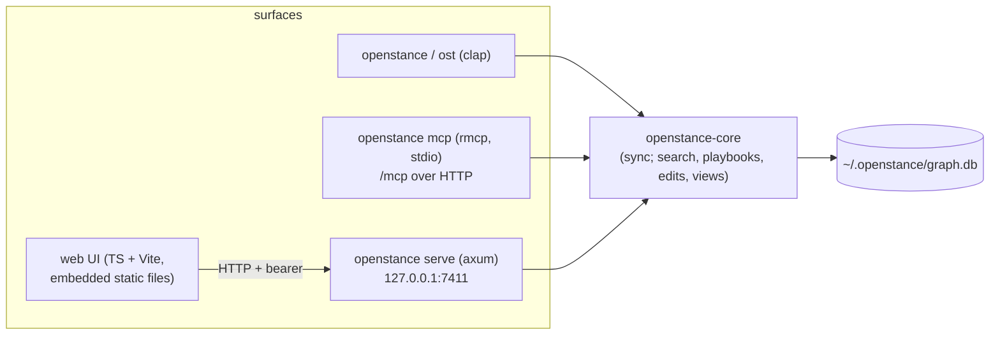

# Interfaces: CLI, MCP, HTTP API, JSON shapes

openstance has three surfaces over one core: a CLI, an MCP server and a local HTTP API. They all return **one JSON shape**. The CLI prints it with `--json`, the HTTP API returns it, and MCP tools return it as `structuredContent`. The optional web UI is a client of the HTTP API and nothing else.

Related: [search.md](search.md) (the `Query` struct and fusion), [scoring.md](scoring.md) (components), [playbooks.md](playbooks.md), [enrichment.md](enrichment.md), [sharing-and-views.md](sharing-and-views.md), [configuration.md](configuration.md), [../architecture/overview.md](../architecture/overview.md), [../architecture/security-and-threat-model.md](../architecture/security-and-threat-model.md).



Each command, tool and endpoint is tagged with the phase it ships in (P1 to P5). See [../plan/roadmap.md](../plan/roadmap.md).

---

## 1. Shared JSON shapes

Conventions:

- Timestamps are ISO 8601 UTC strings (`"2026-09-14T16:02:00Z"`). The database stores unix seconds, and conversion happens only at the surface.
- Money is integer **micro-USD** (`10000` = $0.01). Fields end in `_micro_usd`.
- Scores and components are floats in `[0, 1]`, rounded to 3 decimals on output.
- Every top-level response carries `"v": 1`, the JSON schema version. A breaking change bumps it. Additive fields do not.
- `null` means unknown. Empty arrays are always present, never omitted.
- Person ids are anchor identity ids (`MIN(identity.id)` of the person's cluster). They are stable across `rebuild`, re-import and merges: an id that was merged away still resolves, and `get_person` then returns `"resolved_from": <old id>` ([data-model.md](data-model.md#5-stable-person-ids-anchor-identities)). Only a deleted-and-reimported database changes ids; for references that must survive that, use an identity (email, LinkedIn URL).

### 1.1 `PersonRef`

The compact form used inside other shapes.

```json
{ "id": 812, "display_name": "Tom Okafor", "title": "Engineering Manager", "company": "Stripe", "score": 0.78 }
```

### 1.2 `Person`

```json
{
  "id": 812,
  "display_name": "Tom Okafor",
  "title": "Engineering Manager",
  "company": "Stripe",
  "location": "San Francisco, CA",
  "bio": null,
  "tags": ["devtools", "investor-intro"],
  "first_seen": "2024-02-03T09:12:00Z",
  "last_contact": "2026-09-14T16:02:00Z",
  "score": 0.78,
  "components": { "...": "ScoreComponents, 1.3" },
  "is_bulk": false,
  "do_not_share": false,
  "no_enrich": false,
  "field_sources": {
    "display_name": "mbox:work gmail",
    "title": "override",
    "company": "linkedin_csv:linkedin 2026-10",
    "location": "enrich:treg"
  }
}
```

`field_sources` says where each displayed scalar came from: `override`, `<source.kind>:<source.label>`, or `null`.

### 1.3 `ScoreComponents`

```json
{
  "recency": 0.870,
  "frequency": 0.683,
  "reciprocity": 0.765,
  "meetings": 0.736,
  "breadth": 0.750,
  "weights": { "recency": 0.35, "frequency": 0.20, "reciprocity": 0.25, "meetings": 0.15, "breadth": 0.05 },
  "preset": "default",
  "half_life_days": 180,
  "raw": {
    "days_since_last": 36,
    "n_interactions": 23,
    "messages_from_you": 17,
    "replies_from_them": 13,
    "threads_they_started": 0,
    "n_meetings": 4,
    "channels": ["email", "calendar", "linkedin_dm"]
  }
}
```

`score = sum(weights[k] * component[k])`. With the values above, `0.35*0.870 + 0.20*0.683 + 0.25*0.765 + 0.15*0.736 + 0.05*0.750 = 0.780`. Recency is `exp(-ln(2) * days_since_last / half_life_days)`, so `R = 0.5` at 180 days. The formulas are in [scoring.md](scoring.md). Bulk senders (`is_bulk = true`) have `score: 0` and all components `0`.

### 1.4 `Identity`

```json
{ "id": 5531, "kind": "email", "value": "tom@stripe.com", "confidence": 1.0,
  "source": { "id": 2, "kind": "mbox", "label": "work gmail" },
  "verification": { "status": "deliverable", "at": "2026-10-01T10:00:00Z", "via": "enrich:treg" } }
```

`kind` is one of: `email | phone | linkedin_url | x_handle | x_user_id | ig_handle | name_company | name_local` ([data-model.md](data-model.md#42-identity-raw-dictionary--derived-assignment)). `verification` is present only for emails that were verified.

### 1.5 `Evidence`

A tagged union. Every claim about a relationship carries at least one evidence item.

```json
[
  { "kind": "interaction", "interaction_id": 99120, "type": "meeting", "direction": "mutual",
    "at": "2026-09-14T16:02:00Z", "subject": "devtools dinner", "role": "attendee",
    "source": { "id": 4, "kind": "ics", "label": "work calendar" } },
  { "kind": "field", "field": "company", "value": "Stripe", "matched": "stripe" },
  { "kind": "tie", "with": { "id": 77, "display_name": "Ana Lee" },  "tie_kind": "email",
    "n_shared": 9, "weight": 0.52, "last_at": "2026-06-02T08:00:00Z" },
  { "kind": "enrich", "op": "profile", "field": "company", "value": "Stripe",
    "backend": "treg", "at": "2026-10-19T12:00:00Z", "enrich_log_id": 311 }
]
```

- `interaction.type`: `email | meeting | dm | mention | follow | connection`
- `interaction.direction`: `in | out | mutual | none`
- `subject` is a header or title only, never a message body.
- To list the interactions behind a tie, join `interaction_person` on both people ([data-model.md](data-model.md)). `GET /people/{id}/ties/{other}` returns them.

### 1.6 `SearchResult` and `SearchResponse`

```json
{
  "v": 1,
  "query": {
    "text": "devtools dinner",
    "company": [], "title": [], "location": [], "industry": [], "tags": [],
    "since": null, "until": null, "last_contact_before": null,
    "met_in_person": true, "replied": null,
    "min_score": null, "lost_touch": null, "include_bulk": false, "limit": 30
  },
  "query_source": { "parser": "rules", "fallback": null, "explicit": [] },
  "rerun": "openstance search \"devtools dinner\" --met --no-parse",
  "mode": "text",
  "models": { "parser": "rules", "embedder": "fastembed:bge-small-en-v1.5", "reranker": "none" },
  "total": 7,
  "took_ms": 41,
  "results": [
    {
      "rank": 1,
      "person": { "...": "Person, 1.2" },
      "relevance": { "fts": 0.82, "vector": 0.71, "fused": 0.765, "final": 0.681 },
      "matched": [ { "field": "subjects", "matched": "devtools dinner", "snippet": "devtools dinner" } ],
      "evidence": [ { "...": "Evidence, up to 3 most recent interactions" } ],
      "reason": null,
      "reason_source": null
    }
  ],
  "warnings": [],
  "suggestions": [],
  "timings_ms": null
}
```

- `query` is the **parsed** query, so a user or agent can edit it and rerun it without a model.
- In the `query` echo, `since`, `until` and `last_contact_before` are **unix seconds** (UTC midnight of the parsed date) or `null`, on every surface (CLI `--json`, MCP, HTTP). Inputs take the string forms in the `search_people` schema (`2025`, `2025-01`, `2025-01-01`, `90d`); the web UI turns the echoed seconds back into `YYYY-MM-DD` when it reruns an edited query.
- `final = fused * (0.5 + 0.5 * person.score)`. See [search.md](search.md).
- `reason` is a one-line prose explanation. It is set only when an API or local reranker that writes reasons is configured, and then `reason_source` is `"model:<id>"`. Otherwise both are `null` and the evidence is the explanation.
- `relevance` is `null` in structured mode (no text). `matched` lists the matched fields ([search.md](search.md#8-step-6-evidence)).
- `query_source`, `rerun`, `mode`, `warnings` and `suggestions` are defined in [search.md](search.md#9-result-json). `timings_ms` is filled only with `--explain` / `explain: true`.

### 1.7 `Path` and `HowConnected`

```json
{
  "v": 1,
  "target": { "id": 1203, "display_name": "Kai Wu", "company": "Ramp", "score": 0.12 },
  "direct": { "score": 0.12, "last_contact": "2024-01-11T00:00:00Z" },
  "paths": [
    {
      "via": { "id": 812, "display_name": "Tom Okafor", "company": "Stripe", "score": 0.78 },
      "strength": 0.406,
      "reason": "tie",
      "my_score": 0.78,
      "link_weight": 0.52,
      "evidence": [ { "kind": "tie", "...": "..." }, { "kind": "interaction", "...": "..." } ]
    }
  ]
}
```

`strength = my_score(via) * link_weight`. `reason` is one of:

- `tie`: `link_weight` is the tie weight.
- `same_company` (1.0), `past_company` (0.6) or `school` (0.4): `link_weight` is an affinity used by `path` for targets outside the graph.

`direct` is `null` when there is no interaction with the target.

### 1.8 `PersonDetail` (from `get_person`, `who`, `GET /people/{id}`)

```json
{
  "v": 1,
  "person": { "...": "Person" },
  "identities": [ { "...": "Identity" } ],
  "recent_interactions": [ { "...": "Evidence(kind=interaction)" } ],
  "mutuals": [ { "person": { "...": "PersonRef" }, "tie_kind": "email", "n_shared": 9, "weight": 0.52 } ],
  "overrides": [ { "field": "title", "value": "Engineering Manager", "set_at": "2026-10-02T11:00:00Z" } ],
  "notes": [ { "value": "prefers short asks", "set_at": "2026-08-01T00:00:00Z" } ],
  "suggested": { "title": { "value": "Sr. EM", "from": "enrich:treg", "at": "2026-10-19T12:00:00Z" } },
  "merge": { "merged_from": [97], "flagged": false, "confidence": 1.0 }
}
```

### 1.9 `Quote`, `Receipt`, `Outcome`

Defined in Rust in [enrichment.md](enrichment.md#2-types) and [playbooks.md](playbooks.md#1-types). JSON:

```json
{
  "v": 1,
  "playbook": "path",
  "status": "quote",
  "plan": {
    "run_id": "01JC4Z6Y3R1M8Q",
    "steps": [
      { "n": 1, "description": "lookup target in graph", "egress": null, "will_run": "run" },
      { "n": 2, "description": "enrich profile", "egress": "profile", "will_run": "skip_no_egress" }
    ],
    "quote": {
      "backend": "treg",
      "lines": [ { "job": { "person_id": null, "request": { "kind": "profile", "name": "Priya Raman", "company": "Stripe", "linkedin": null } },
                   "micro_usd": 10000, "basis": "exact", "provider_hint": null } ],
      "total_micro_usd": 10000, "budget_micro_usd": 500000, "within_budget": true,
      "skipped": [], "quoted_at": "2026-10-20T09:00:00Z"
    },
    "egress_max": [ { "op": "profile", "max": 1 }, { "op": "find_email", "max": 1 }, { "op": "verify_email", "max": 1 } ]
  },
  "result": { "...": "playbook-specific, may be partial (local steps only)" },
  "receipt": { "run_id": "01JC4Z6Y3R1M8Q", "backend": "treg", "requests_sent": 0,
               "quoted_micro_usd": 10000, "spent_micro_usd": 0, "budget_micro_usd": 500000,
               "skipped": [], "enrich_log_ids": [] },
  "notes": ["egress not allowed: pass allow_egress=true to send 1 request for $0.0100"]
}
```

`status` is one of: `done | partial | quote | nothing_to_do`.

### 1.10 `ViewSummary` and `ViewPerson`

See [sharing-and-views.md](sharing-and-views.md#4-the-ost-file-format).

```json
{ "id": "01JC50...", "name": "devtools-investors", "direction": "imported",
  "owner": { "pubkey": "age1qz...", "label": "rohan" }, "created_at": "2026-10-01T00:00:00Z",
  "expires_at": "2026-10-31T00:00:00Z", "rows": 42, "query": { "...": "Query" } }
```

```json
{ "display_name": "Maya Chen", "title": "Partner", "company": "Foo Ventures", "location": "NYC",
  "score_bucket": "strong", "last_contact_month": "2026-07",
  "emails": ["maya@foo.vc"], "linkedin": "in/mayachen" }
```

### 1.11 `Error`

```json
{ "v": 1, "error": { "code": "ambiguous", "message": "3 people match \"Sam\"",
  "candidates": [ { "id": 3, "display_name": "Sam Ito" }, { "id": 9, "display_name": "Sam Park" } ] } }
```

| `code` | HTTP | CLI exit | Meaning |
| --- | --- | --- | --- |
| `bad_request` | 400 | 2 | invalid input or flags |
| `unauthorized` | 401 | - | missing or wrong bearer token |
| `not_found` | 404 | 5 | no such person, view or playbook |
| `ambiguous` | 409 | 6 | the person reference matched several people; see `candidates` |
| `view_expired` | 410 | 7 | the view is past `expires_at` |
| `budget_exceeded` | 402 | 4 | the quote exceeds the effective budget even before running (`within_budget: false`) |
| `egress_disabled` | 409 | 3 | the operation needs an enricher and `enrich.backend = "none"` |
| `db_busy` | 503 | 10 | the database is locked by another writer; retry |
| `schema_too_new` | 503 | 10 | `graph.db` was written by a newer openstance; upgrade the binary (older databases are migrated automatically on open, after a backup) |
| `internal` | 500 | 1 | bug; message is safe to show, details in the log |
| `forbidden` | 403 | - | HTTP only: a cross-origin request from an origin not in `serve.cors_origins` |
| `misdirected` | 421 | - | HTTP only: the `Host` header is not a loopback address with the server's port |
| `payload_too_large` | 413 | - | HTTP only: the body is over 1 MB (uploads: `serve.max_upload_mb`) |
| `method_not_allowed` | 405 | - | HTTP only: the route exists but not with this method |

A quote is **not** an error. When `allow_egress` is false, the response is `200` with `status: "quote"`.

---

## 2. MCP server

- **Transport:** stdio via `openstance mcp` (P2). Streamable HTTP at `POST/GET /mcp` on `openstance serve` (P4), with the same bearer token as the API.
- **Library:** `rmcp`. Tools only, no resources or prompts in v1. The agent-facing guidance ships as skill files in `playbooks/` ([playbooks.md](playbooks.md#10-agent-skill-files-playbooks)).
- **Results:** every tool returns `structuredContent` (the JSON shape below) **and** a short `text` content block, a plain-text rendering of the same data, for clients that ignore structured output.
- **Privacy over HTTP:** MCP over HTTP (`/mcp`, used by remote connectors) excludes `do_not_share` people from every result by default, since results leave the machine. Local stdio MCP returns them, as local search does.
- **Egress rule:** every tool that can spend money takes `allow_egress` (default `false`) and `max_usd`. With `allow_egress: false` it returns the quote (`status: "quote"`) and sends nothing. `max_usd` can only **lower** the configured `enrich.max_usd_per_run` ([enrichment.md](enrichment.md#5-budget)).

### 2.1 Tool table

| Tool | Phase | Spends money | Annotations | Input | Output |
| --- | --- | --- | --- | --- | --- |
| `search_people` | P2 | no | readOnly | text + structured filters | `SearchResponse` |
| `get_person` | P2 | no | readOnly | person reference | `PersonDetail` |
| `how_connected` | P2 | no | readOnly | target reference | `HowConnected` |
| `path_to` | P3 | yes | openWorld | target, company, allow_egress, max_usd | `Outcome` (playbook `path`) |
| `brief` | P3 | yes (optional web search) | openWorld | person, web, allow_egress, max_usd | `Outcome` (playbook `brief`) |
| `list_views` | P3 | no | readOnly | direction filter | `{ views: ViewSummary[] }` |
| `search_view` | P3 | no | readOnly | view name or `*`, text, filters | `{ results: ViewSearchResult[] }` |
| `quote_enrich` | P3 | no (prices only) | readOnly, openWorld (asks the backend for prices; sends no contact data) | enrich requests | `Quote` |

"Who knows someone at X" has no separate tool. Use `search_people` with `company: ["X"]`, then `how_connected` on the target if needed. The `accounts` and `reconnect` skills say so.

### 2.2 Input schemas

```json
{
  "name": "search_people",
  "description": "Search the user's own relationship graph (local, free). Returns people ranked by text relevance lifted by relationship score, with dated evidence. Filters you set are echoed back in `query`; edit and rerun instead of rephrasing.",
  "inputSchema": {
    "type": "object",
    "properties": {
      "text":          { "type": "string", "description": "free text, e.g. 'fintech founders I met'" },
      "company":       { "type": "array", "items": { "type": "string" } },
      "title":         { "type": "array", "items": { "type": "string" } },
      "location":      { "type": "array", "items": { "type": "string" } },
      "industry":      { "type": "array", "items": { "type": "string" }, "description": "soft: boosts relevance, never excludes" },
      "tags":          { "type": "array", "items": { "type": "string" }, "description": "exact match on the user's tags" },
      "since":         { "type": "string", "description": "had an interaction on or after: YYYY, YYYY-MM, YYYY-MM-DD or 90d/6m/1y" },
      "until":         { "type": "string", "description": "had an interaction before this date (with since: inside the window)" },
      "last_contact_before": { "type": "string", "description": "last contact strictly before this date (\"haven't talked since\")" },
      "met_in_person": { "type": "boolean" },
      "replied":       { "type": "boolean" },
      "min_score":     { "type": "number", "minimum": 0, "maximum": 1 },
      "lost_touch":    { "type": "boolean", "description": "high frequency, low recency" },
      "include_bulk":  { "type": "boolean", "default": false },
      "limit":         { "type": "integer", "minimum": 1, "maximum": 100, "default": 20 },
      "parse":         { "type": "boolean", "default": true, "description": "run the query parser on text; false = take text and filters literally (search.md no_parse)" },
      "explain":       { "type": "boolean", "default": false }
    },
    "additionalProperties": false
  }
}
```

```json
{ "name": "get_person",
  "inputSchema": { "type": "object", "required": ["person"],
    "properties": {
      "person": { "type": "string", "description": "id, email, linkedin url/slug, @x_handle, or name" },
      "interactions": { "type": "integer", "minimum": 0, "maximum": 50, "default": 10 },
      "mutuals": { "type": "integer", "minimum": 0, "maximum": 50, "default": 10 } },
    "additionalProperties": false } }
```

```json
{ "name": "how_connected",
  "inputSchema": { "type": "object", "required": ["target"],
    "properties": {
      "target": { "type": "string", "description": "person id, email, linkedin, or name (must be in the graph; use path_to for strangers)" },
      "limit": { "type": "integer", "minimum": 1, "maximum": 10, "default": 3 } },
    "additionalProperties": false } }
```

```json
{ "name": "path_to",
  "description": "Find warm intro paths to a person, including people not in the graph. Local steps are free. Looking up a stranger's employers or email costs money: call with allow_egress=false first, show the user the quote, and only then call with allow_egress=true.",
  "inputSchema": { "type": "object", "required": ["target"],
    "properties": {
      "target": { "type": "string", "description": "name, email, linkedin url, or person id" },
      "company": { "type": "string" },
      "linkedin": { "type": "string" },
      "find_email": { "type": "boolean", "default": false },
      "limit": { "type": "integer", "minimum": 1, "maximum": 10, "default": 3 },
      "allow_egress": { "type": "boolean", "default": false },
      "max_usd": { "type": "number", "minimum": 0 },
      "plan_only": { "type": "boolean", "default": false } },
    "additionalProperties": false } }
```

```json
{ "name": "brief",
  "inputSchema": { "type": "object", "required": ["person"],
    "properties": {
      "person": { "type": "string" },
      "web": { "type": "boolean", "default": false, "description": "one web search for recent public posts (costs money)" },
      "allow_egress": { "type": "boolean", "default": false },
      "max_usd": { "type": "number", "minimum": 0 } },
    "additionalProperties": false } }
```

```json
{ "name": "list_views",
  "inputSchema": { "type": "object",
    "properties": { "direction": { "enum": ["own", "imported", "all"], "default": "all" } },
    "additionalProperties": false } }
```

```json
{ "name": "search_view",
  "inputSchema": { "type": "object", "required": ["view"],
    "properties": {
      "view": { "type": "string", "description": "view name or id; '*' searches every imported, unexpired view" },
      "text": { "type": "string" },
      "company": { "type": "array", "items": { "type": "string" } },
      "title": { "type": "array", "items": { "type": "string" } },
      "limit": { "type": "integer", "minimum": 1, "maximum": 100, "default": 20 } },
    "additionalProperties": false } }
```

`search_view` output: `{ "v": 1, "results": [ { "view": { "id": "...", "name": "...", "owner": { "label": "rohan" } }, "person": ViewPerson, "relevance": 0.71 } ] }`. When `view = "*"`, rows from different views that share an email or LinkedIn identity are merged into one result, listing every view it came from.

```json
{ "name": "quote_enrich",
  "inputSchema": { "type": "object", "required": ["requests"],
    "properties": { "requests": { "type": "array", "maxItems": 500, "items": {
      "type": "object", "required": ["kind"],
      "properties": {
        "kind": { "enum": ["profile", "find_email", "verify_email", "company", "web_search"] },
        "person_id": { "type": "integer" },
        "name": { "type": "string" }, "company": { "type": "string" }, "linkedin": { "type": "string" },
        "domain": { "type": "string" }, "email": { "type": "string" }, "query": { "type": "string" } } } } },
    "additionalProperties": false } }
```

### 2.3 Client setup

```console
# Claude Code
$ claude mcp add openstance -- openstance mcp

# Cursor: ~/.cursor/mcp.json
{ "mcpServers": { "openstance": { "command": "openstance", "args": ["mcp"] } } }
```

Remote connectors (claude.ai, ChatGPT) need a publicly reachable HTTPS URL. `127.0.0.1:7411` is not one. openstance does not ship a tunnel. A user who sets one up exposes their graph behind only the bearer token, so `openstance serve --mcp-only` exists to expose `/mcp` without the rest of the API. Whether each connector accepts a static bearer token, or requires OAuth, must be verified in Phase 4. A hosted MCP endpoint is a cloud-tier item ([../product/pricing-and-cloud.md](../product/pricing-and-cloud.md)).

---

## 3. HTTP API (P4)

- **Bind:** `127.0.0.1:7411` by default (`serve.host`, `serve.port`). Binding a non-loopback address requires `--host 0.0.0.0 --i-understand-this-exposes-my-graph`.
- **Auth:** `Authorization: Bearer <token>` on every route except `GET /health` and the static UI files. The token is 32 random bytes, base64url, generated at `openstance init` and stored in `~/.openstance/api.token` (mode 0600). `openstance serve --rotate-token` replaces it.
- **Host check:** requests whose `Host` header is not `127.0.0.1:<port>`, `localhost:<port>` or `[::1]:<port>` are rejected with 421 (`misdirected`). This defends against DNS rebinding. With `--i-understand-this-exposes-my-graph`, the bound address is accepted too.
- **CORS:** off. No `Access-Control-*` headers are sent, except for origins listed in `serve.cors_origins` (empty by default; use `http://localhost:5173` for UI development with Vite), which get `Access-Control-Allow-Origin` (never `-Credentials`) and preflight answers. A request carrying any other cross-site `Origin` is refused with 403 (`forbidden`), preflights included. The embedded UI is same-origin and needs no CORS. No cookies are used.
- **Headers:** every response carries `X-Content-Type-Options: nosniff`, `Referrer-Policy: no-referrer`, `X-Frame-Options: DENY` and `Content-Security-Policy: default-src 'self'; script-src 'self'; style-src 'self' 'unsafe-inline'; img-src 'self' data:; font-src 'self'; connect-src 'self'; object-src 'none'; frame-ancestors 'none'; base-uri 'none'; form-action 'self'` (inline style attributes and `data:` images are allowed for the UI; scripts never). API responses add `Cache-Control: no-store`. At most 64 requests are handled at once.
- **UI token handoff:** `openstance serve` prints `http://127.0.0.1:7411/#token=<token>`. The UI reads the fragment, which browsers never send to a server, keeps the token in `sessionStorage`, and strips it from the address bar.
- **Content type:** `application/json; charset=utf-8`, except for uploads (multipart) and view export (`application/octet-stream`).
- **Limits:** request body 1 MB, except `POST /import` and `POST /views/import` (`serve.max_upload_mb`, default 2048). `POST /import` streams each file into a private temp directory (0700, files 0600) under its uploaded file name (directory parts stripped), runs the normal importer, records the file name (never the temp path) as `source.path`, and deletes the directory.
- **Connections:** core is synchronous; every call runs on tokio's blocking pool. Writes (edits, imports, playbooks, quotes, the shortlist and introductions, MCP tool calls) share one writer connection; reads use a pool of 4 reader connections, so browsing keeps working during a long import.

### 3.1 Endpoint table

| Method and path | Phase | Maps to | Body / query | Response |
| --- | --- | --- | --- | --- |
| `GET /health` | P4 | - | - | `{ "ok": true, "version": "0.4.0", "schema_version": 4 }` (no auth) |
| `GET /people` | P4 | `search_people` | `?q=&company=&title=&location=&industry=&since=&until=&met=&replied=&min_score=&lost_touch=&include_bulk=&limit=&parse=` (repeat a key for arrays) | `SearchResponse` |
| `POST /search` | P4 | `search_people` | `Query` JSON (same fields as the MCP input) | `SearchResponse` |
| `GET /people/{id}` | P4 | `get_person` | `?interactions=10&mutuals=10` | `PersonDetail` |
| `GET /people/{id}/ties/{other}` | P4 | tie evidence | `?limit=10` | `{ "v": 1, "person": PersonRef, "other": PersonRef, "tie": Tie \| null, "ties": Tie[], "interactions": Evidence[] }` (section 3.4) |
| `GET /connections` | P4 | `how_connected` | `?target=<ref>&limit=3` | `HowConnected` |
| `POST /playbooks/{name}` | P4 | any playbook | `{ "input": {...}, "allow_egress": false, "max_usd": null, "plan_only": false }` | `Outcome` |
| `POST /quote` | P4 | `quote_enrich` | `{ "requests": [...] }` | `Quote` |
| `POST /edits` | P4 | edit, merge, split, review | `{ "ops": [Edit...] }` (section 3.2) | `{ "v": 1, "applied": n, "people": PersonRef[] }` |
| `GET /review` | P4 | `review --list` | `?min_confidence=` | `{ "v": 1, "flagged": [...], "suggestions": [...], "info": [...] }` (same as `review --list --json`) |
| `GET /views` | P4 | `list_views` | `?direction=` | `{ "views": ViewSummary[] }` |
| `POST /views` | P4 | `view create` | `{ "name", "query": "text" \| Query \| search input, "ttl": "30d", "to": [pubkeys, aliases or "self"], "yes": false }` (`yes`, alias `replace`, replaces an existing view and allows `ttl: "never"`, like `--yes`; a `POST /search`-style object has its text parsed and its filters laid over it like the CLI's flags, while the full echoed `Query` shape is stored as is) | `ViewSummary` (with `"v": 1`) |
| `GET /views/{name}/search` | P4 | `search_view` | `?q=&company=&title=&limit=` | `{ "v": 1, "results": [...] }` |
| `POST /views/{name}/export` | P4 | `view export` | `?armor=true` | `.ost` bytes (`application/octet-stream`) |
| `POST /views/import` | P4 | `view import` | multipart `file` | `{ "v": 1, "status": "imported" \| "replaced" \| "kept_newer", "view": ViewSummary, "path": "..." }` (same as `view import --json`) |
| `POST /import` | P4 | `import` | multipart `file` (repeatable), `kind?`, `label?`, `bodies?` | `ImportStats` |
| `GET /sources` | P4 | `source list` | - | `{ "v": 1, "sources": [Source...] }` (section 3.4) |
| `GET /enrich-log` | P4 | `enrich log` | `?run=&since=&person=` | `{ "v": 1, "rows": [...], "totals": { "requests_sent", "spent_micro_usd", "quoted_only", "blocked" } }` (same as `enrich log --json`) |
| `GET /config` | P4 | `config` | - | `{ "v": 1, "config", "origins", "warnings", "config_file", "file_found", "home", "db_path" }` (same as `config --json`; the file holds env var names, never secret values). `home` and `db_path` are the resolved locations after `$OPENSTANCE_HOME` and `--db`; `config.db.path` stays the configured literal (default `~/.openstance/graph.db`), so the UI shows `db_path` |
| `GET /stats` | P4 | dashboard | - | `Stats` (section 3.4) |
| `GET /shortlist` | P4 | shortlist | - | `{ "v": 1, "shortlist": ShortlistEntry[] }` newest first |
| `POST /shortlist` | P4 | shortlist | `{ "person": <ref>, "note": null }` | `{ "v": 1, "entry": ShortlistEntry }` (idempotent) |
| `PATCH /shortlist/{person}` | P4 | shortlist | `{ "note": "..." \| null }` | `{ "v": 1, "entry": ShortlistEntry }` |
| `DELETE /shortlist/{person}` | P4 | shortlist | - | `{ "v": 1, "removed": true }` |
| `GET /intros` | P4 | introductions | `?stage=` | `{ "v": 1, "intros": Intro[] }` in board order |
| `POST /intros` | P4 | introductions | `{ "person": <ref>, "connector": <ref> \| null, "stage": "draft", "note": null, "follow_up": "YYYY-MM-DD" \| null }` | `{ "v": 1, "intro": Intro }` |
| `PATCH /intros/{id}` | P4 | introductions | any of `stage`, `connector`, `note`, `follow_up` (`null` clears) | `{ "v": 1, "intro": Intro }` |
| `DELETE /intros/{id}` | P4 | introductions | - | `{ "v": 1, "removed": true }` |
| `POST /mcp`, `GET /mcp` | P4 | MCP streamable HTTP | MCP JSON-RPC | MCP |
| `GET /`, `GET /assets/*` | P4 | embedded UI | - | static files (absent with `--no-ui`) |

There are no write endpoints for raw sources other than `POST /import`, and no endpoint that returns raw message data. Subjects appear only inside evidence.

### 3.2 `Edit` ops (`POST /edits`)

```json
{ "ops": [
  { "op": "set",    "person": 42, "field": "title", "value": "CTO" },
  { "op": "unset",  "person": 42, "field": "location" },
  { "op": "tag",    "person": 42, "value": "investor" },
  { "op": "untag",  "person": 42, "value": "devtools" },
  { "op": "note",   "person": 42, "value": "met at YC demo day" },
  { "op": "flag",   "person": 42, "field": "do_not_share", "value": true },
  { "op": "merge",  "a": 42, "b": 97 },
  { "op": "split",  "person": 42, "identities": [5531] },
  { "op": "unmerge","a": 42, "b": 97 },
  { "op": "confirm","person": 42 },
  { "op": "reject", "a": 42, "b": 97 }
] }
```

`person`, `a` and `b` take a person id or any person reference string (email, LinkedIn slug, `@handle`, name). `set` / `unset` fields: `display_name` (alias `name`), `title`, `company`, `location`, `bio`. `flag` fields: `do_not_share`, `no_enrich`, `is_bulk`. `confirm` accepts a flagged merge (`review --confirm`); `reject` keeps a suggested pair apart (`review --reject`); to split a flagged merge, send `split` with the `flagged_identities` ids from `GET /review`. A batch holds 1 to 500 ops.

Each op becomes `override` rows exactly as described in [data-model.md](data-model.md):

- Scalar `set` and `unset` are last-write-wins. `unset` writes a `NULL` tombstone.
- `tag`/`note` add a row. `untag` deletes the row.
- `merge` writes `merged_into`. `split` writes `split_from`.

The ops apply in one transaction (all or nothing: a bad op returns `400` and nothing is written), each followed by the same incremental re-resolve and re-score the matching CLI command runs. The response lists every touched person after the change.

### 3.3 Examples

```console
$ TOKEN=$(cat ~/.openstance/api.token)
$ curl -s -H "Authorization: Bearer $TOKEN" \
    'http://127.0.0.1:7411/people?q=fintech+founders&met=true&since=2025&limit=2'
{ "v": 1, "query": { "text": null, "title": ["founder"], "industry": ["fintech"],
  "since": 1735689600, "met_in_person": true, "limit": 2, ... },
  "query_source": { "parser": "rules", "fallback": null, "explicit": ["since", "met_in_person", "limit"] },
  "rerun": "openstance search --title founder --industry fintech --since 2025-01-01 --met --limit 2",
  "mode": "structured", "total": 2, "took_ms": 37, "results": [ ... ] }

$ curl -s -X POST -H "Authorization: Bearer $TOKEN" -H 'content-type: application/json' \
    -d '{"input":{"target":"Priya Raman","company":"Stripe"},"allow_egress":false}' \
    http://127.0.0.1:7411/playbooks/path
{ "v": 1, "playbook": "path", "status": "quote", "plan": { ... "quote": { "total_micro_usd": 10000, ... } },
  "result": { "target": { "in_graph": false, ... }, "paths": [] }, "receipt": { "requests_sent": 0, ... } }

$ curl -s -X POST -H "Authorization: Bearer $TOKEN" -F file=@Connections.csv -F label="linkedin 2026-10" \
    http://127.0.0.1:7411/import
{ "v": 1, "sources": [ { "id": 7, "kind": "linkedin_csv", "label": "linkedin 2026-10",
  "identities": 4812, "interactions": 4812, "skipped_duplicate_file": false } ],
  "resolution": { "people_created": 1210, "auto_merged": 3402, "flagged": 37 }, "took_ms": 1640 }

$ curl -s http://127.0.0.1:7411/people
{ "v": 1, "error": { "code": "unauthorized", "message": "missing bearer token" } }
```

### 3.4 Workspace, dashboard and source shapes (P4)

The web UI's Shortlist and Introductions pages are backed by two user-authored tables ([data-model.md](data-model.md#411-shortlist-edit-schema-v4)). They are local bookkeeping only: openstance never sends a message, and these rows never appear in views, exports, enrichment requests or MCP results. `<ref>` is a person id or any person reference string; `{person}` in a path is a person id (a merged-away id still resolves). `stage` is one of `draft | asked | intro_made | met | closed`.

```json
{ "person_id": 812, "person": { "...": "PersonRef" }, "note": "ask about the seed round",
  "added_at": "2026-10-20T12:00:00Z" }
```
`ShortlistEntry`. `person` is `null` only when the person no longer exists (for example after their source was removed).

```json
{ "id": 3, "person_id": 1203, "person": { "...": "PersonRef" },
  "connector": { "id": 812, "display_name": "Tom Okafor", "title": "Engineering Manager", "company": "Stripe", "score": 0.78 },
  "stage": "asked", "note": "warm: same YC batch", "follow_up": "2026-11-02",
  "created_at": "2026-10-20T12:00:00Z", "updated_at": "2026-10-21T09:30:00Z" }
```
`Intro`. `connector` is `null` for a direct ask and must differ from the person. Notes are capped at 4000 characters; `follow_up` must be a `YYYY-MM-DD` date. Board order is stage, then follow-up date (earliest first, none last), then newest.

```json
{ "v": 1, "people": 1210, "bulk": 88, "sources": 5, "last_import": "2026-10-19T08:00:00Z",
  "review": { "flagged": 4, "suggestions": 2 },
  "enrich": { "requests_sent": 3, "spent_micro_usd": 30000 },
  "shortlist": 6,
  "intros": { "draft": 2, "asked": 1, "intro_made": 0, "met": 1, "closed": 0 },
  "schema_version": 4 }
```
`Stats` (`GET /stats`). `people` excludes you and bulk senders. `review` counts the `GET /review` queue and `enrich` totals `enrich_log` (requests that left the machine and their actual cost).

```json
{ "id": 7, "kind": "linkedin_csv", "label": "linkedin 2026-10", "path": "Connections.csv",
  "imported_at": "2026-10-19T08:00:00Z", "importer_version": 1, "stats": { "...": "ImportStats" } }
```
`Source` (`GET /sources`, oldest first). `stats` is `null` for enrichment sources.

```json
{ "tie_kind": "email", "n_shared": 9, "weight": 0.52, "last_at": "2026-06-02T08:00:00Z" }
```
`Tie` (inside `GET /people/{id}/ties/{other}`; `tie` is the strongest kind, `ties` all of them, `interactions` the shared interactions, newest first, `?limit` 1 to 50, default 10).

---

## 4. CLI conventions and global flags

Binary `openstance`. The `ost` alias is installed next to it (a symlink on Unix, a copy on Windows) and accepts every command.

| Flag | Default | Meaning |
| --- | --- | --- |
| `--db <path>` | `db.path` | use another database file |
| `--config <path>` | `~/.openstance/config.toml` | config file |
| `--json` | off | print the shared JSON shape instead of a table; implies `--no-color`; never prompts |
| `-y, --yes` | off | approve egress quotes and confirmations non-interactively |
| `--max-usd <n>` | `enrich.max_usd_per_run` | budget for this run (can raise above config; see [enrichment.md](enrichment.md#5-budget)) |
| `--now <date>` | system clock | fixed "now" for scoring (tests, reproducible reports) |
| `-q, --quiet` / `-v, --verbose` (repeatable) | warn | log level for stderr (`tracing`) |
| `--no-color` | auto | also honored: `NO_COLOR` |

**Person references** (`<person>`, `<target>`) accept an id (`812`), an email, a LinkedIn URL or slug (`in/tomokafor`), an X handle (`@tomokafor`), or a name. A name that matches more than one person prints the candidates and exits with code 6.

**Dates** (`--since`, `--until`, `--ttl`) accept `YYYY`, `YYYY-MM`, `YYYY-MM-DD`, or relative `90d`, `6m`, `1y`.

Output goes to stdout. Logs, progress bars and prompts go to stderr. With `--json`, stdout is exactly one JSON document (or NDJSON for `import --json --progress`).

---

## 5. CLI: setup and data

### `openstance init` (P1)

```
openstance init [--db <path>] [--me <email>]... [--force-keys]
```

This creates `~/.openstance/`, the database (schema migrations applied), `config.toml` (all keys commented out, showing defaults), the age keypair `age.key`, and `api.token`. `--me` writes `[me] identities` (otherwise the first import proposes them). It is idempotent: on an existing setup it changes nothing. Pending migrations run automatically whenever any command opens an older database, after a `graph.db.bak-v<N>` backup ([data-model.md](data-model.md#8-migrations)).

```console
$ openstance init
created ~/.openstance/graph.db (schema 1)
created ~/.openstance/config.toml (all defaults)
created ~/.openstance/age.key   public key: age1qz8...k3x
created ~/.openstance/api.token
next: openstance import ~/Downloads/takeout/*.mbox ~/Downloads/Connections.csv
```

### `openstance import` (P1; `ics`, `x_archive` P3; more P5)

```
openstance import <file>... [--kind <importer>] [--label <text>] [--bodies] [--map <map.toml|name>]
                            [--replace <source-id>] [--as-event] [--dry-run] [--no-resolve] [--json]
```

| Flag | Meaning |
| --- | --- |
| `--kind` | skip detection: `mbox`, `linkedin_csv`, `vcf` (P1); `ics`, `x_archive` (P3); `csv`, `imap`, `whatsapp`, `telegram`, `slack`, `discord`, `notes`, `pst` (P5) |
| `--label` | `source.label`, default derived from the file name and date |
| `--bodies` | mbox: also parse bodies for signatures (title/company). Overrides `import.email_bodies` for this run |
| `--map` | csv: column map file (see [ingestion.md](ingestion.md)) |
| `--replace` | delete that source's raw rows and import this file in its place, keeping the label (after an importer fix) |
| `--as-event` | csv: treat the file as one event's attendee list (one `meeting` with N attendees) |
| `--dry-run` | parse and report counts, write nothing |
| `--no-resolve` | skip resolution and scoring (batch several imports, then `openstance rebuild`) |

Re-importing a file with the same hash is a no-op.

```console
$ openstance import ~/Downloads/takeout/All\ mail.mbox ~/Downloads/Connections.csv
mbox          All mail.mbox      412,903 messages  38,114 identities  91 s
linkedin_csv  Connections.csv      4,812 rows       4,812 identities   1.2 s
resolution    21,402 people (3,402 auto-merged, 37 flagged -> openstance review)
scoring       preset default, 1,208 bulk senders excluded
embeddings    21,402 people in 74 s (fastembed:bge-small-en-v1.5)
```

### `openstance rebuild` (P1)

```
openstance rebuild [--embeddings] [--scores-only] [--json]
```

This replays all sources, then all overrides, recomputes ties and scores, rebuilds `person_fts` from scratch, and re-embeds people whose embedding input changed. `--embeddings` forces re-embedding everyone (needed after changing `model.embedder`). `--scores-only` just re-scores, for example after editing weights.

### `openstance review` (P1)

```
openstance review [--list] [--json] [--min-confidence <0..1>]
openstance review --confirm-all [--rule <rule>] [--min-confidence <0..1>]
openstance review --reject-suggestions [--rule rare_name|jaro_winkler]
openstance review --confirm <person> | --split <person>
```

Rule semantics: [entity-resolution.md](entity-resolution.md#8-openstance-review). Without flags this is interactive: for each flagged merge it shows both identity sets and shared evidence, with keys `[a]ccept  [s]plit  [k]skip  [q]uit`. `--confirm-all --min-confidence 0.85` accepts all flagged merges at or above that confidence. Accepting writes `merged_into`. Splitting writes `split_from`.

```console
$ openstance review --list
 conf  rule                 a                             b
 0.85  name+company         Sam Ito <sam@acme.io>         Sam Ito (linkedin in/samito, Acme)
 0.75  name+mutual thread   J. Park <jp@gmail.com>        Jae Park <jae@park.dev>
```

### `openstance source` (P1)

```
openstance source list [--json]
openstance source show <id>              # stats, importer version, dormant identities
openstance source rm <id> [--yes]        # delete a source and its raw rows, then rebuild
```

### Maintenance (P1)

```
openstance gc                            # remove identities no longer referenced (after source rm)
openstance doctor                        # sources from old importer versions, edit-only people, index health
openstance backup <file>                 # consistent copy via the SQLite backup API
```

### `openstance export` (P1: csv, json; P3: vcf; P4: parquet behind the `parquet` cargo feature)

```
openstance export --format csv|json|vcf|parquet [--query <text> + search filters] [-o <file>]
                  [--include-bulk] [--include-do-not-share]
```

`do_not_share` people are excluded by default even from your own exports. CSV cells that start with `=`, `+`, `-` or `@` are prefixed with `'` to block formula injection, the same rule the v0.1 prototype uses.

### `openstance config` (P1)

```
openstance config                 # effective config, each key annotated with its origin (default|file|env|flag)
openstance config path
openstance config get <key>       # e.g. score.half_life_days
openstance config set <key> <value>
openstance config edit            # $EDITOR
```

Secrets are printed as `***`.

---

## 6. CLI: search and people

### `openstance search` (P1 rules + FTS5; P2 embeddings + fusion; P4 model parser and reranker)

```
openstance search ["<text>"] [--company X]... [--title Y]... [--location Z]... [--industry I]... [--tag T]...
                  [--since D] [--until D] [--before D] [--met] [--replied] [--min-score N] [--lost-touch]
                  [--include-bulk] [--limit 30] [--explain] [--no-parse] [--query-json <json|->] [--no-model] [--json]
```

| Flag | Query field |
| --- | --- |
| `--company`, `--title`, `--location`, `--industry`, `--tag` | the matching array (repeatable); `--tag` sets `tags` |
| `--since`, `--until` | interaction window: at least one interaction in `[since, until)` ([search.md](search.md#2-the-query-struct)) |
| `--before` | `last_contact_before` |
| `--met` | `met_in_person = true` |
| `--replied` | `replied = true` |
| `--min-score` | `min_score` |
| `--lost-touch` | `lost_touch = true` |
| `--include-bulk` | include bulk senders (score 0) |
| `--explain` | print the parsed `Query` and per-result relevance breakdown |
| `--no-parse` | skip the parser; text goes straight to FTS/embedder, flags are taken literally |
| `--query-json` | a full `Query` as JSON (or `-` for stdin); implies `--no-parse` |
| `--no-model` | rules parser, no embedder, no reranker, regardless of config |

```console
$ openstance search "fintech founders I've met" --since 2025 --limit 3 --explain
query: text="fintech" title=[founder] industry=[fintech] met_in_person=true since=2025-01-01  (parser: rules)
 #  person              title / company           score  last contact  evidence
 1  Maya Chen           Founder, Ledgerly         0.81   2026-07-11    meeting "Ledgerly x Rohan coffee" 2026-07-11
                                                                       email "Re: seed round notes" 2026-06-30
 2  Luis Ortega         Co-founder, PayRail       0.63   2026-03-02    meeting "fintech meetup" 2026-03-02
 3  Ines Duarte         Founder & CEO, Kontor     0.52   2025-11-19    meeting "devtools dinner" 2025-11-19
3 results in 38 ms. Edit filters and rerun: --title founder --industry fintech --met --since 2025
```

### `openstance who` (P2)

```
openstance who <person> [--interactions 10] [--json]
```

```console
$ openstance who tom@stripe.com
Tom Okafor - Engineering Manager, Stripe - San Francisco, CA          score 0.78 (preset default)
  R 0.870  (36 days since last; half-life 180)      x 0.35
  F 0.683  (23 interactions)                        x 0.20
  C 0.765  (13 replies / 17 sent)                   x 0.25
  M 0.736  (4 meetings)                             x 0.15
  B 0.750  (email, calendar, linkedin_dm)           x 0.05
identities  tom@stripe.com (mbox, 1.0)  in/tomokafor (linkedin_csv, 1.0)
recent      2026-09-14 meeting "devtools dinner"  |  2026-08-30 email in "Re: infra hiring"
mutuals     Ana Lee (9 shared)  Kai Wu (3 shared)
title from  override (2026-10-02)
```

### `openstance how` (P2)

The CLI face of `how_connected`. `how-connected` is accepted as an alias.

```
openstance how <target> [--limit 3] [--json]
```

```console
$ openstance how "Kai Wu"
direct: score 0.12, last contact 2024-01-11
 1  via Tom Okafor   strength 0.406 = 0.78 x 0.52   9 shared, last 2026-06-02 email "Re: infra hiring"
 2  via Ana Lee      strength 0.183 = 0.61 x 0.30   3 shared, last 2025-12-01 meeting "Ramp offsite"
```

### `openstance edit` (P1)

```
openstance edit <person> [--name S] [--title S] [--company S] [--location S] [--bio S]
                         [--unset <field>]... [--tag T]... [--untag T]... [--note S]
                         [--no-share | --share] [--no-enrich | --enrich] [--not-bulk | --bulk]
                         [--x-handle H] [--history]
```

Every flag writes `override` rows (`--x-handle` adds an `x_handle` identity and a `merged_into` pin instead). `--unset` writes a NULL tombstone; `--history` prints the person's override rows. Edits survive `rebuild`, re-import and enrichment.

### `openstance merge` / `openstance split` (P1)

```
openstance merge <a> <b>                     # force together (merged_into)
openstance merge --undo <a> <b>              # remove the forced merge
openstance split <person> [--identity <kind:value|id>]...   # move identities to a new person (split_from); interactive without --identity
openstance split --undo <a> <b>              # remove the split_from rows between them
```

Exact semantics (anchor swap, pinning): [entity-resolution.md](entity-resolution.md#9-merge-and-split-commands).

---

## 7. CLI: playbooks

All playbook commands share `--json`, `--yes`, `--max-usd`, `--plan` (print the plan and quote, then exit 0 without running local steps), and `--now`. Input fields, steps and outputs are in [playbooks.md](playbooks.md).

| Command | Phase | Flags |
| --- | --- | --- |
| `openstance path "<target>"` | P3 | `--company`, `--linkedin`, `--find-email`, `--limit 3` |
| `openstance brief <person>` | P3 | `--web` |
| `openstance accounts <companies.txt>` | P4 | `--no-one-hop`, `--limit-per-company 10` |
| `openstance refresh` | P4 | `--min-interactions 5`, `--limit 50` |
| `openstance watch` | P4 | `--targets <file or list>`, `--check-profiles`, `--top 100` |
| `openstance reconnect` | P4 | `--limit 10` |
| `openstance verify <person>` | P4 | - |

Egress approval in the CLI: the quote is printed, then `Send N requests for $X? [y/N]`. With `--yes` (or its explicit alias `--allow-egress`, accepted by every playbook command) it proceeds. With `--json` or no TTY and no `--yes`, it prints the `Outcome` with `status: "quote"` and exits with code 3.

---

## 8. CLI: enrichment (P3)

```
openstance enrich quote <op> [--name ..] [--company ..] [--domain ..] [--email ..] [--query ..]
openstance enrich log [--run <id>] [--since 30d] [--person <ref>] [--json]
openstance enrich forget <person> [--yes]     # delete that person's enrich_log rows + enrich:* facts, rebuild
```

```console
$ openstance enrich log --since 30d
run              at                playbook  op            person        cost      status
01JC4Z6Y3R1M8Q   2026-10-19 12:00  path      profile       (Priya Raman) $0.0100   ok
01JC4Z6Y3R1M8Q   2026-10-19 12:00  path      find_email    (Priya Raman) $0.0100   ok
01JC4Z6Y3R1M8Q   2026-10-19 12:00  path      verify_email  (Priya Raman) $0.0050   ok
total 30 days: 3 requests, $0.0250
```

---

## 9. CLI: views and keys (P3)

```
openstance keys show                           # print my age public key
openstance view create <name> [--query "<text>" + search filters] [--ttl 30d|never] --to <age1...|alias|self>...
                       [--include-phone] [--include-handles] [--sync] [--yes]
openstance view list [--direction own|imported|all]
openstance view show <name>                    # definition + current row count (do_not_share excluded)
openstance view export <name> [-o file.ost] [--armor]   # stdout if no -o and stdout is not a TTY
openstance view import <file.ost>
openstance view search <name|*> ["<text>"] [--company X] [--limit 20]
openstance view rm <name>                      # own: delete definition; imported: delete local copy
```

```console
$ openstance view create devtools-investors --query "devtools investor" --ttl 30d --to age1xyz...
view devtools-investors: 42 people (3 excluded: do_not_share), expires 2026-11-19
$ openstance view export devtools-investors > devtools-investors.ost
wrote 42 people, 61 identities, encrypted to 1 recipient (age1xyz...)
```

Format, keys and expiry are covered in [sharing-and-views.md](sharing-and-views.md).

---

## 10. CLI: servers

### `openstance mcp` (P2)

```
openstance mcp [--db <path>] [--read-only]
```

This runs the MCP server on stdio. Logs go to stderr and the log file, never to stdout. `--read-only` hides `path_to` and `brief` egress, forcing `allow_egress` to false regardless of input.

### `openstance serve` (P4)

```
openstance serve [--port 7411] [--host 127.0.0.1] [--no-ui] [--mcp-only] [--rotate-token] [--print-token]
                 [--i-understand-this-exposes-my-graph]
```

```console
$ openstance serve
openstance api  http://127.0.0.1:7411   (bearer token in ~/.openstance/api.token)
web ui          http://127.0.0.1:7411/#token=Zk3...   (open this link once)
mcp             http://127.0.0.1:7411/mcp
```

- `--port 0` picks a free port. `--host` (or `serve.host`) other than a loopback address is refused (exit 2) unless `--i-understand-this-exposes-my-graph` is also on the command line; it then prints a warning.
- `--rotate-token` writes a new token before serving (the old one stops working at once). `--print-token` prints the token and exits without serving (with `--rotate-token`: the new one).
- `--no-ui` turns the static UI off; `--mcp-only` serves only `/health` and `/mcp`.
- `--json` prints one ready line instead: `{ "v": 1, "api": "http://127.0.0.1:7411", "ui": "http://127.0.0.1:7411/#token=...", "mcp": "http://127.0.0.1:7411/mcp", "token_file": "..." }` (`api` / `ui` are `null` when turned off).
- The web UI is compiled in with the `ui` cargo feature (on by default) from `ui/dist`. A build without a built UI (no node in CI, say) still succeeds and `/` then shows a page telling you to run `npm run build` in `ui/`.
- MCP over HTTP is for local clients that speak streamable HTTP. Hosted connectors (claude.ai, ChatGPT) cannot reach a loopback address, and no tunnel is shipped; see the hosted endpoint idea in [../product/pricing-and-cloud.md](../product/pricing-and-cloud.md). Over `/mcp`, `do_not_share` people are left out of every result (a call about one returns `not_found`), because results may leave the machine.

---

## 11. CLI: sync and teams (P5)

```
openstance sync [--remote <name>] [--push-only | --pull-only]
openstance sync remote add <name> git+ssh://... | s3://bucket/prefix
```

See [sharing-and-views.md](sharing-and-views.md#8-sync-and-team-federation-phase-5).

---

## 12. Output formats

| Mode | When | Shape |
| --- | --- | --- |
| table | default on a TTY | human columns, truncated to terminal width, evidence lines indented |
| plain | default when stdout is not a TTY and no `--json` | same as table, no color or truncation |
| `--json` | explicit | exactly the shared JSON shape for that command (section 1) |

The JSON from `openstance search --json` equals the body of `GET /people?...` and the `structuredContent` of `search_people` for the same query and `--now`. A CI test asserts this byte-for-byte after key sorting.

---

## 13. Versioning

- JSON: `"v": 1`. Fields can be added. Removing or renaming a field bumps `v`, and both versions are served for one minor release.
- CLI: commands and flags follow semver from 1.0. Before 1.0, breaking changes go in `CHANGELOG.md` under "Breaking".
- MCP: tool names are stable. New optional input properties are additive.

---

## 14. Exit codes

| Code | Meaning |
| --- | --- |
| 0 | success (including `--plan`) |
| 1 | internal error |
| 2 | usage / bad input |
| 3 | egress needs approval (quote printed) or `egress_disabled` |
| 4 | budget exceeded before running, or run stopped partial on budget |
| 5 | not found |
| 6 | ambiguous person reference |
| 7 | view expired or not addressed to my key |
| 10 | database busy or migration required |

---

## 15. Acceptance criteria

- [ ] `search --json`, `GET /people` and MCP `search_people` return identical JSON for the same input and `--now` (CI test).
- [ ] Every MCP tool input schema in this doc is the one registered (snapshot test of `tools/list`).
- [ ] `path_to` and `brief` with no `allow_egress` make zero network connections and return `status: "quote"` whenever an egress step was planned.
- [ ] The HTTP API rejects missing or wrong tokens (401), foreign `Host` headers (421) and cross-origin preflights (no CORS headers) by default.
- [ ] `openstance mcp` writes nothing but JSON-RPC to stdout (test: run with `-vvv` and parse stdout as JSON-RPC only).
- [ ] Every CLI command in sections 5 to 11 has a `--help` that matches this doc. `docs/tech-spec/interfaces.md` is updated in the same PR as any flag change.
