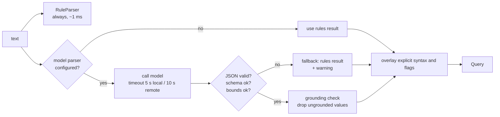

# Models

Status: build-ready spec. Phase 1 ships the traits, Null implementations and `RuleParser`. Phase 2 ships the fastembed embedder. Phase 4 ships the Ollama, OpenAI-compatible and Anthropic parser and reranker backends ([roadmap](../plan/roadmap.md)).
Crate: `openstance-model` (traits and backends). `openstance-core` depends only on the traits.

Related: [search](search.md), [configuration](configuration.md), [enrichment](enrichment.md), [security and threat model](../architecture/security-and-threat-model.md), [crates and dependencies](../architecture/crates-and-dependencies.md), [ADR-0006](../decisions/0006-hybrid-retrieval-optional-models.md).

---

## 1. Principles

1. **The binary works with nothing installed.** Every trait has a Null or rules implementation; models are an upgrade, never a requirement.
2. **Models are optional at exactly two points of search** (parse and rerank) plus the embedder for semantic recall ([search](search.md#3-pipeline)). Ingestion, entity resolution and scoring never call a model.
3. **Model output is data, not authority.** Parser output is validated against `Query` and grounded in the input text; reranker output can only reorder candidates it was given. Evidence is always deterministic.
4. **Local by default.** The default embedder runs on CPU in-process. Remote backends are opt-in per config line, and anything sent off the machine follows the egress rules in section 9.
5. **Core stays sync.** Backends use blocking HTTP (`ureq` with rustls). The MCP and HTTP servers (the only tokio users) call search through `tokio::task::spawn_blocking`.

---

## 2. Traits

```rust
// openstance-model/src/lib.rs

pub type Result<T> = std::result::Result<T, ModelError>;

#[derive(Debug, thiserror::Error)]
pub enum ModelError {
    #[error("model not available: {0}")]        Unavailable(String),   // not downloaded, server down
    #[error("timeout after {0:?}")]              Timeout(std::time::Duration),
    #[error("invalid model output: {0}")]        InvalidOutput(String), // JSON/schema/grounding failure
    #[error("http {status}: {body}")]            Http { status: u16, body: String },
    #[error("egress not allowed for {0}")]       EgressDenied(String),
    #[error(transparent)]                        Other(#[from] anyhow::Error),
}

#[derive(Debug, Clone, Copy, PartialEq, Eq)]
pub enum EmbedKind { Query, Passage }

pub trait Embedder: Send + Sync {
    /// Stable id stored in the DB, e.g. "fastembed:bge-small-en-v1.5". Changing it forces a re-index.
    fn id(&self) -> &str;
    /// Vector length; 0 for NullEmbedder (vector search disabled).
    fn dims(&self) -> usize;
    /// True when calls leave the machine (section 9).
    fn is_remote(&self) -> bool;
    fn embed(&self, texts: &[&str], kind: EmbedKind) -> Result<Vec<Vec<f32>>>;
}

pub trait QueryParser: Send + Sync {
    fn id(&self) -> &str;                       // "rules", "ollama:qwen2.5:7b", "anthropic:claude-haiku-4-5"
    fn is_remote(&self) -> bool;
    /// `today` is unix seconds at local midnight; the parser's timezone is fixed at construction.
    fn parse(&self, text: &str, today: i64) -> Result<Query>;
}

pub struct Candidate {
    pub id: i64,                 // person.id; never sent to remote backends (section 5.3)
    pub profile: CandidateProfile,
    pub fused: f32,
    pub score: f32,
    pub no_enrich: bool,
}

pub struct CandidateProfile {
    pub title: Option<String>, pub company: Option<String>, pub location: Option<String>,
    pub tags: Vec<String>,
    pub display_name: Option<String>,   // local backends only
    pub subjects: Vec<String>,          // local backends only, top 5
}

pub struct Ranked { pub id: i64, pub rank_score: f32, pub reason: Option<String> }

pub trait Reranker: Send + Sync {
    fn id(&self) -> &str;                // "none", "fastembed:bge-reranker-base", "anthropic:claude-haiku-4-5"
    fn is_remote(&self) -> bool;
    fn rerank(&self, q: &Query, cands: Vec<Candidate>) -> Result<Vec<Ranked>>;
}
```

`Query` is defined in [search](search.md#2-the-query-struct) and lives in `openstance-model` (re-exported by core) so parsers can return it without depending on core.

> **Differs from the original spec PDF:** `Embedder::embed` takes an `EmbedKind`, because bge and nomic models expect different prefixes for queries and documents; all traits gain `id()` (for cache keys and re-index detection) and `is_remote()` (for egress rules).

### 2.1 Null and default implementations

| Trait | Implementation | Behavior |
|---|---|---|
| Embedder | `NullEmbedder` | `id = "none"`, `dims = 0`, `embed` returns `Unavailable`; search skips the vector half |
| QueryParser | `RuleParser` (default) | regex and lexicon rules, no model ([search](search.md#42-ruleparser)) |
| QueryParser | `PassthroughParser` | whole input becomes `Query.text`; used by `--no-parse` |
| Reranker | `NullReranker` (default) | returns candidates in input (fused) order, no reasons |
| test only | `HashEmbedder` | deterministic 384-d vectors from token hashes; used in CI so search tests never download a model ([testing strategy](../engineering/testing-strategy.md)) |
| test only | `MockParser`, `MockReranker` | canned outputs, record calls |

### 2.2 Construction from config

```rust
pub struct Models { pub embedder: Box<dyn Embedder>, pub parser: Box<dyn QueryParser>, pub reranker: Box<dyn Reranker> }

pub fn from_config(cfg: &ModelConfig, paths: &Paths, lexicon: Lexicon) -> Result<Models>;
```

Spec strings are `backend:model`:

| Key | Accepted values |
|---|---|
| `model.embedder` | `none`, `fastembed:bge-small-en-v1.5` (default), `ollama:<model>` (e.g. `ollama:nomic-embed-text`), `openai:<model>` (e.g. `openai:text-embedding-3-small`) |
| `model.parser` | `rules` (default), `ollama:<model>` (e.g. `ollama:qwen2.5:7b`), `openai:<model>` (e.g. `openai:gpt-4o-mini`), `anthropic:<model>` (e.g. `anthropic:claude-haiku-4-5`) |
| `model.reranker` | `none` (default), `fastembed:bge-reranker-base`, `ollama:<model>`, `openai:<model>`, `anthropic:<model>` |

`anthropic:` is rejected for `model.embedder` at config load (Anthropic has no embeddings endpoint). Backend construction is lazy: the fastembed model loads on the first `embed` call, not at startup, so structured CLI queries never pay model load time.

Each backend is a Cargo feature of `openstance-model` (`fastembed`, `ollama`, `openai`, `anthropic`), all on in release builds; a contributor can build without `fastembed` to skip ONNX Runtime ([crates and dependencies](../architecture/crates-and-dependencies.md)).

---

## 3. Embedder

### 3.1 Backends

| Backend | Default model | Dims | Where it runs | Notes |
|---|---|---|---|---|
| fastembed | `bge-small-en-v1.5`, int8-quantized ONNX | 384 | in-process, CPU, via ONNX Runtime (`ort`) | default; about a 33 MB download on first use |
| ollama | `nomic-embed-text` | 768 | local Ollama server | `POST {base_url}/api/embed` with `{"model", "input": [..]}` |
| openai-compatible | `text-embedding-3-small` | 1536 (or `dimensions` if set) | remote API or local compatible server | `POST {base_url}/embeddings` |

Dims for ollama and openai-compatible backends are probed once (embed a fixed string) and stored with the embedder id.

### 3.2 Query and passage forms

| Model family | Query form | Passage form |
|---|---|---|
| bge-*-en-v1.5 | `"Represent this sentence for searching relevant passages: " + text` | text as is |
| nomic-embed-text | `"search_query: " + text` | `"search_document: " + text` |
| OpenAI text-embedding-3-* | text as is | text as is |

The table lives in `openstance-model/src/embed/prefixes.rs`; unknown models get no prefix and a debug log.

### 3.3 fastembed integration

```rust
let model = TextEmbedding::try_new(
    InitOptions::new(EmbeddingModel::BGESmallENV15Q)
        .with_cache_dir(paths.models_dir.join("fastembed"))
        .with_show_download_progress(io::stderr().is_terminal()),
)?;
```

- Pin the `fastembed` crate version in the workspace; its `embed` signature has changed across major versions. Wrap the model in a `Mutex` if the pinned version needs `&mut self`.
- Batch size 256 for indexing. One query string per search.
- Vectors are L2-normalized before storage so cosine distance in sqlite-vec is well behaved.
- Thread count: ONNX Runtime intra-op threads = physical cores minus one, configurable through `OPENSTANCE_EMBED_THREADS`.

---

## 4. QueryParser

### 4.1 Flow



### 4.2 Output schema

Models produce a wire format with ISO dates (models are bad at unix timestamps); it is converted to `Query` after validation. The schema is generated with `schemars` from `ParsedQueryWire` and checked in as `openstance-model/schema/query.schema.json` (a test fails if they drift). Strict modes need every field present, so optional values are nullable rather than omitted:

```json
{
  "type": "object",
  "additionalProperties": false,
  "required": ["text","company","title","location","industry","tags","since","until",
               "last_contact_before","met_in_person","replied","min_score","lost_touch","limit"],
  "properties": {
    "text":                {"type": ["string","null"], "maxLength": 200},
    "company":             {"type": "array", "items": {"type": "string", "maxLength": 80}, "maxItems": 8},
    "title":               {"type": "array", "items": {"type": "string", "maxLength": 80}, "maxItems": 8},
    "location":            {"type": "array", "items": {"type": "string", "maxLength": 80}, "maxItems": 8},
    "industry":            {"type": "array", "items": {"type": "string", "maxLength": 40}, "maxItems": 8},
    "tags":                {"type": "array", "items": {"type": "string", "maxLength": 40}, "maxItems": 8},
    "since":               {"type": ["string","null"], "pattern": "^\\d{4}-\\d{2}-\\d{2}$"},
    "until":               {"type": ["string","null"], "pattern": "^\\d{4}-\\d{2}-\\d{2}$"},
    "last_contact_before": {"type": ["string","null"], "pattern": "^\\d{4}-\\d{2}-\\d{2}$"},
    "met_in_person":       {"type": ["boolean","null"]},
    "replied":             {"type": ["boolean","null"]},
    "min_score":           {"type": ["number","null"], "minimum": 0, "maximum": 1},
    "lost_touch":          {"type": ["boolean","null"]},
    "limit":               {"type": ["integer","null"], "minimum": 1, "maximum": 200}
  }
}
```

`include_bulk` is deliberately not in the schema: only the user (flag or explicit syntax) can turn it on.

### 4.3 Validation (in order)

1. **Parse:** `serde_json::from_str::<ParsedQueryWire>` with `deny_unknown_fields`. Failure: `InvalidOutput`, fall back.
2. **Bounds:** lengths and counts as in the schema (re-checked, since not every backend enforces schemas); dates parse; `since < until`; no date later than `today + 1 day`; `limit` defaults to 30 when null. Failure: fall back.
3. **Grounding:** prevents invented filters.
   - `company`, `location`: keep a value only if its normalized form, or an alias of it, appears in the normalized input text.
   - `title`, `industry`: keep a value only if it is in the static role/industry tables ([search](search.md#44-entity-phrases)) or appears in the input.
   - `tags`: keep only existing tags.
   - `text`: if it contains words not present in the input, replace it with the RuleParser's residual text.
   - Dropped values add a warning (`parser dropped ungrounded company "OpenAI"`). Grounding never triggers a full fallback unless everything is dropped and the input was non-empty.
4. **Overlay:** explicit field syntax and CLI/JSON filters override parsed fields ([search](search.md#41-precedence)).

The response always reports `query_source.parser` (the parser that produced the result) and `query_source.fallback` (the reason, if rules were used instead).

### 4.4 Backends

| Backend | Endpoint | Structured output mechanism |
|---|---|---|
| ollama | `POST {base_url}/api/chat`, `"stream": false`, `"options": {"temperature": 0}` | `"format": <JSON schema>` (Ollama structured outputs) |
| openai-compatible | `POST {base_url}/chat/completions`, `temperature: 0` | `response_format: {"type": "json_schema", "json_schema": {"name": "query", "strict": true, "schema": ...}}`; `json_mode = "object"` falls back to `{"type": "json_object"}` and `"prompt"` to instructions only, for servers without schema support |
| anthropic | `POST https://api.anthropic.com/v1/messages`, headers `x-api-key`, `anthropic-version: 2023-06-01` | `output_config: {"format": {"type": "json_schema", "schema": ...}}` (structured outputs); a single tool with `strict: true` is the alternative if a chosen model lacks structured-output support |

There is no official Anthropic Rust SDK; the backend uses raw HTTP with `ureq`. Retries: 2 on 429/5xx/connection errors with exponential backoff, inside the overall timeout.

### 4.5 Parser prompt outline

Kept in `openstance-model/prompts/parse.md`, versioned, and covered by the local eval tier. The static part comes first so backends with prefix caching can reuse it; the date goes in the user turn.

```
System:
  You convert a question about the user's own contacts into a JSON filter object.
  Fill only fields the question states or clearly implies. Never invent a company,
  person, place or date that is not in the question. Use lowercase singular role
  words (founder, investor, engineer, pm, designer, recruiter, ...).
  Dates: return YYYY-MM-DD. "last year" = Jan 1 to Jan 1 of the previous calendar year.
  "met" means an in-person or calendar meeting. "lost touch" sets lost_touch.
  Words that are not filters go into "text"; use null when nothing remains.
  [field-by-field description generated from the schema]
  [6 to 8 worked examples: the table in search.md section 4.7]

User:
  Today is 2026-10-20 (Tuesday), timezone Asia/Kolkata.
  Question: fintech founders I met last year
```

Nothing from the graph (names, emails, subjects) is included in the parser prompt. The input text is the user's own question and nothing else.

### 4.6 Caching

An in-process LRU (256 entries) keyed by `(parser.id, normalized text, today)` avoids re-parsing when an MCP client repeats a call. Nothing is cached on disk.

---

## 5. Reranker

### 5.1 Contract

- Input: the parsed `Query` and at most 50 candidates in fused order ([search](search.md#7-step-5-rerank-optional)).
- Output: a permutation (or subset) of the input ids with `rank_score` and an optional `reason` of at most 140 characters.
- Validation: ids must be a subset of the input; duplicates are dropped; missing candidates are appended in fused order. Reasons longer than 140 characters are truncated. Any failure returns the fused order and a warning.
- The reranker never changes `score`, `components`, `matched` or `evidence`.

### 5.2 Local cross-encoder

`fastembed:bge-reranker-base` via `TextRerank` (`RerankerModel::BGERerankerBase`). The document per candidate is the embedding text (section 6.1) truncated to 256 tokens. No reasons are produced. This model is much larger than the embedder (several hundred MB), so it is opt-in and downloaded only when configured. Smaller cross-encoders supported by fastembed can be evaluated in the Phase 4 eval.

### 5.3 API rerankers

Ollama, OpenAI-compatible and Anthropic backends use one prompt (`prompts/rerank.md`) and JSON output `{"ranked": [{"i": 3, "reason": "..."}]}`, validated like parser output.

Payload rules:

- Candidates are labeled `i = 0..49` by position, never by `person.id`.
- **Remote backends** (`is_remote() == true`) receive only `title`, `company`, `location`, `tags` and a coarse score bucket (`strong` / `warm` / `weak`). No names, emails, phone numbers or interaction subjects. Candidates with `no_enrich = 1` are sent as an empty profile and keep their fused position.
- **Local backends** (Ollama on a loopback address) may also receive display names and up to five recent subjects, which improves reasons.

Prompt outline:

```
System:
  Rank these contacts for the user's question. Use only the fields given.
  Return every index once, best first, with a reason of at most 20 words that
  cites a field (title, company, location, tag). Do not speculate beyond the fields.

User:
  Question: ml researchers in sf who could advise on evals
  Filters: title=researcher, location=san francisco
  Candidates:
  0 | Research Scientist | Acme AI | San Francisco | tags: ml | strong
  1 | ML Engineer | Stripe | San Francisco | | warm
  ...
```

Reasons are labeled `"reason_source": "model:<id>"` in results ([search](search.md#9-result-json)).

---

## 6. Embedding text and re-indexing

### 6.1 Embedding text

One passage per non-bulk person, built in core (`core::search::embed_text`):

```
{display_name}. {title} at {company}. {location}. {bio}
Tags: {tag1}, {tag2}
Topics: {subject1}; {subject2}; ...
```

- Empty parts are omitted (no "None at None").
- Topics: up to 20 most frequent normalized interaction subjects for that person, after stripping `Re:`/`Fwd:` prefixes and dropping generic subjects (`hi`, `hello`, `meeting`, `invitation:`, `accepted:`, `updated invitation`, LinkedIn's default DM subject). This is what lets "devtools dinner" match semantically.
- Notes are excluded: free-text notes contain negations ("not an investor") that embeddings handle badly, a lesson from the v0.1 prototype ([prototype](../prototype-v0.1.md)). Notes stay searchable through FTS only if the data model indexes them.
- Truncated to the model's maximum input (512 tokens for bge-small) by the backend.
- `text_hash = blake3(embedder.id() + "\n" + embed_text)`.

### 6.2 Storage

`person_vec` is a sqlite-vec `vec0` table keyed by `person_id` ([data model](data-model.md)). Its dimension is fixed at creation, so it is created at runtime with the configured embedder's dims:

```sql
CREATE VIRTUAL TABLE person_vec USING vec0(
  person_id INTEGER PRIMARY KEY,
  embedding float[384],          -- {dims}
  +text_hash TEXT                -- auxiliary column; skip re-embedding unchanged people
);
```

The schema-version/meta table holds `embedder_id`, `embedder_dims` and `embedder_state` (`ready` or `building`). If the pinned sqlite-vec version lacks auxiliary columns, `text_hash` moves to the meta table as a per-person map. That is an implementation detail and does not change behavior.

### 6.3 When re-indexing happens

| Event | Action |
|---|---|
| import or edit changes a person's embed text | re-embed that person at the end of the import (hash differs) |
| `openstance rebuild` | re-embed everyone whose hash differs |
| `openstance rebuild --embeddings` | force re-embed everyone |
| configured `embedder_id` differs from meta | vector search disabled with a warning until the next `rebuild`; `rebuild` drops and recreates `person_vec` with the new dims |
| `embedder = "none"` | `person_vec` left in place but unused; `rebuild` does not touch it |

### 6.4 Procedure

1. Set `embedder_state = building` (search skips the vector half while building).
2. If the dims or id changed: `DROP TABLE person_vec; CREATE VIRTUAL TABLE person_vec ... float[{dims}]`.
3. Stream people whose `text_hash` is missing or different, in batches (256 for fastembed, 512 for HTTP backends), committing every 2,000 rows so an interrupted run resumes where it stopped.
4. For remote embedders, quote first and skip `no_enrich` people (section 9).
5. Set `embedder_id`, `embedder_dims`, `embedder_state = ready`.

Target: first-run embedding of 20k people in under 90 s on CPU ([performance targets](../engineering/performance-targets.md)).

---

## 7. Model download and caching

- Location: `~/.openstance/models/` (`fastembed/` for ONNX models). Never the current directory; fastembed's default cache dir is overridden.
- First use downloads from the model's Hugging Face repository with a progress bar on stderr (TTY only). Approximate sizes: bge-small-en-v1.5 quantized about 33 MB; bge-reranker-base is much larger and is downloaded only if configured.
- After download, a `manifest.json` records model name, revision and sha256 of each file; files are verified on load, and a mismatch triggers one re-download and then a hard error.
- Override the location with `model.cache_dir` or `OPENSTANCE_MODEL_DIR`.
- Offline: `OPENSTANCE_OFFLINE=1` (and the standard `HF_HUB_OFFLINE=1`) forbids downloads. Missing models then produce `Unavailable`, and search degrades ([search](search.md#12-degradation)). For air-gapped machines, copy `~/.openstance/models/` from another machine.
- Proxies: `HTTPS_PROXY` is respected.
- Model downloads are the only network traffic the default configuration ever makes, and they carry no user data. `openstance init` says this and offers to download right away.
- Proposed management commands, not yet in [interfaces](interfaces.md) (open question): `openstance models list | pull <id> | rm <id>`. Until then, `openstance rebuild --embeddings` downloads the configured embedder.

Binary size target: under 40 MB without models. ONNX Runtime is statically linked through `ort` and is the largest single dependency; track this in CI ([ci and release](../engineering/ci-and-release.md)).

---

## 8. Configuration

Full reference in [configuration](configuration.md); model-related keys:

```toml
[model]
embedder = "fastembed:bge-small-en-v1.5"   # none | fastembed:<m> | ollama:<m> | openai:<m>
parser   = "rules"                         # rules | ollama:<m> | openai:<m> | anthropic:<m>
reranker = "none"                          # none | fastembed:bge-reranker-base | ollama:<m> | openai:<m> | anthropic:<m>
timeout_local_ms  = 5000
timeout_remote_ms = 10000

[model.ollama]
base_url = "http://127.0.0.1:11434"        # a non-loopback host counts as remote

[model.openai]
base_url = "https://api.openai.com/v1"     # any OpenAI-compatible server (vLLM, llama.cpp, LM Studio, ...)
api_key_env = "OPENAI_API_KEY"             # keys are read from env, never stored in config
json_mode = "schema"                       # schema | object | prompt
# dimensions = 512                         # optional, embeddings only

[model.anthropic]
api_key_env = "ANTHROPIC_API_KEY"
```

`openstance config` prints the effective models and, for each remote one, the host it sends data to.

---

## 9. Privacy and egress rules for models

Model calls to a remote host are egress, the same as enrichment ([enrichment](enrichment.md), [security and threat model](../architecture/security-and-threat-model.md)). Rules enforced in `openstance-model` and core, not left to each backend:

| Call | Data that leaves | Rule |
|---|---|---|
| remote parser | the question text only | allowed once configured; each call is logged to `enrich_log` with backend `model:<provider>` (e.g. `model:anthropic`), op `parse`, token counts and estimated cost |
| remote reranker | title, company, location, tags, score bucket for at most 50 people; no names, emails or subjects | logged as above; `no_enrich` people are sent as empty profiles |
| remote embedder, indexing | embed text (names, titles, subjects) for every non-bulk person | **quoted first** (people, tokens, estimated USD), requires interactive confirmation or `--yes`; `no_enrich` people are never sent and get no vector; logged as one `enrich_log` row per batch |
| remote embedder, query | the query text | logged like a parse call |
| local backends (fastembed, Ollama on loopback) | nothing | not logged as egress |

A config that names a remote backend is the user's consent for per-query calls; bulk uploads still need explicit confirmation. Remote backend errors never include request bodies in logs.

---

## 10. Cost notes

Prices are per million tokens at the time of writing and change often. The binary keeps a small price table per model id for quotes and `enrich_log` estimates, and the user can override it in config. Verify before relying on these numbers.

| Model | Input $/MTok | Output $/MTok |
|---|---|---|
| Anthropic `claude-haiku-4-5` | 1.00 | 5.00 |
| OpenAI `gpt-4o-mini` | 0.15 | 0.60 |
| OpenAI `text-embedding-3-small` | 0.02 | n/a |
| fastembed, Ollama (local) | 0 | 0 |

Rough per-operation cost:

| Operation | Tokens (approx.) | Haiku 4.5 | gpt-4o-mini |
|---|---|---|---|
| parse one query | 1,500 in (prompt, schema, examples) + 150 out | $0.0023 | $0.0003 |
| rerank 50 candidates with reasons | 3,500 in + 1,500 out | $0.011 | $0.0014 |
| 1,000 queries/month, parse only | | about $2.30 | about $0.30 |
| 1,000 queries/month, parse + rerank | | about $13 | about $1.70 |
| embed 20k people remotely (once) | about 5M tokens | n/a | about $0.10 |

The default configuration costs $0 per query. The Phase 4 eval should show whether a small local parser (Ollama 3B to 8B) closes most of the gap to API models; if it does, documentation should recommend local first.

---

## 11. Tests

- Trait conformance suite (`openstance-model/tests/conformance.rs`) run against every backend that is available: dims match vectors, empty input, Unicode input, batch of 1,000.
- Parser validation: table tests with hostile model outputs (extra fields, wrong types, invented companies, future dates, 10,000-item arrays, prose around JSON). All must fall back or drop values, never panic.
- Schema drift test: generated schema equals the checked-in `query.schema.json`.
- Egress tests with a mock HTTP server: remote reranker payloads contain no names or emails; `no_enrich` profiles are empty; remote embedding without confirmation returns `EgressDenied`.
- CI uses `HashEmbedder`, `RuleParser` and `NullReranker` only; model tiers run locally ([testing strategy](../engineering/testing-strategy.md)).
