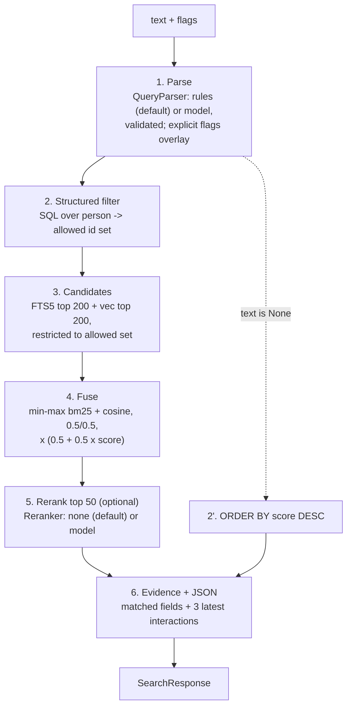

# Search

Status: build-ready spec. Phase 1 delivers the rules parser, structured SQL and FTS5. Phase 2 adds the embedder, vector candidates and fusion. Phase 4 adds model parsers and rerankers ([roadmap](../plan/roadmap.md)).
Crate: `openstance-core` (`core::search`), with model traits from `openstance-model` ([models](models.md)).

Related: [scoring](scoring.md), [models](models.md), [data model](data-model.md), [interfaces](interfaces.md), [ADR-0006](../decisions/0006-hybrid-retrieval-optional-models.md), [performance targets](../engineering/performance-targets.md).

---

## 1. What search must do

- Answer plain-English questions over the local graph: "who do I know at Stripe", "fintech founders I've actually met", "people I lost touch with who are now at Anthropic".
- Always work with **no model installed**: flags and a rules parser plus SQL and FTS5.
- Show the filters it extracted, and let the user edit them and rerun without calling a model again.
- Return evidence (matched fields, recent interactions) for every result; never prose-only.
- Targets on an M2 laptop with 20k people and 500k interactions: **under 50 ms** for structured queries, **under 300 ms** for text queries with the local embedder warm.

One function serves every surface: `openstance search`, MCP `search_people`, HTTP `GET /people?q=`, and `search_view` over imported views.

```rust
pub fn search(g: &Graph, req: &SearchRequest, models: &Models) -> Result<SearchResponse>;
```

---

## 2. The Query struct

```rust
#[derive(Debug, Clone, Default, PartialEq, Serialize, Deserialize, JsonSchema)]
#[serde(deny_unknown_fields)]
pub struct Query {
    /// Free text for FTS5 and the embedder. None = pure structured query.
    pub text: Option<String>,
    /// Hard filters. Values inside one field are OR-ed; fields are AND-ed.
    #[serde(default)] pub company: Vec<String>,
    #[serde(default)] pub title: Vec<String>,
    #[serde(default)] pub location: Vec<String>,
    /// Soft: boosts text relevance and matches tags; never excludes (no industry column exists).
    #[serde(default)] pub industry: Vec<String>,
    /// Exact tag match against override(field='tag').
    #[serde(default)] pub tags: Vec<String>,
    /// Interaction window, unix seconds: at least one contact interaction in [since, until).
    pub since: Option<i64>,
    pub until: Option<i64>,
    /// Last contact strictly before this instant ("haven't talked to since 2024").
    pub last_contact_before: Option<i64>,
    /// true: has a meeting interaction (inside the window if one is set). false: has none.
    pub met_in_person: Option<bool>,
    /// true: reciprocity > 0. false: reciprocity = 0.
    pub replied: Option<bool>,
    pub min_score: Option<f32>,
    /// High frequency, low recency: score_f >= 0.5 AND score_r < 0.2.
    pub lost_touch: Option<bool>,
    /// Include is_bulk = 1 people. Default false.
    #[serde(default)] pub include_bulk: bool,
    /// Default 30, max 200.
    pub limit: usize,
}
```

> **Differs from the original spec PDF:** added `tags`, `include_bulk` and `last_contact_before`; `since`/`until` mean "had an interaction in this window" rather than bounds on `last_contact`, so "people I met last year" still finds people you also met this year. `industry` is soft because the schema has no industry column. These are recorded here and in [interfaces](interfaces.md).

`SearchRequest` wraps the inputs and the provenance:

```rust
pub struct SearchRequest {
    pub text: Option<String>,        // raw user text, parsed in step 1
    pub filters: QueryPatch,         // explicit flags / JSON filters; always win over parsed values
    pub no_parse: bool,              // skip step 1: text goes straight to Query.text
    pub explain: bool,               // include full score_detail and timings
    pub today: i64,                  // injected for tests; CLI passes now()
}
```

`QueryPatch` has the same fields as `Query`, all `Option`, and is applied over the parsed `Query` field by field.

---

## 3. Pipeline



Steps 2, 3, 4 and 6 are SQL and arithmetic. Steps 1 and 5 use a model only when one is configured. Query embedding in step 3 uses the configured `Embedder` (local by default); with `embedder = "none"` the vector half is skipped.

> **Differs from the original spec PDF:** the PDF filtered by structured fields *after* taking the global top 200 FTS and vector hits. That loses recall on filtered queries ("ml people at Stripe" when the top 200 "ml" hits are elsewhere). Here the structured filter runs first and candidates are generated inside the allowed set. The result is a superset of the PDF's behavior at the same cost (the allowed set is at most 20k ids).

### 3.1 Two modes

| Mode | Condition | Ordering |
|---|---|---|
| structured | `Query.text` is None after step 1 | `score DESC, last_contact DESC, id ASC` over the allowed set; steps 3 to 5 skipped |
| text | `Query.text` is Some | fused relevance (step 4), optional rerank (step 5) |

Ties in any ordering break by `score DESC`, then `last_contact DESC`, then `id ASC`, so results are deterministic.

---

## 4. Step 1: parsing

### 4.1 Precedence

1. Explicit field syntax in the text (`company:stripe`) and CLI flags / JSON filters (`--company stripe`) always win.
2. A configured model parser ([models](models.md#4-queryparser)) if it returns valid output.
3. `RuleParser` otherwise. It also runs (1 ms) when a model parser is configured, so a fallback is ready and so its explicit-syntax results can be overlaid.

The parser never invents a filter the user cannot see: the parsed `Query` is always returned in the response (section 9) and printed by the CLI.

### 4.2 RuleParser

Construction: `RuleParser::new(lexicon: Lexicon, tz: chrono_tz::Tz)`. The lexicon is built at `rebuild` (and cached in memory per process) from the user's own graph plus static tables:

| Lexicon | Source |
|---|---|
| companies | distinct normalized `person.company`, plus company names mapped from email domains in [entity resolution](entity-resolution.md) |
| locations | distinct normalized `person.location` plus a static alias table |
| tags | distinct `override(field='tag')` values |
| titles | static role table (below) |
| industries | static table (below) |

Algorithm:

1. Normalize: NFKC, lowercase, collapse whitespace, strip punctuation except `@ . : - " '`. Keep the original string for quoted phrases.
2. Extract explicit field syntax (section 4.3) and remove it from the working text.
3. Run date rules (section 4.5), then flag rules (4.6), then entity rules (4.4). Each match consumes its tokens.
4. Remaining tokens minus stopwords (the v0.1 prototype's `STOP` list in `dist/model.js` is the starting point) become `Query.text`. If nothing remains, `text = None`.
5. Plurals and aliases are canonicalized with the v0.1 alias map (`founders -> founder`, `vcs -> investor`, `sf -> san francisco`, `bangalore -> bengaluru`, `devtools -> developer tools`, ...), extended in `core::search::aliases`.

Rules are ordered and the longest match wins at each position. Everything is table-driven and unit-tested one phrase per row (`core/src/search/rules_tests.rs`).

### 4.3 Explicit field syntax

| Syntax | Field |
|---|---|
| `company:stripe`, `company:"jane street"`, `at:stripe` | company |
| `title:founder`, `role:"product manager"` | title |
| `location:sf`, `in:"new york"` | location |
| `industry:fintech` | industry |
| `tag:investor`, `#investor` | tags |
| `since:2025-01`, `since:2025-01-15`, `until:2026-06` | since / until |
| `before:2024` | last_contact_before |
| `met`, `met:yes`, `met:no` | met_in_person |
| `replied`, `replied:no` | replied |
| `lost-touch` | lost_touch |
| `min-score:0.5` | min_score |
| `limit:10` | limit |
| `bulk:yes` | include_bulk |

These are the same keys as the CLI flags, so `openstance search 'company:stripe met'` equals `openstance search --company stripe --met`.

### 4.4 Entity phrases

| Field | Trigger | Rule |
|---|---|---|
| company | `at X`, `@ X`, `from X`, `now at X`, `works at X`, `who knows (someone) at X` | X = longest lexicon match (up to 4 tokens) after the trigger; if no lexicon match, accept the next 1 to 3 tokens up to a stopword or another trigger, only when they were capitalized in the raw text |
| company | bare mention | a lexicon company of 4+ characters that appears without a trigger, only if it is not an English dictionary word and is not in the title or industry tables (`notion` without `at` stays text) |
| location | `in X`, `based in X`, `from X`, `near X` | X must match the location lexicon or the static alias table; checked before company so `in sf` is a location and `at sf` is not |
| title | role words anywhere | static table: `founder` (founder, co-founder, cofounder, founding), `ceo`, `cto`, `cfo`, `coo`, `vp` (vp, vice president), `head of`, `director`, `engineer` (engineer, eng, swe, developer, dev), `pm` / `product manager`, `designer`, `recruiter` (recruiter, talent), `investor` (investor, vc, angel, partner at a fund), `researcher`, `sales` (ae, account executive, seller), `marketing`, `advisor` |
| industry | industry words anywhere | static table: fintech, devtools / developer tools, ai / ml / machine learning, crypto / web3, healthtech / health, climate, security / infosec, saas, b2b, consumer, gaming, edtech, biotech, robotics, hardware |
| tags | `#word`, or a token that exactly equals an existing tag and is not in another table | |

`in` is ambiguous ("people in fintech"): lookup order is location lexicon, then industry table, then left as text.

### 4.5 Date phrases

All dates are computed in the user's local timezone from `today` (unix seconds) and converted to unix seconds. Windows are half-open `[since, until)`.

| Phrase | since | until |
|---|---|---|
| `today` | start of today | start of tomorrow |
| `yesterday` | start of yesterday | start of today |
| `this week` | Monday 00:00 this week | none |
| `last week` | Monday of previous week | Monday of this week |
| `this month` | 1st of this month | none |
| `last month` | 1st of previous month | 1st of this month |
| `this year` | Jan 1 this year | none |
| `last year` | Jan 1 of (year - 1) | Jan 1 this year |
| `in 2025`, `during 2025` | Jan 1 2025 | Jan 1 2026 |
| `in march`, `in march 2025` | March 1 of the most recent March not in the future (or the given year) | April 1 of that year |
| `since 2025`, `since march`, `since 2025-03`, `after ...` | start of that period | none |
| `before 2024`, `until 2024-06` | none | start of that period |
| `last N days/weeks/months/years`, `past N ...`, `in the last N ...` | today minus N units | none |
| `recently`, `lately` | today minus 90 days | none |
| `haven't talked to since X`, `not since X`, `haven't spoken to since X` | | sets `last_contact_before = start of X` instead of a window |

Number words one to twelve are accepted ("last two years"). An unparseable date-looking token is left in `text` and a warning is added (`"could not parse date: 'Q5'"`).

### 4.6 Flag phrases

| Phrase (normalized) | Sets |
|---|---|
| `met`, `i've met`, `have met`, `actually met`, `met in person`, `in person`, `had a meeting with` | `met_in_person = true` |
| `never met`, `haven't met`, `not met` | `met_in_person = false` |
| `replied`, `who replied`, `responded`, `wrote back`, `actually talk to`, `talk to` | `replied = true` |
| `never replied`, `didn't reply`, `ghosted`, `no reply` | `replied = false` |
| `lost touch`, `drifted`, `haven't talked to in a while`, `fell out of touch`, `should reconnect` | `lost_touch = true` |
| `close`, `warm`, `strong`, `know well` | `min_score = 0.4` |
| `top N`, `N people`, `first N` | `limit = N` (capped at 200) |

### 4.7 Examples

| Input | Parsed Query (non-default fields) |
|---|---|
| `who do I know at Stripe` | `company=["stripe"]` |
| `fintech founders I've actually met` | `title=["founder"], industry=["fintech"], met_in_person=true` |
| `fintech founders I met last year` | `title=["founder"], industry=["fintech"], met_in_person=true, since=2025-01-01, until=2026-01-01` |
| `people I lost touch with who are now at Anthropic` | `company=["anthropic"], lost_touch=true` |
| `ml researchers in sf` | `title=["researcher"], location=["san francisco"], text="ml"` |
| `devtools dinner` | `text="developer tools dinner"` (finds people via the `subjects` FTS column) |
| `investors who replied #angels limit:10` | `title=["investor"], replied=true, tags=["angels"], limit=10` |
| `haven't talked to since 2024 at google` | `company=["google"], last_contact_before=2024-01-01` |

These rows are part of the parser unit tests and seed the 50-query search eval ([testing strategy](../engineering/testing-strategy.md)).

---

## 5. Step 2: structured filter (SQL)

### 5.1 Base

The filter produces the allowed id set (or, in structured mode, the final ordered page). Generated SQL uses bound parameters only; user strings are never interpolated. FTS match strings are built by quoting every term (`"stripe"`), doubling embedded quotes, so FTS5 syntax in user input is inert.

```sql
SELECT p.id
FROM person p
WHERE p.score IS NOT NULL            -- excludes the self person
  AND (:include_bulk OR p.is_bulk = 0)
  /* + one clause per present field, below */
```

`person` columns already reflect overrides (rebuild replays overrides; see [data model](data-model.md)), so filters see user edits.

### 5.2 Per-field clauses

**company** (OR over values): FTS column filter on the current company, or any work email at a matching domain.

```sql
AND (
  p.id IN (SELECT rowid FROM person_fts WHERE person_fts MATCH :company_fts)   -- 'company:("stripe" OR "jane street")'
  OR p.id IN (SELECT person_id FROM identity
              WHERE kind = 'email' AND (value LIKE :dom1 ESCAPE '\' OR ...))  -- '%@stripe.com', '%.stripe.com'
)
```

Company-to-domain mapping comes from the entity-resolution company table; personal domains (gmail.com, outlook.com, icloud.com, ...) are never used. Note the domain branch can match people who used to work there; results carry a `matched` entry that says `via email domain` so the user can tell.

**title** and **location**: FTS column filters with aliases expanded.

```sql
AND p.id IN (SELECT rowid FROM person_fts WHERE person_fts MATCH :title_fts)      -- 'title:("founder" OR "co founder" OR "cofounder")'
AND p.id IN (SELECT rowid FROM person_fts WHERE person_fts MATCH :location_fts)   -- 'location:("san francisco" OR "sf")'
```

**tags**:

```sql
AND EXISTS (SELECT 1 FROM override o
            WHERE o.person_id = p.id AND o.field = 'tag' AND lower(o.value) IN (:t1, :t2))
```

**since / until / met_in_person** (combined into one EXISTS when both are set):

```sql
AND EXISTS (
  SELECT 1 FROM interaction_person ip
  JOIN interaction i ON i.id = ip.interaction_id
  WHERE ip.person_id = p.id
    AND i.kind IN ('email','meeting','dm','connection')   -- 'meeting' only, when met_in_person = true
    AND (:since IS NULL OR i.at >= :since)
    AND (:until IS NULL OR i.at <  :until)
)
-- met_in_person = false:
AND NOT EXISTS (SELECT 1 FROM interaction_person ip JOIN interaction i ON i.id = ip.interaction_id
                WHERE ip.person_id = p.id AND i.kind = 'meeting')
```

**last_contact_before, replied, min_score, lost_touch** use the stored columns from [scoring](scoring.md#61-stored-columns):

```sql
AND p.last_contact < :last_contact_before
AND p.score_c > 0              -- replied = true   (= 0 for false)
AND p.score >= :min_score
AND p.score_f >= 0.5 AND p.score_r < 0.2      -- lost_touch = true
```

**industry**: no SQL clause. Industry terms are appended to the FTS and embedding text in step 3 and are matched against tags in step 6 (`matched` entry with `field = "industry"`).

### 5.3 Structured mode ordering

```sql
... ORDER BY p.score DESC, p.last_contact DESC, p.id ASC
LIMIT :limit
```

Index support: `person(score DESC)`, `person(last_contact DESC)`, `interaction_person(person_id)`, `interaction(at)`, `identity(kind, value)` (all defined in [data model](data-model.md)).

---

## 6. Step 3 and 4: candidates and fusion

### 6.1 FTS5 candidates

`person_fts` columns: `display_name, title, company, location, bio, subjects` (`subjects` = space-joined interaction subjects for that person). It is a regular, content-storing FTS5 table keyed by `rowid = person.id` ([data model](data-model.md)).

```sql
SELECT rowid AS id, -bm25(person_fts, 8.0, 5.0, 5.0, 2.0, 1.0, 1.0) AS rel
FROM person_fts
WHERE person_fts MATCH :text_fts               -- '"ml" OR "researcher*"' ; terms OR-ed for recall
  AND rowid IN (SELECT value FROM json_each(:allowed_ids))   -- omitted when no structured filter
ORDER BY rel DESC
LIMIT 200;
```

- Terms are OR-ed: bm25 already rewards documents that match more terms. Prefix matching (`term*`) is used only for terms of 4+ characters.
- Column weights favor name, title and company over bio and subjects.
- `bm25()` is lower-is-better; it is negated so higher is better before normalization.
- When the allowed set is the whole graph, the `rowid IN` clause is dropped.

### 6.2 Vector candidates

Query text (plus industry terms) is embedded with the `Embedder` using the query instruction form ([models](models.md#3-embedder)).

Unfiltered (allowed set = everyone):

```sql
SELECT person_id AS id, distance
FROM person_vec
WHERE embedding MATCH :qvec AND k = 200
ORDER BY distance;
```

Filtered: brute-force distance over the allowed ids (at most 20k rows of 384 floats, under 10 ms):

```sql
SELECT person_id AS id, vec_distance_cosine(embedding, :qvec) AS distance
FROM person_vec
WHERE person_id IN (SELECT value FROM json_each(:allowed_ids))
ORDER BY distance
LIMIT 200;
```

`cos = 1 - distance`. Bulk people have no vectors. If the stored embedder id does not match the configured one, the vector half is skipped and a warning is returned ([models](models.md#6-embedding-text-and-re-indexing)).

### 6.3 Fusion

Candidates = union of the FTS hits and the vector hits (at most 400 ids). For each candidate:

```
fts_n = (rel - min_rel) / (max_rel - min_rel)       over FTS hits; 0 if not an FTS hit
vec_n = (cos - min_cos) / (max_cos - min_cos)       over vector hits; 0 if not a vector hit
        (if max == min for a list, every hit in that list gets 1.0)

relevance = 0.5 * fts_n + 0.5 * vec_n               -- both halves available
relevance = fts_n                                   -- no embedder / vec skipped
relevance = vec_n                                   -- FTS returned nothing

fused = relevance * (0.5 + 0.5 * score)
```

The `(0.5 + 0.5 * score)` multiplier means a strong relationship lifts a weaker text match, but a person with score 0 still keeps half their relevance (so a cold but exact match is not erased).

Worked example (three candidates, both halves):

| Person | -bm25 | cos | fts_n | vec_n | relevance | score | fused |
|---|---|---|---|---|---|---|---|
| A | 9.0 | 0.82 | 1.00 | 1.00 | 1.000 | 0.37 | 0.685 |
| B | 6.0 | 0.78 | 0.50 | 0.67 | 0.583 | 0.89 | 0.551 |
| C | 3.0 | 0.70 | 0.00 | 0.00 | 0.000 | 0.61 | 0.000 |
| D | (no FTS hit) | 0.80 | 0.00 | 0.83 | 0.417 | 0.61 | 0.335 |

Order: A, B, D, C. Candidates with `fused = 0` are dropped unless fewer than `limit` results remain.

`min_score` and the other structured filters were already applied in step 2, so fusion never reintroduces a filtered-out person.

---

## 7. Step 5: rerank (optional)

- Input: top 50 by `fused`, plus the parsed `Query`.
- `NullReranker` (default): returns the fused order unchanged, no reasons.
- Model rerankers ([models](models.md#5-reranker)) return a new order for those 50 and, for API models, a one-line `reason` each. Results 51+ keep fused order after them.
- The reranker never changes `score`, `components` or `evidence`. Its reason is labeled `"reason_source": "model:<id>"` in JSON so deterministic evidence and model prose are never confused.
- Timeout (default 5 s local, 10 s remote) or invalid output: keep fused order, add a warning.

---

## 8. Step 6: evidence

For each returned person (after `limit`), evidence = matched fields + the three most recent contact interactions. One query for the whole page:

```sql
SELECT person_id, interaction_id, kind, direction, at, subject, source_kind FROM (
  SELECT ip.person_id, i.id AS interaction_id, i.kind, i.direction, i.at, i.subject, s.kind AS source_kind,
         row_number() OVER (PARTITION BY ip.person_id ORDER BY i.at DESC) AS rn
  FROM interaction_person ip
  JOIN interaction i ON i.id = ip.interaction_id
  JOIN source s      ON s.id = i.source_id
  WHERE ip.person_id IN (SELECT value FROM json_each(:page_ids))
    AND i.kind IN ('email','meeting','dm','connection')
    AND i.at <= :now
)
WHERE rn <= 3;
```

Matched fields are computed in Rust from the parsed Query and the person row:

| field | example `matched` entry |
|---|---|
| company | `{"field":"company","value":"Stripe","matched":"stripe","via":"person.company"}` or `"via":"email domain stripe.com"` |
| title | `{"field":"title","value":"Co-founder & CEO","matched":"founder"}` |
| location | `{"field":"location","value":"San Francisco, CA","matched":"san francisco"}` |
| text | `{"field":"subjects","matched":"devtools dinner","snippet":"Re: devtools dinner, Thursday"}` from FTS5 `snippet()` |
| semantic | `{"field":"semantic","similarity":0.81}` when the person came only from the vector half |
| flags | `{"field":"met_in_person","value":true,"via":"4 meetings"}` |

Evidence line format (CLI text output and the `line` field in JSON):

```
2026-09-14  email in   "Re: devtools dinner"          (work gmail)
2026-08-30  meeting    "Acme <> Priya sync"           (calendar)
2026-06-02  dm out     "LinkedIn message"             (linkedin 2026-10)
```

`{YYYY-MM-DD}  {kind} {direction}  "{subject}"  ({source.label})`. Subjects only, never bodies (bodies are not imported by default; see [ingestion](ingestion.md)). LinkedIn and X DMs have no subject; the line shows the channel name.

**Evidence classes (proposed, not built).** [ADR-0014](../decisions/0014-evidence-classes-and-claim-provenance.md) proposes that every evidence item carries a class derived from existing columns: `observed` (email, meeting, dm), `curated_export` (connection, contact, follow), `user_assertion` (overrides, intros), `enrichment` (`enrich:<backend>`) or `model_interpretation` (`semantic` matches, `reason_source: "model:<id>"`). Until it is accepted and the field is added in [interfaces](interfaces.md), nothing in this section changes.

---

## 9. Result JSON

The `search_people` payload. This doc owns the search-specific fields; the complete `SearchResponse` shape, including the `v` field and the nested `Person` object inside each result, is defined in [interfaces](interfaces.md#16-searchresult-and-searchresponse). The example below is abbreviated (person fields shown flat for readability):

```json
{
  "query": {
    "text": null,
    "company": ["anthropic"], "title": [], "location": [], "industry": [], "tags": [],
    "since": null, "until": null, "last_contact_before": null,
    "met_in_person": null, "replied": null, "min_score": null,
    "lost_touch": true, "include_bulk": false, "limit": 30
  },
  "query_source": { "parser": "rules", "fallback": null, "explicit": ["company"] },
  "rerun": "openstance search --company anthropic --lost-touch",
  "mode": "structured",
  "models": { "embedder": "fastembed:bge-small-en-v1.5", "reranker": "none" },
  "total": 4,
  "results": [
    {
      "rank": 1,
      "id": 812,
      "display_name": "Marcus Lee",
      "title": "Member of Technical Staff",
      "company": "Anthropic",
      "location": "San Francisco, CA",
      "last_contact": "2025-07-27",
      "score": 0.607,
      "components": { "recency": 0.177, "frequency": 0.950, "reciprocity": 0.8, "meetings": 0.865, "breadth": 0.5 },
      "relevance": null,
      "fused": null,
      "matched": [
        { "field": "company", "value": "Anthropic", "matched": "anthropic", "via": "person.company" },
        { "field": "lost_touch", "value": true, "via": "frequency 0.95, recency 0.18" }
      ],
      "evidence": [
        { "interaction_id": 99812, "at": "2025-07-27", "kind": "email", "direction": "in",
          "subject": "Re: catching up", "source": "work gmail",
          "line": "2025-07-27  email in   \"Re: catching up\"  (work gmail)" }
      ],
      "reason": null,
      "reason_source": null
    }
  ],
  "warnings": [],
  "timings_ms": { "parse": 1, "filter": 6, "candidates": 0, "fuse": 0, "rerank": 0, "evidence": 3, "total": 11 }
}
```

- `timings_ms` is present only with `--explain` / `explain: true`.
- `rerun` is the exact CLI command that reproduces `query` with no model call.
- `do_not_share` people are returned in local search (it is your graph); they are excluded only from view export and `search_view` results built for others ([sharing and views](sharing-and-views.md)).

---

## 10. Edit and rerun

The parsed filters are a first-class output so the user can correct the parser instead of rephrasing:

- **CLI.** After the results, print the filters and the `rerun` command:
  ```
  filters: company=anthropic  lost_touch  (parser: rules)
  rerun:   openstance search --company anthropic --lost-touch
  ```
  `--no-parse` skips step 1; `--query-json '<json>'` (or `-` for stdin) accepts a full `Query` and also skips step 1.
- **MCP.** `search_people` takes `text` plus the `Query` fields as flat top-level properties (`company`, `title`, `tags`, `since`, ...), which form the `QueryPatch`. Clients can call once with text, show `query`, then call again with the edited fields and `parse: false` (the MCP/HTTP spelling of `no_parse`). See [interfaces](interfaces.md#22-input-schemas).
- **UI.** Filters render as editable chips; editing a chip calls `GET /people` with structured params and `parse=false`.

Rerunning with explicit filters never calls a model parser; it may still use the local embedder for `text`.

---

## 11. Latency budget

Targets: M2 laptop, 20k people, 500k interactions, warm process (MCP server or `serve`), default config.

| Step | Default config | Budget | Notes |
|---|---|---|---|
| 1. parse | RuleParser | 2 ms | lexicon held in memory |
| 1. parse | Ollama 3B to 8B | 300 to 1500 ms | outside the 300 ms target; opt-in |
| 2. filter | SQL | 15 ms | worst case: company domain LIKE scan over 50k identities |
| 3a. FTS5 top 200 | SQL | 10 ms | |
| 3b. query embed | fastembed bge-small, 1 text | 20 ms | warm model |
| 3c. vec top 200 | sqlite-vec brute force | 15 ms | 20k x 384 floats |
| 4. fuse | Rust | 1 ms | at most 400 candidates |
| 5. rerank | none | 0 ms | local cross-encoder: 150 to 500 ms for 50 pairs on CPU; API: network-bound |
| 6. evidence | SQL | 10 ms | one window query for the page |
| render JSON | serde | 5 ms | |
| **total, structured** | | **< 50 ms** | steps 1, 2, 6 |
| **total, text** | | **< 100 ms typical, < 300 ms target** | |

CLI one-shot calls pay process start plus model load (ONNX session init for the embedder, roughly 0.3 to 0.8 s) once per invocation. The embedder is loaded lazily and only when `Query.text` is Some, so structured CLI queries stay under 50 ms of query time. Benchmarks live in `benches/search.rs` ([performance targets](../engineering/performance-targets.md)).

---

## 12. Degradation

| Condition | Behavior | Warning in response |
|---|---|---|
| `parser = "rules"` (default) | RuleParser only | none |
| model parser times out, errors, or fails validation | RuleParser result used | `parser fallback: <reason>` |
| `embedder = "none"` | relevance = fts_n | none (configured) |
| embedder configured but model not downloaded and offline | relevance = fts_n | `embedder unavailable: run 'openstance rebuild --embeddings' when online` |
| stored vectors from a different embedder | vector half skipped | `embeddings out of date: run 'openstance rebuild --embeddings'` |
| FTS returns 0 hits and no vector half | fall back to structured ordering over the allowed set with `text` ignored, only if the user passed structured filters; otherwise empty results | `no text matches; showing filter matches by score` |
| `reranker = "none"` | fused order | none |
| reranker fails | fused order | `rerank skipped: <reason>` |
| zero results | empty `results`, plus `suggestions`: the filters that would each widen the result if dropped (`drop met_in_person -> 12 results`) | none |

The suggestions follow the v0.1 prototype's principle of never silently widening a search ([prototype](../prototype-v0.1.md)): the user decides which filter to drop.

---

## 13. Tests

- RuleParser: one test per row of the tables in section 4, plus the examples in 4.7, with a fixed `today` and timezone.
- SQL builder: snapshot tests (`insta`) of generated SQL and params for each field; an injection test with FTS5 operators and quotes in every string field.
- Fusion: unit tests for the min-max edge cases (single hit, all equal, one list empty).
- Search eval: 50 queries with expected top-5 ids over the synthetic fixture graph, `rules` parser and `none` reranker in CI; a model tier runs locally ([testing strategy](../engineering/testing-strategy.md)).
- Benchmarks: structured and text queries against the 20k-person generated fixture; CI fails if p95 exceeds the targets by more than 20%.
