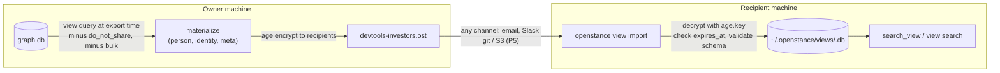
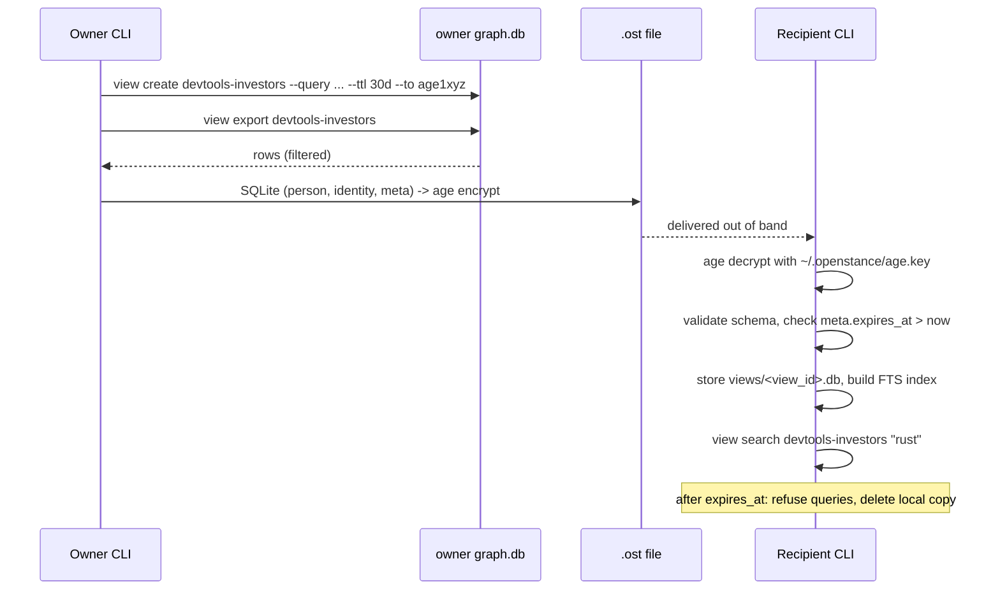
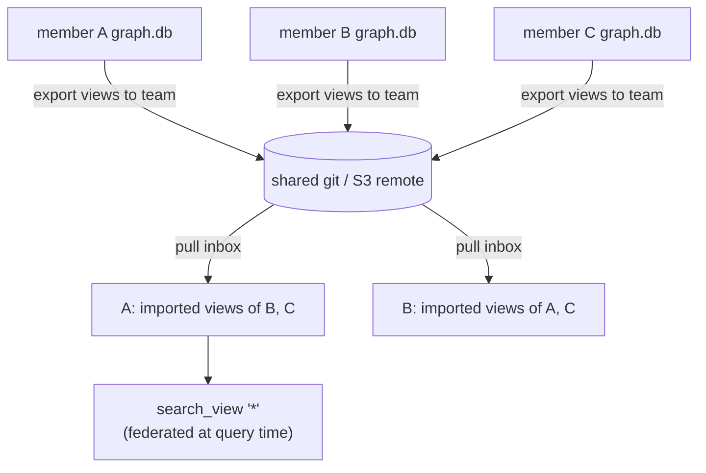

# Sharing and views

openstance shares **slices, never the graph**. A view is a saved query. Exporting it materializes the rows the query returns *at that moment* into a small, self-contained SQLite file, encrypted to one or more recipients with `age`. The recipient gets people and how to reach them. They never get your interactions, subjects, notes, ties or score components. Nothing is shared by default.

Related: [interfaces.md](interfaces.md#9-cli-views-and-keys-p3) (CLI, MCP `list_views` / `search_view`, HTTP `/views`), [data-model.md](data-model.md) (`view` table), [search.md](search.md) (the `Query` a view stores), [configuration.md](configuration.md#share), [../architecture/security-and-threat-model.md](../architecture/security-and-threat-model.md), [../plan/phase-5-and-beyond.md](../plan/phase-5-and-beyond.md).

| Capability | Phase |
| --- | --- |
| `view create / list / show / export / import / search / rm`, `keys show`, MCP `list_views`, `search_view` | P3 |
| HTTP `/views` endpoints, UI | P4 |
| `sync` over git / S3, team federation (`search_view "*"` across members) | P5 |
| Hosted links, server-side TTL enforcement, access log | cloud tier, if built ([../product/pricing-and-cloud.md](../product/pricing-and-cloud.md)) |

---

## 1. Concepts

| Term | Meaning |
| --- | --- |
| **View** | A named, saved `Query` (plus a TTL and recipients) stored in your `view` table. It holds no rows itself. |
| **Export** | Running the view's query now and writing the permitted columns of the matching people into an encrypted `.ost` file. |
| **`.ost` file** | `age`-encrypted SQLite. Read-only by convention. Self-describing (`meta` table). |
| **Imported view** | A `.ost` file someone sent you, decrypted with your key and stored under `~/.openstance/views/`. You can search it, but it is never merged into your graph. |
| **Recipient** | An age X25519 public key (`age1...`). |



---

## 2. View definition

The `view` table is defined in [data-model.md](data-model.md#3-full-ddl) (authoritative DDL). The columns that matter here:

```sql
-- excerpt; see data-model.md
  name             TEXT NOT NULL UNIQUE,
  view_id          TEXT UNIQUE,          -- ULID, set on first export, copied to the file's meta.view_id
  query_json       TEXT NOT NULL,        -- serialized Query (search.md), limit ignored on export unless set
  created_at       INTEGER NOT NULL,
  expires_at       INTEGER,              -- NULL = no expiry (discouraged)
  recipient_pubkey TEXT,                 -- one or more age recipients, newline-separated
  origin           TEXT NOT NULL DEFAULT 'local',  -- 'local' | 'imported'
  owner_pubkey     TEXT,                 -- imported views: claimed owner (see 5.3)
  file_path        TEXT,                 -- imported views: ~/.openstance/views/<view_id>.db
  last_exported_at INTEGER
```

- `query_json` uses exactly the `Query` shape from [search.md](search.md), including `text`. When a view is exported, the query runs with the **rules parser and the current embedder**. The parsed query is stored at create time, so later exports do not depend on a model.
- Every view-specific exclusion is applied at export time, not at create time (section 4.3). Someone flagged `do_not_share` after the view was created is still excluded from the next export.
- `view create <name>` with an existing name replaces the definition after confirmation (`--yes` to skip). Use this to change the query, the TTL or the recipients.
- The view's stable identity in exported files is a ULID, generated on first export, stored in the file's `meta.view_id` and in the `view.view_id` column. Recipients use it to replace an older export of the same view.
- An imported view is registered as a `view` row with `origin = 'imported'`, `owner_pubkey` and `file_path`; its rows live only in the decrypted file under `~/.openstance/views/` and are never merged into `graph.db`.

---

## 3. Lifecycle



---

## 4. The `.ost` file format

### 4.1 Envelope

- Outer layer: an **age v1** file (binary, the default) encrypted to one or more X25519 recipients. `view export --armor` writes the ASCII-armored form for pasting into text channels.
- Inner payload: one SQLite database file, written as:
  - `PRAGMA application_id = 0x4F535431` (`'OST1'`), checked on import
  - `PRAGMA user_version = 1` (format version)
  - `journal_mode = DELETE`, then `VACUUM`, so the file has no WAL sidecar and no free pages holding deleted data
- Extension `.ost`. Media type `application/vnd.openstance.view+age` (informal).
- Size: about 200 bytes per person before encryption, so 1,000 people is roughly 200 KB.

### 4.2 Tables (format version 1)

```sql
CREATE TABLE meta (
  key   TEXT PRIMARY KEY,
  value TEXT NOT NULL
);
-- required keys:
--   format_version      '1'
--   view_id             ULID, stable across re-exports of the same view
--   name                'devtools-investors'
--   owner_pubkey        'age1...'   (claimed; see 5.3)
--   owner_label         'rohan'     (claimed, free text from share.owner_label)
--   created_at          unix seconds (view definition)
--   exported_at         unix seconds
--   expires_at          unix seconds or '' for none
--   query_json          the Query, so the recipient sees what slice this is
--   row_count           integer
--   score_buckets       'strong>=0.60;medium>=0.30;weak'
--   openstance_version  '0.3.0'

CREATE TABLE person (
  id                 INTEGER PRIMARY KEY,   -- view-local, assigned in shuffled order; NOT the owner's person.id
  display_name       TEXT,
  title              TEXT,
  company            TEXT,
  location           TEXT,
  score_bucket       TEXT NOT NULL CHECK (score_bucket IN ('strong','medium','weak')),
  last_contact_month TEXT                   -- 'YYYY-MM', NULL if unknown
);

CREATE TABLE identity (
  person_id INTEGER NOT NULL REFERENCES person(id),
  kind      TEXT    NOT NULL CHECK (kind IN ('email','linkedin_url')),
  value     TEXT    NOT NULL,              -- normalized, as in the owner's identity table
  PRIMARY KEY (person_id, kind, value)
);
```

The display fields are the owner's **effective** values, with overrides applied. If you corrected someone's title, the recipient sees the corrected title.

### 4.3 What is included and what is excluded

| Included | Excluded (never in a `.ost`) |
| --- | --- |
| display name, title, company, location | `interaction`, `interaction_person`: no subjects, dates of individual messages, or directions |
| score **bucket** (strong / medium / weak) | numeric score and components |
| last-contact **month** | exact `last_contact` and `first_seen` timestamps |
| emails and LinkedIn URLs | phone numbers, X/IG handles, `name_company` identities |
| the view's query and metadata | `tie` rows (your other relationships) |
| | `override` notes and tags, `bio` |
| | `enrich_log`, `source`, embeddings, FTS data |
| | people with `do_not_share = 1` |
| | bulk senders (`is_bulk = 1`) |
| | owner's internal `person.id` values |

The rationale: a recipient can see who you know in this slice, roughly how well, and how to reach them, which is what they need in order to ask you for an intro. They cannot reconstruct your inbox, calendar or the rest of your network. View-local ids are assigned in shuffled order so the file does not leak your graph's size or insertion order.

Two flags widen the export: `--include-phone` and `--include-handles` add the corresponding identities. They print a warning and are recorded in `meta.included_extra`. Nothing can add interactions or notes.

### 4.4 Import validation

The recipient treats a `.ost` as untrusted input:

1. Decrypt with the local identity. If it fails, the result is `not addressed to my key` (exit 7).
2. Before opening, check the decrypted size against `share.max_import_mb` (default 100).
3. Open with `SQLITE_OPEN_READONLY`, `trusted_schema = OFF`, defensive mode on.
4. Require `application_id` = `'OST1'`, `user_version` <= the supported format, and `sqlite_master` containing **only** the three tables above and their autoindexes. Any trigger, view or extra table is rejected.
5. Require `meta.expires_at` to be empty or `> now`. Otherwise refuse with `view_expired` (exit 7).
6. Copy into `~/.openstance/views/<view_id>.db` (mode 0600) and add a local FTS5 index over `display_name, title, company, location`. If a copy with the same `view_id` exists, keep the one with the newer `exported_at`.

Imported views are never merged into `graph.db`, never scored, never embedded, and never sent to an enricher.

---

## 5. Keys

### 5.1 Keypair

- `openstance init` generates an age X25519 identity at `share.keypair` (default `~/.openstance/age.key`, mode 0600). The file holds the `AGE-SECRET-KEY-1...` line and the public key as a comment.
- `openstance keys show` prints the public key (`age1...`). Recipients share this once, out of band.
- `init --force-keys` generates a new key. Views already exported to your old public key can only be read with the old key, so the old file is moved to `age.key.<date>.bak`, not deleted.
- v1 stores the identity unencrypted on disk: it has the same protection as `graph.db` (full-disk encryption recommended). A passphrase-protected identity is an open question in [../risks-and-open-questions.md](../risks-and-open-questions.md).

### 5.2 Recipients

- `--to age1...` (repeatable). `--to self` adds your own public key, so you can open your own exports.
- Aliases live in config: `[share.recipients] alice = "age1..."`, then `--to alice`.
- In Phase 5 team mode, `--to team:<name>` expands to every key in the shared remote's `keys/` directory (section 8).
- SSH-key recipients (age supports `ssh-ed25519`) are not supported in v1, to keep a single key type.

### 5.3 Authenticity: an honest limit

age provides confidentiality to recipients. It does **not** authenticate the sender. Anyone who knows your recipient's public key can make a `.ost` file whose `meta.owner_label` says "rohan". So in v1:

- `owner_label` and `owner_pubkey` are shown as **claimed** ("claimed owner: rohan (age1qz...k3x)").
- Recipients should trust a file for the same reason they trust the channel it arrived through.
- Phase 5 adds an optional detached signature (`meta.sig`, Ed25519 over the plaintext DB hash) with a signing key generated beside the age key. Tracked in [../risks-and-open-questions.md](../risks-and-open-questions.md).

---

## 6. TTL and expiry

- `view create --ttl 30d` sets `expires_at = created_at + ttl`. The default TTL is `share.default_ttl` (`"30d"`). `--ttl never` is allowed, but it prints a warning and needs `--yes`.
- Re-exports carry the same `expires_at`. To extend, re-run `view create` with a new `--ttl`. This sets `expires_at = now + ttl`.
- **Enforcement is cooperative.** An openstance client:
  - refuses to import a file past `expires_at`
  - refuses `search_view` on an expired imported view, and deletes its local copy
  - purges expired imported views when `mcp`, `serve` or any `view` command starts
- **Beyond that it is advisory.** The recipient has the decrypted data on their disk. A modified client, a backwards system clock, or `sqlite3` on the decrypted DB ignores the TTL. The docs and the CLI say so. The CLI prints "expiry is advisory for offline files" on export.

---

## 7. Revocation: an honest limit

Revocation of an offline file means **do not re-export it**. Once a `.ost` has been delivered and decrypted, the data cannot be pulled back. openstance does not pretend otherwise. The product overview describes views as "revocable", and this is what that word means in the open-source build:

| Action | Effect |
| --- | --- |
| `view rm <name>` (owner) | no further exports. Files already sent are unaffected |
| Flag someone `do_not_share` | excluded from future exports. Already-sent files still contain them |
| Phase 5 sync: stop syncing a view | the next `sync` deletes it from the recipient's inbox on the remote, and cooperating clients delete their local copy on the next pull. Copies the recipient already made are unaffected |
| Cloud tier (if built) | hosted links can be disabled and accesses logged. Data a recipient already fetched is still out |

---

## 8. Sync and team federation (Phase 5)

Phase 5 work, gated on traction ([../plan/phase-5-and-beyond.md](../plan/phase-5-and-beyond.md)). It requires no openstance server: the "server" is a git remote or an S3-compatible bucket that the users already control.

### 8.1 Remote layout

```
<remote root>/
  openstance-sync.toml                 # { format = 1 }
  keys/<label>.pub                     # optional: members' age public keys (team mode)
  inbox/<recipient-fp>/<view_id>.ost   # one file per view per recipient
```

`recipient-fp` is the first 16 hex characters of `sha256(age public key)`. A file encrypted to N recipients is written once per recipient inbox. This keeps listing and deletion per recipient simple, at the cost of N copies, which is acceptable at a few hundred KB each.

### 8.2 `openstance sync`

```
openstance sync remote add work git+ssh://git@github.com/acme/openstance-views.git
openstance sync remote add work s3://acme-openstance/views?region=eu-west-1
openstance sync [--remote work] [--push-only | --pull-only]
```

- **Push:** for every own view with `sync = true` (`view create --sync`), export fresh and write it to each recipient's inbox. Views removed or un-synced since the last push are deleted from the inboxes.
- **Pull:** list `inbox/<my-fp>/`, download new or changed files, import each one (section 4.4). Files that disappeared from the remote are deleted locally.
- **git** (`git+ssh://`, `git+https://`) shells out to the system `git` (clone into `~/.openstance/sync/<remote>/`, commit, pull --rebase, push). There is no libgit2 dependency.
- **S3** (`s3://`, with an optional `endpoint=` for R2, MinIO and similar) uses a blocking S3 client so core stays sync. Credentials come from the standard AWS env vars and profile. The client crate will be chosen in Phase 5.
- A remote operator sees recipient fingerprints, file sizes and timing, but not contents. This is documented in the threat model.

### 8.3 Team mode

Team mode is sync with a shared remote. There is no central database.

1. Each member keeps their own `graph.db`.
2. Members commit their public keys to `keys/`.
3. Each member chooses which views to export, `--to team:<remote>`.
4. Everyone's `search_view "*"` federates at query time over all imported, unexpired views. Rows that share an email or LinkedIn URL across views are merged into one result, listing each owner and bucket ("Maya Chen - strong via rohan, medium via ana").
5. Access control is the remote's access control (repo or bucket permissions). Removing a member means removing their key from `keys/` and their access to the remote. Views already pulled stay with them (section 7).



---

## 9. Acceptance criteria

- [ ] An exported `.ost`, decrypted with `age -d -i key`, opens in `sqlite3` and contains exactly the tables `meta`, `person`, `identity`. A test greps the plaintext for every interaction subject in the fixture graph and finds none.
- [ ] `do_not_share` and bulk people in the query result are absent from the file, and `view show` reports how many were excluded.
- [ ] Owner `person.id` values never appear in the file (test: the fixture uses distinctive ids; assert no match).
- [ ] Import refuses: a wrong key (exit 7), an expired file (exit 7), a file with an extra table or a trigger, and a wrong `application_id`.
- [ ] `search_view` on an imported view returns `ViewPerson` rows and never touches `graph.db` (test: open `graph.db` read-only during the call).
- [ ] Re-importing a newer export of the same `view_id` replaces the older one. An older export does not replace a newer one.
- [ ] `--ttl never` without `--yes` fails with exit 2.
